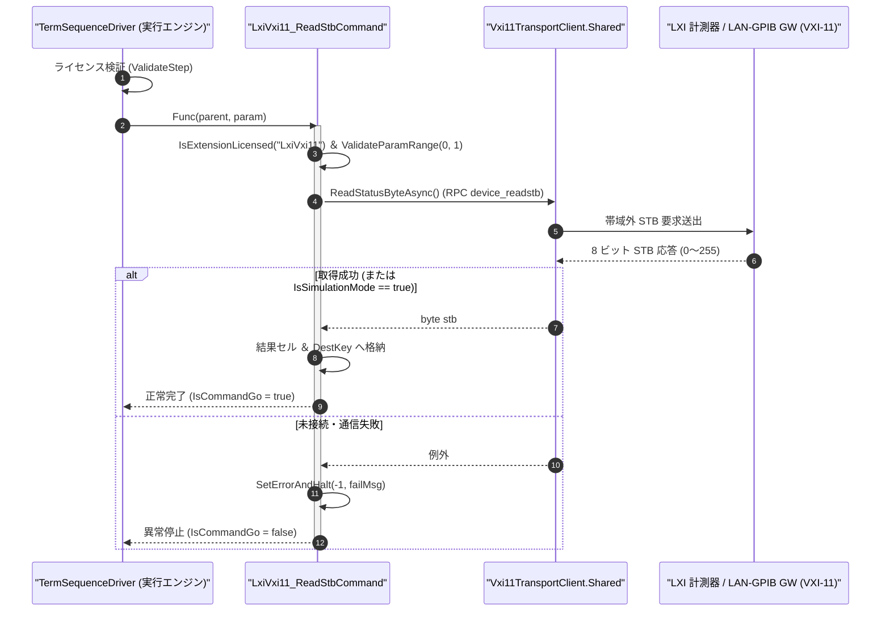

# コマンドリファレンス：LxiVxi11_ReadStb

👉 [← LxiVxi11 アドイン取扱説明書に戻る](./LxiVxi11取扱説明書.Md)

## 概要

**LxiVxi11_ReadStb** は、GPIB のシリアルポールに相当する **帯域外ステータスバイト（STB）読取** を実行する制御系コマンドです。
`Vxi11TransportClient.Shared` を介して 帯域外 RPC `device_readstb` を実行し、測定処理中でもブロックせずに計測器の 8 ビットステータスバイト（STB：`0`〜`255`）を取得します（GPIB シリアルポール相当）。

---

## 💡 書式・パラメータ仕様

### コマンド構文

```csv
,SEQUENCE, [ステップキー], LxiVxi11_ReadStb, "[DestKey(任意)]"
```

### パラメータ（引数）一覧

| 引数位置 | 引数名 | 必須/任意 | 説明・制約 |
| :--- | :--- | :---: | :--- |
| 第 1 引数 | `DestKey` | 任意 | 取得したステータスバイト（10 進整数文字列 `"0"`〜`"255"`）を格納する `PARAM` 変数キー名。省略時は結果セルのみへ格納。 |

---

## 🔄 特殊置換規約・分岐規約の適用

* **動的置換（`$`）**: 第 1 引数で `$PARAMキー$` による動的置換に対応します。
* **ジャンプ先指定（`#`）**: 非適用。
* **共通コマンド指定（`@`）**: 非適用。
* **エイリアス（別名）**: `Analysis_LxiVxi11_ReadStb`, `Sqn_LxiVxi11_ReadStb`

---

## 💡 動作例（正しい構文での記述例）

### スクリプト記述例

```csv
COMMAND, "SAMPLE_LXIVXI11_STB", "STB_VAL"
,PARAM, "STB_VAL", Work, "ステータスバイト", ""
,SEQUENCE, 010, LxiVxi11_Open, "192.168.0.10", "inst0", 5000
,SEQUENCE, 020, LxiVxi11_Send, "INIT"
; 帯域外でステータスバイトを取得（MAV=16, RQS=64 等の確認）
,SEQUENCE, 030, LxiVxi11_ReadStb, "STB_VAL"
,SEQUENCE, 040, LxiVxi11_Close
,SEQUENCE, 050, Exit, "$STB_VAL$", 0
```

### 実行時の挙動・変数変化

* **実行前の状態**: 計測器が測定実行中またはデータ出力準備中の状態。
* **実行後の状態**: 取得された 8 ビット整数値（例: `"16"`）が結果セルおよび `"STB_VAL"` へ格納されます。

---

## 🔄 動作フロー（シーケンス図）



---

## 🚫 エラーハンドリング・安全設計（仕様制限）

1. **ライセンス検証・引数ガード**:
   - `LxiVxi11` 未認証時は `-100`、引数 2 個以上は `ValidateParamRange(0, 1)` 違反で停止します。
2. **帯域外チャネル障害時の安全停止**:
   - 未接続または応答タイムアウト時は `SetErrorAndHalt(-1, failMsg)` で停止します。

---

## 🧪 ユニットテスト仕様

本コマンドクラス（`LxiVxi11_ReadStbCommand.cs`）の `RunUnitTest()` 検証仕様です。

### テスト実行前提条件

* **実行トリガー**: `RunUnitTest()` メソッドの呼び出し
* **有効化条件**: `ErrorLogger.MinimumLevel == LogLevel.Test`
* **検証結果出力**: `_log.LogTest` へ出力。`finally` で `IsSimulationMode` を復元。

### テストケース一覧

| No | テストカテゴリ | テスト条件（入力値） | 期待される結果（出力値） | 検証の目的 / 観点 |
| :---: | :--- | :--- | :--- | :--- |
| **1** | 正常系 | `IsSimulationMode = true`（模擬 STB=`16`）下で `DestKey="STB_VAL"` を指定して実行 | `!param.HasError`、`IsCommandGo == true`、変数 `STB_VAL == "16"` となる | 帯域外 STB 読取および変数格納の検証 |
| **2** | 異常系 | 余剰引数 2 個を指定して実行 | `ValidateParamRange(0, 1)` 違反で `HasError == true` かつ `!IsCommandGo` となる | 引数上限超過の拒否検証 |