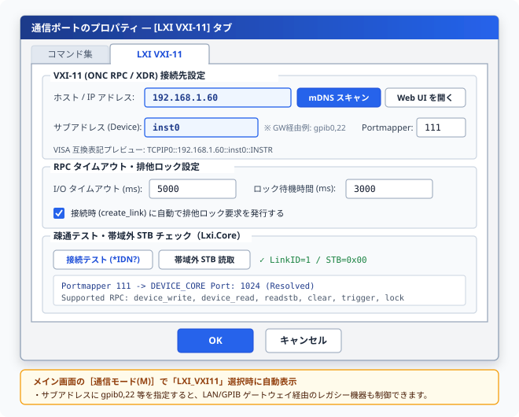
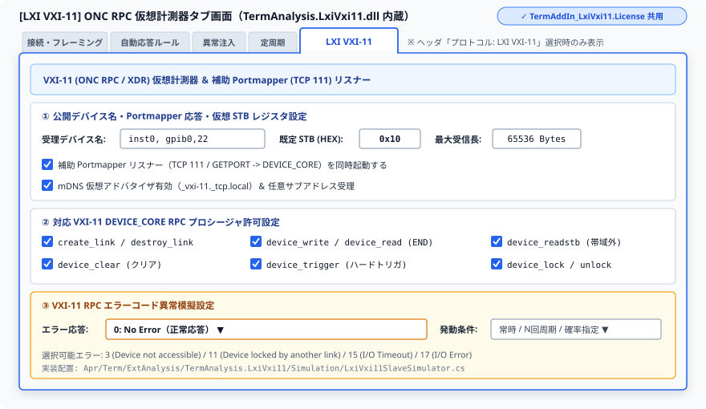

# LxiVxi11（LAN［LXI］VXI-11 / ONC RPC 通信）アドイン取扱説明書

👉 [← TermAddIn_LxiVxi11 製品トップに戻る](https://github.com/Monaca-App/TermAddIn_LxiVxi11)  
👉 [← プロパティ設定画面取扱説明書（共通）](../プロパティ設定画面取扱説明書.Md) ／ [← TermEmulator 操作説明書（共通）](https://github.com/Monaca-App/TermEmulator/blob/main/Manual/TermEmulator操作説明書.Md) ／ [← マクロスクリプト取扱説明書（共通）](../マクロスクリプト取扱説明書.Md)

---

本書は、**TermAddIn_LxiVxi11**（`TermAnalysis.LxiVxi11.dll`：VXI-11 / ONC RPC / XDR 通信エクステンション）の **取扱説明書 兼 機能解説書** です。NI-VISA なしで LXI Core 必須の VXI-11 通信、GPIB 互換の帯域外制御（STB・Clear・Trigger・Lock）、および LAN / GPIB ゲートウェイ経由制御を実現します。VXI-11 の仕組み解説、プロパティ設定画面の **「LXI VXI-11」タブ**、**TermEmulator の `[LXI VXI-11]` 仮想計測器タブ**、および全 11 コマンドのリファレンスを 1 冊にまとめています。

* **必須拡張ライセンス**: **`TermAddIn_LxiVxi11.License`** （組み込み先: `TermAnalysis.LxiVxi11.dll`、`TermEmulator` と相互共用）
* **共通同梱基盤**: `TermAnalysis.Lxi.Core.dll`（無償同梱：mDNS 自動発見・LXI XML 識別・Web UI 起動・IEEE 488.2 バイナリブロック解析）


### 関連する公式規格・仕様書（外部リンク）
* [IVI Foundation 公式仕様ポータル（VXI-11 / VISA 関連仕様）](https://www.ivifoundation.org/specifications/default.aspx) — VXI-11 / VISA 関連の計測器制御プロトコル仕様を参照できます（本アドインは LXI Core 必須の VXI-11 仕様に準拠）。
* [IETF RFC 5531：ONC RPC Version 2 Protocol Specification](https://datatracker.ietf.org/doc/html/rfc5531) ／ [IETF RFC 4506：XDR External Data Representation Standard](https://datatracker.ietf.org/doc/html/rfc4506) — VXI-11 の下位プロトコルである ONC RPC および XDR バイナリ表現の公式規格書です。
---

## 目次

- [1. 機能概要と基礎知識（はじめての方へ）](#1-機能概要と基礎知識はじめての方へ)
- [2. プロパティ設定画面：「LXI VXI-11」タブの詳細](#2-プロパティ設定画面lxi-vxi-11タブの詳細)
- [3. TermEmulator 仮想スレーブ設定：「[LXI VXI-11]」タブの詳細](#3-termemulator-仮想スレーブ設定lxi-vxi-11タブの詳細)
- [4. マクロコマンド一覧（全 11 コマンド）](#4-マクロコマンド一覧全-11-コマンド)

---

## 1. 機能概要と基礎知識（はじめての方へ）

### 対応する機能の概要
**LxiVxi11（VXI-11 / ONC RPC 通信）** アドインは、LXI Core 規格の必須プロトコルである **VXI-11** に対応し、LAN 計測器および **LAN / GPIB ゲートウェイ（E5810A/B 等）経由の GPIB 計測器** を制御する通信機能です。
通常の送受信・バイナリ波形取得に加え、GPIB と同等の **帯域外ステータスバイト読取（`ReadStb`）・デバイスクリア（`Clear`）・ハードウェアトリガ（`Trigger`）・排他ロック（`Lock`）** をサポートします。

### 機能の実現方法
* **ONC RPC / XDR の Pure C# 完全実装**: RFC 5531（ONC RPC Record Marking）および RFC 4506（XDR 4 バイト境界エンコード）を `.NET Framework 4.8` 標準 `TcpClient` 上に直接実装しています。Portmapper（TCP `111`）によるポート自動解決から `create_link` / `device_write` / `device_read`（END フラグ `0x04` 終端制御）/ `device_readstb` / `device_clear` / `device_trigger` / `device_lock` まで NI-VISA なしで完結します。
* **非 SCPI 機器にも対応する単独受信設計**: `LxiVxi11_Receive` と共通ワークバッファ（`Set_Data`）の連携により、SCPI 非準拠の旧型 GPIB 計測器（例: `gpib0,22` 経由の `3458A`）もそのまま制御できます。
* **仮想 VXI-11 サーバー模擬**: `TermEmulator` の `[LXI VXI-11]` タブ（補助 Portmapper 含む）により、実機やゲートウェイなしで全 RPC 制御を検証できます。

### このアドインを選択することの利点
* **GPIB 資産をそのまま LAN 化・延命できる**: 高価な PC 用 GPIB ボードや NI-VISA を用意せず、LAN / GPIB ゲートウェイ越しに既存の GPIB 計測器を Excel から制御できます。
* **長時間測定中でも止まらず状態監視・中断できる**: `LxiRaw` と異なり帯域外制御（`ReadStb` / `Clear`）を備えるため、測定中にフリーズすることなく完了確認や強制リセットが可能です。
* **複数 PC 共有環境での誤操作を防止**: `LxiVxi11_Lock` で排他ロックを取得できるため、他の PC からの割り込みによる測定データ破損を防げます。

### `LxiRaw` ではできない `LxiVxi11` ならではの強み
* **帯域外制御（測定中でも割り込める）**: 計測器が長い測定をしている最中でも、別の通り道から「今測定中か？（`ReadStb`）」「今すぐリセット（`Clear`）」「ハードウェアトリガ（`Trigger`）」を送れます。
* **排他ロック（`Lock`）**: 複数のパソコンが同じ計測器へ繋いでいる現場で、自分の測定中に他のパソコンから割り込まれないように鍵をかけられます。
* **LAN / GPIB ゲートウェイ対応**: サブアドレスに `gpib0,22` のように指定するだけで、LAN 変換器越しの GPIB 機器（アドレス 22 番）をそのまま操作できます。

### 設定の妥当性を判断するためのチェックポイント
| 確認項目 | 項目の意味 | 設定値の目安・確認方法 |
| :--- | :--- | :--- |
| **ホスト / IP アドレス** | 計測器（または LAN/GPIB 変換器）の LAN 住所 | 本体パネルで確認するか、**`LAN 機器スキャン (mDNS)`** で自動検出します。 |
| **サブアドレス（デバイス名）** | 機器の中の「呼び出し先名」 | 通常の LAN 計測器は **`inst0`**（初期値のまま）でほぼ確実に通ります。LAN / GPIB 変換器経由のときだけ **`gpib0,＜GPIB アドレス＞`**（例: `gpib0,22`）にします。 |
| **Portmapper ポート** | 通信用ポート番号を自動問い合わせするための標準ポート番号 | 規格で **`111`** に決まっているため、特別な理由がない限り **`111` のまま変更しません**。 |
| **タイムアウト / ロック待機** | 返事やロック解放を待つ最大時間 | 通常は **`5000` ms（5 秒）** で妥当です。長時間測定を行う場合のみ延ばします。 |

### 通信の仕組み解説（VXI-11 の 2 段階接続と代表的なトラブル事例・対処法）
VXI-11 は最初に Portmapper（TCP `111`）へ接続用ポート番号を照会してから、本体チャネル（`DEVICE_CORE`）へ繋ぎ直す 2 段階方式です。

```text
① Portmapper 照会: PC ➔ TCP:111 (Portmapper GETPORT) ➔ 計測器: "DEVICE_CORE はポート 1024 です"
② セッション確立: PC ➔ TCP:1024 (create_link "inst0") ➔ 計測器: リンクID (lid) 発行
③ 送受信・帯域外: device_write / device_read (END=0x04終端) / device_readstb / device_clear / device_lock
```

* **事例①：社内ネットワーク越しに接続できない** ➔ VXI-11 は `111` 番に加えて計測器が動的に割り当てるポートも使うため、ファイアウォールで遮断されることがあります。その場合は固定単一ポートの [LxiHiSlip](../LxiHiSlip/LxiHiSlip取扱説明書.Md)（`4880`）または [LxiRaw](../LxiRaw/LxiRaw取扱説明書.Md)（`5025`）が有利です。
* **事例②：LAN / GPIB ゲートウェイ越しに通信できない** ➔ サブアドレスが `inst0` のままになっているケースが大半です。`"gpib0,22"`（インターフェース名＋カンマ＋GPIB アドレス）を二重引用符で囲んで指定してください。
* **事例③：ロック取得（`LxiVxi11_Lock`）がタイムアウトする** ➔ 別の PC や別ソフトがロックを握ったまま解放していません。他セッションを閉じるか、機器側でロック解除してください。

---

## 2. プロパティ設定画面：「LXI VXI-11」タブの詳細



メイン画面で **`LXI_VXI11`** モードを選択しているときに表示され、`LxiVxi11_Open` 等の VXI-11 接続条件を設定します。

| 項目名 | 設定値・範囲（既定値） | 詳しい意味と設定のポイント |
| :--- | :--- | :--- |
| **`ホスト / IP アドレス`** | IPv4 / IPv6 アドレスまたはホスト名 | 接続先 LXI 計測器または LAN / GPIB ゲートウェイ（E5810A/B 等）の IP アドレスを指定します。 |
| **`サブアドレス（デバイス名）`** | 文字列（既定 `inst0`） | 通常の LXI 計測器は `inst0`、LAN / GPIB ゲートウェイ経由時は `gpib0,22` のように指定します。 |
| **`Portmapper ポート`** | `1`〜`65535`（既定 `111`） | ONC RPC Portmapper（`GETPORT`）で `DEVICE_CORE`（Program `0x0607AF` / Version `1`）のポートを自動解決します。 |
| **`タイムアウト / ロック待機`** | ミリ秒（既定 `5000` ms） | RPC 応答待機および `device_lock` 取得時のタイムアウト時間です。 |
| **`LAN 機器スキャン (mDNS)` / `Web UI`** | 共通操作ボタン（`Lxi.Core` 提供） | `_vxi-11._tcp.local` の自動検出、LXI XML 識別取得、`*IDN?` 疎通テスト、機器 Web UI 起動を行います。 |

---

## 3. TermEmulator 仮想スレーブ設定：`[LXI VXI-11]` タブの詳細



* **主な用途**: LXI Core 準拠 VXI-11 計測器および LAN / GPIB ゲートウェイの仮想スレーブ模擬。
* **模擬機能**:
  * `DEVICE_CORE` サーバー上で `create_link` / `device_write` / `device_read`（END フラグ `0x04` 終端制御）/ `device_readstb` / `device_clear` / `device_trigger` / `device_lock` / `device_unlock` / `destroy_link` を完全模擬。
  * 初回 Portmapper 照会（TCP `111`）用の内部補助 Portmapper リスナー起動、およびテスト用固定ポート直接接続の両方式をサポート。
  * `TermAnalysis.Lxi.Core` の仮想 LXI 機器アドバタイザにより、mDNS 発見から VXI-11 帯域外制御まで実機なしで検証可能。

---

## 4. マクロコマンド一覧（全 11 コマンド）

| コマンド名 | 構文概要 | 主な役割・用途 |
| :--- | :--- | :--- |
| **[LxiVxi11_Open](./LxiVxi11_Open.Md)** | `,SEQUENCE, [ステップ], LxiVxi11_Open, "[IP(任意)]", "[SubAddress(任意: inst0)]", [TimeoutMs(任意)]` | Portmapper 解決および `create_link` で VXI-11 セッションを確立 |
| **[LxiVxi11_Close](./LxiVxi11_Close.Md)** | `,SEQUENCE, [ステップ], LxiVxi11_Close` | `destroy_link` を送信してセッションを正常切断・破棄 |
| **[LxiVxi11_Mode](./LxiVxi11_Mode.Md)** | `,SEQUENCE, [ステップ], LxiVxi11_Mode, [TimeoutMs], [LockTimeoutMs]` | 通信タイムアウト・ロック待機時間等を動的変更 |
| **[LxiVxi11_Send](./LxiVxi11_Send.Md)** | `,SEQUENCE, [ステップ], LxiVxi11_Send, "[送信文字列]"` | `device_write` によりコマンド文字列を非同期送信 |
| **[LxiVxi11_Receive](./LxiVxi11_Receive.Md)** | `,SEQUENCE, [ステップ], LxiVxi11_Receive, "[格納先キー(任意)]", [TimeoutMs(任意)]` | `device_read` で単独受信し、結果セルおよび共通ワークバッファへ格納（非 SCPI 機器対応） |
| **[LxiVxi11_Query](./LxiVxi11_Query.Md)** | `,SEQUENCE, [ステップ], LxiVxi11_Query, "[送信文字列]", "[格納先キー(任意)]", [TimeoutMs(任意)]` | 送信＋受信を一括実行し、結果セル・共通ワークバッファ・指定変数へ格納 |
| **[LxiVxi11_ReadBlock](./LxiVxi11_ReadBlock.Md)** | `,SEQUENCE, [ステップ], LxiVxi11_ReadBlock, "[保存先ファイルパス]", [TimeoutMs(任意)]` | IEEE 488.2 バイナリブロックを受信・ファイル保存 |
| **[LxiVxi11_Clear](./LxiVxi11_Clear.Md)** | `,SEQUENCE, [ステップ], LxiVxi11_Clear` | RPC `device_clear` で機器の入出力バッファ・状態をクリア |
| **[LxiVxi11_ReadStb](./LxiVxi11_ReadStb.Md)** | `,SEQUENCE, [ステップ], LxiVxi11_ReadStb, "[格納先キー(任意)]"` | RPC `device_readstb` による帯域外ステータスバイト（STB）読取（GPIB シリアルポール相当） |
| **[LxiVxi11_Trigger](./LxiVxi11_Trigger.Md)** | `,SEQUENCE, [ステップ], LxiVxi11_Trigger` | RPC `device_trigger` によるプロトコルレベルの計測トリガ送出 |
| **[LxiVxi11_Lock](./LxiVxi11_Lock.Md)** | `,SEQUENCE, [ステップ], LxiVxi11_Lock, "[LOCK/UNLOCK]", [TimeoutMs(任意)]` | RPC `device_lock` / `device_unlock` による排他／共有ロック制御 |
