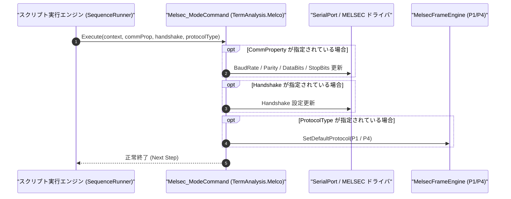

# コマンドリファレンス：Melsec_Mode

---

## 概要

**Melsec_Mode** は、三菱電機 MELSEC 計算機リンク通信における UART 通信条件（ボーレート・パリティ・データビット・ストップビット）、フロー制御（ハンドシェイク）、および専用プロトコル形式（`P1`: 形式 1［CR/LF なし］／`P4`: 形式 4［CR/LF あり］）を設定するコマンドです。

> 💡 **補足**: MELSEC 計算機リンクユニットのスイッチ設定（例: 9600bps / 19200bps、奇数パリティ、7bit/8bit、サムチェック有無、プロトコル形式 1 または形式 4）に合わせて通信条件を一括設定します。

---

## 💡 書式・パラメータ仕様

### コマンド構文

```csv
,SEQUENCE,Melsec_Mode, "[CommProperty]", "[Handshake]", "[ProtocolType: P1 / P4]"
```

### パラメータ（引数）一覧

| 引数位置 | パラメータ名 | 必須/任意 | 型・制約 | 説明 |
| :---: | :--- | :---: | :--- | :--- |
| 第1引数 | `CommProperty` | 任意 | `"Baud,Parity,DataBits,StopBits"`（例: `"9600,O,7,1"`） | UART 通信条件をカンマ区切り文字列で指定します。空文字 `""` または省略時は現在値を維持します。 |
| 第2引数 | `Handshake` | 任意 | `NONE` / `RTSCTS` / `DTRDSR` | フロー制御方式を指定します。空文字または省略時は現在値を維持します。 |
| 第3引数 | `ProtocolType` | 任意 | `P1` / `P4`（既定値: `P4`） | 計算機リンク専用プロトコルの基本形式を指定します（`P1`: 形式1、`P4`: 形式4［フレーム末尾に `CR+LF` 付与］）。 |

---

## 🔄 特殊置換規約・分岐規約の適用

1. **カンマを含む第1引数の保護**:
   - `"9600,O,7,1"` や `"19200,E,8,1"` のようにカンマを含む UART 条件は、ダブルクォーテーション `""` で囲んで記述します。
2. **部分更新（省略または空文字 `""` の維持仕様）**:
   - 変更したい項目のみを指定し、他の引数を省略または `""` とすることで、既存の通信設定を維持したまま特定の属性だけを変更できます。

---

## 💡 動作例（正しい構文での記述例）

### スクリプト記述例

```csv
; 1. 計算機リンク標準設定（9600bps, 奇数パリティ, 7bit, Stop 1, フロー制御なし, プロトコル形式4）
,SEQUENCE,Melsec_Mode, "9600,O,7,1", "NONE", "P4"
,SEQUENCE,Melsec_Open

; 2. 通信中にプロトコル形式のみを P1（形式1）へ切り替え
,SEQUENCE,Melsec_Mode, "", "", "P1"
,SEQUENCE,Melsec_Close
,SEQUENCE,Exit
```

### 実行時の挙動・変数変化

1. 1 回目の `Melsec_Mode` で `9600,O,7,1`、ハンドシェイク `NONE`、プロトコル形式 `P4` が設定されます。
2. 2 回目の `Melsec_Mode` では UART 設定を維持したまま、デフォルトプロトコル形式のみが `P1` に切り替わります。

---

## 🔄 動作フロー（シーケンス図）



---

## 🚫 エラーハンドリング・安全設計（仕様制限）

1. **不正な通信パラメータおよびプロトコル形式の検証**:
   - `CommProperty` の書式不正や、`ProtocolType` に `P1` / `P4` 以外の文字列が指定された場合は、`ArgumentException` を送出して誤設定を防止します。
2. **オープン中の動的反映**:
   - ポートオープン中に `Melsec_Mode` が実行された場合、OS シリアルドライバへリアルタイムに設定変更を適用します。

---

## 🧪 ユニットテスト仕様

### テスト実行前提条件
- **対象クラス**: `TermAnalysis.Melco.Melsec_ModeCommand`（`Melsec_ModeCommand.cs`）
- **モック環境**: `IMelsecTransportAdapter` モックが注入されていること。

### テストケース一覧

| テストID | テスト観点 | 入力スクリプト | 期待される動作・検証項目 |
| :--- | :--- | :--- | :--- |
| `UT-MELSEC-MODE-01` | 全項目一括設定 | `,SEQUENCE,Melsec_Mode, "9600,O,7,1", "NONE", "P4"` | ボーレート 9600、奇数パリティ、7bit、Stop 1、形式 4 が正しく設定されること。 |
| `UT-MELSEC-MODE-02` | 部分更新（形式のみ） | `,SEQUENCE,Melsec_Mode, "", "", "P1"` | UART 条件を維持したままプロトコル形式が `P1` に変更されること。 |
| `UT-MELSEC-MODE-03` | 異常系（不正プロトコル名） | `,SEQUENCE,Melsec_Mode, "", "", "P99"` | `ArgumentException` が送出されること。 |

