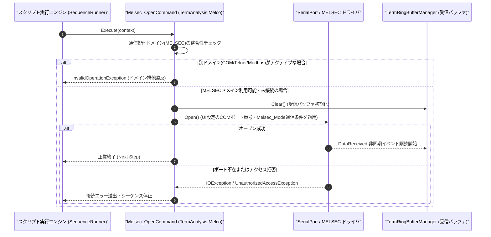

# コマンドリファレンス：Melsec_Open

---

## 概要

**Melsec_Open** は、Term アプリケーションの UI 設定および `Melsec_Mode` で指定された通信条件に基づき、三菱電機 MELSEC シーケンサ計算機リンク（専用プロトコル形式 1 / 形式 4）用のシリアルポート（UART 回線）をオープンするコマンドです。
実行時に Term 通信制御の排他選択モードを **MELSEC モード**（`TermAnalysis.Melco.dll`）へ確定させます。

> 💡 **補足**: 使用する COM ポート番号は PC 環境設定（UI 設定値）から取得し、ミニシーケンスの引数には含めません。物理 COM ポートに加え、公式無償ツール **[c2c](https://github.com/Monaca-App/c2c)** が公開中の仮想 COM ポート（例: `COM10` ⇔ `COM11`）も透過的にオープン可能です。

---

## 💡 書式・パラメータ仕様

### コマンド構文

```csv
,SEQUENCE,Melsec_Open
```

### パラメータ（引数）一覧

| 引数位置 | パラメータ名 | 必須/任意 | 型・制約 | 説明 |
| :--- | :--- | :---: | :--- | :--- |
| （引数なし） | - | - | - | UI 設定および `Melsec_Mode` の設定に基づいて計算機リンク用 COM ポートをオープンします。 |

---

## 🔄 特殊置換規約・分岐規約の適用

1. **引数なしコマンド**:
   - 引数を取らないため、変数展開（`$` / `#` / `@`）は使用しません。
2. **大文字・小文字の非区別（Case-Insensitive）**:
   - `Melsec_Open`、`MELSEC_OPEN`、`melsec_open` のいずれも同一コマンドとして正規化されます。
3. **排他ドメインの確定**:
   - 本コマンド実行以降、セッション内の通信プロトコルは MELSEC に固定され、COM / Telnet / Modbus コマンドとの混在実行は排他制御によりブロックされます。

---

## 💡 動作例（正しい構文での記述例）

### スクリプト記述例

```csv
; 1. MELSEC計算機リンク形式4（9600bps, Odd, 7bit, Stop 1）を設定して回線オープン
,SEQUENCE,Melsec_Mode, "9600,O,7,1", "NONE", "P4"
,SEQUENCE,Melsec_Open

; 2. 局番00のD0100から1点読出要求(WR)を送信し、応答を受信
,SEQUENCE,Melsec_P4s_S, "00", "WR", "0D010001"
,SEQUENCE,Melsec_Res_P4s_R, "00", "@D100_VAL"
,SEQUENCE,Melsec_Close
,SEQUENCE,Exit
```

### 実行時の挙動・変数変化

1. `Melsec_Mode` により計算機リンク標準の `9600,O,7,1` およびプロトコル形式 `P4` が設定されます。
2. `Melsec_Open` により COM ポートが開かれ、`TermRingBufferManager` への非同期フレーム受信監視が開始されます。

---

## 🔄 動作フロー（シーケンス図）



---

## 🚫 エラーハンドリング・安全設計（仕様制限）

1. **二重オープンの安全な扱い（Idempotent 制御）**:
   - すでに MELSEC 回線がオープンされている状態で再実行された場合、エラーとせず安全に継続します。
2. **他通信ドメインとの排他保護**:
   - 同一シーケンス内で `Com_Open` や `Modbus_Open` 等と併用された場合は、排他制御エラーとして即座に検出・遮断します。

---

## 🧪 ユニットテスト仕様

### テスト実行前提条件
- **対象クラス**: `TermAnalysis.Melco.Melsec_OpenCommand`（`Melsec_OpenCommand.cs`）
- **モック環境**: `IMelsecTransportAdapter` モックが注入されていること。

### テストケース一覧

| テストID | テスト観点 | 入力スクリプト | 期待される動作・検証項目 |
| :--- | :--- | :--- | :--- |
| `UT-MELSEC-OPEN-01` | 正常オープン | `,SEQUENCE,Melsec_Open` | モックシリアルポートがオープン状態になり、排他ドメインが `MELSEC` に設定されること。 |
| `UT-MELSEC-OPEN-02` | 大文字小文字非区別 | `,SEQUENCE,melsec_open` | `Melsec_OpenCommand` が正常に呼び出されること。 |
| `UT-MELSEC-OPEN-03` | 異常系（排他違反） | `Telnet_Open` 後に `,SEQUENCE,Melsec_Open` | `InvalidOperationException` が送出され、混在が阻止されること。 |

