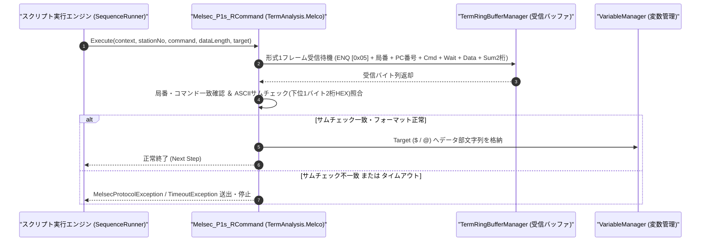

# コマンドリファレンス：Melsec_P1s_R

---

## 概要

**Melsec_P1s_R** は、三菱電機 MELSEC 計算機リンク **専用プロトコル形式 1（サムチェック付き、CR/LF なし）** において、外部マスターまたはシーケンサから送信される要求電文（`ENQ [0x05]` 開始フレーム）を受信・解析し、局番・コマンド・データ長の検証および 2 桁 ASCII サムチェックの照合を行った上で、データ部を指定ターゲット変数へ格納するコマンドです。

> 💡 **補足**: シーケンサシミュレータ（スレーブ応答側）として要求電文を待ち受ける場合や、形式 1 フレームを直接受信解析する場合に使用します。

---

## 💡 書式・パラメータ仕様

### コマンド構文

```csv
,SEQUENCE,Melsec_P1s_R, "<StationNo>", "<Command>", "<DataLength>", "<Target>"
```

### パラメータ（引数）一覧

| 引数位置 | パラメータ名 | 必須/任意 | 型・制約 | 説明 |
| :---: | :--- | :---: | :--- | :--- |
| 第1引数 | `StationNo` | **必須** | 2桁16進文字列（例: `"00"`, `"01"`, `"FF"`） | 受信を期待する局番（Station No.）＋PC番号（通常 `"00FF"` または局番 `"00"`）を指定します。 |
| 第2引数 | `Command` | **必須** | 2文字コマンド文字列（例: `"BR"`, `"WR"`, `"BW"`, `"WW"`） | 受信を期待する計算機リンクコマンド名を指定します。 |
| 第3引数 | `DataLength` | **必須** | 整数（文字数） | コマンドおよび伝送待ち時間フィールドに続くデータ部のバイト（文字）長を指定します。 |
| 第4引数 | `Target` | **必須** | 変数名（`$` / `@`） | 受信フレームから抽出したデータ部文字列を格納するターゲット変数を指定します。 |

---

## 🔄 特殊置換規約・分岐規約の適用

1. **変数展開（`$` / `@` / `#`）**:
   - 第 1〜第 3 引数には変数を指定可能です（例: `"$ST_NO"`, `"$EXPECTED_CMD"`）。
2. **レガシー別名互換**:
   - 旧表記の `MELSEC_P1S_R` や `MelsecP1sR` は内部正規化により本 `Melsec_P1s_R` コマンドへ統一マッピングされます。

---

## 💡 動作例（正しい構文での記述例）

### スクリプト記述例

```csv
,PARAM,RECV_PAYLOAD,

,SEQUENCE,Melsec_Mode, "9600,O,7,1", "NONE", "P1"
,SEQUENCE,Melsec_Open

; 局番00、ワード一括書込コマンド(WW)、データ部12文字の形式1フレームを受信し $RECV_PAYLOAD へ格納
,SEQUENCE,Melsec_P1s_R, "00", "WW", "12", "$RECV_PAYLOAD"
,SEQUENCE,Melsec_Close
,SEQUENCE,Exit
```

### 実行時の挙動・変数変化

1. 受信リングバッファから `ENQ (0x05)` + `"00FFWW0D0100011234"` + `Sum(2桁)` のフレームが到着するのを待機します。
2. サムチェック 2 桁が一致し、局番 `"00"`・コマンド `"WW"` が一致すると、データ部 `"D0100011234"`（または伝送待ち時間を含む指定長文字列）が `$RECV_PAYLOAD` に格納されます。

---

## 🔄 動作フロー（シーケンス図）



---

## 🚫 エラーハンドリング・安全設計（仕様制限）

1. **サムチェック（Sum Check）の厳格検証**:
   - `ENQ` の次バイトからデータ部末尾までの ASCII コード総和の下位 1 バイト（16 進 2 文字）と受信サム値を照合し、不一致の場合は変数を更新せずプロトコルエラーを送出します。
2. **受信タイムアウト保護**:
   - 規定時間内に指定長の形式 1 フレームが揃わない場合は `TimeoutException` を送出して無限待機を防止します。

---

## 🧪 ユニットテスト仕様

### テスト実行前提条件
- **対象クラス**: `TermAnalysis.Melco.Melsec_P1s_RCommand`（`Melsec_P1s_RCommand.cs`）
- **モック環境**: `TermRingBufferManager` に形式 1 フレームを投入できるテスト環境が構成されていること。

### テストケース一覧

| テストID | テスト観点 | 入力スクリプト | 期待される動作・検証項目 |
| :--- | :--- | :--- | :--- |
| `UT-MELSEC-P1SR-01` | 正常系（形式1要求受信） | `,SEQUENCE,Melsec_P1s_R, "00", "WR", "7", "$DATA"` | 正しいサムチェック付き `ENQ` フレームからデータ部 7 文字が `$DATA` に格納されること。 |
| `UT-MELSEC-P1SR-02` | 異常系（サムチェック不一致） | サム値を改ざんしたフレーム投入時 | `MelsecProtocolException` が送出され、`$DATA` が書き換えられないこと。 |
| `UT-MELSEC-P1SR-03` | 異常系（タイムアウト） | 受信データなし | `TimeoutException` が送出されること。 |

