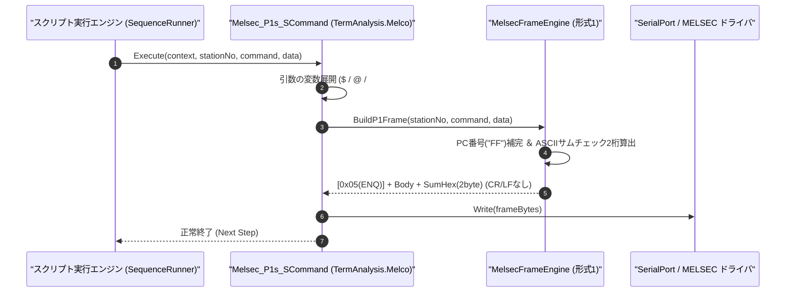

# コマンドリファレンス：Melsec_P1s_S

---

## 概要

**Melsec_P1s_S** は、三菱電機 MELSEC 計算機リンク **専用プロトコル形式 1（サムチェック付き、CR/LF なし）** の電文フレームを自動構築し、先頭制御コード（`ENQ [0x05]`）および末尾の 2 桁 ASCII サムチェックコードを自動計算・付与してシリアルポートへ送信するコマンドです。

> 💡 **補足**: シーケンサに対するデバイス読み出し要求（`BR` / `WR`）やデバイス書き込み要求（`BW` / `WW`）を形式 1 で送信する際に使用します。

---

## 💡 書式・パラメータ仕様

### コマンド構文

```csv
,SEQUENCE,Melsec_P1s_S, "<StationNo>", "<Command>", "<Data>"
```

### パラメータ（引数）一覧

| 引数位置 | パラメータ名 | 必須/任意 | 型・制約 | 説明 |
| :---: | :--- | :---: | :--- | :--- |
| 第1引数 | `StationNo` | **必須** | 2桁または4桁16進文字列（例: `"00"`, `"00FF"`） | 送信先の局番（2桁指定時は自局 PC 番号 `"FF"` が自動補完されます）を指定します。 |
| 第2引数 | `Command` | **必須** | 2文字コマンド文字列（例: `"BR"`, `"WR"`, `"BW"`, `"WW"`） | 計算機リンクコマンド名を指定します。 |
| 第3引数 | `Data` | **必須** | 文字列（伝送待ち時間＋先頭デバイス＋点数＋書込値） | コマンドに続くデータ部（例: 伝送待ち時間 `"0"` + デバイス `"D0100"` + 点数 `"01"` = `"0D010001"`）を指定します。 |

---

## 🔄 特殊置換規約・分岐規約の適用

1. **変数展開（`$` / `@` / `#`）の完全サポート**:
   - 第 3 引数 `Data` に `"0D010001$WRITE_HEX"` のように変数を埋め込むことで、動的なデバイス書き込み値を送信できます。
2. **サムチェックの自動算出**:
   - ユーザーがスクリプト上でサムチェック値を手計算する必要はなく、局番〜データ部末尾までの ASCII コード加算値（下位 2 桁 HEX）が自動付与されます。

---

## 💡 動作例（正しい構文での記述例）

### スクリプト記述例

```csv
,PARAM,WRITE_VAL,03E8

,SEQUENCE,Melsec_Mode, "9600,O,7,1", "NONE", "P1"
,SEQUENCE,Melsec_Open

; 1. 局番00、D0100から1ワード読出要求(WR)を形式1で送信し、応答を受信
,SEQUENCE,Melsec_P1s_S, "00", "WR", "0D010001"
,SEQUENCE,Melsec_Res_P1s_R, "00", "@READ_DATA"

; 2. 局番00、D0200へ1ワード($WRITE_VAL = 03E8h = 1000)書込要求(WW)を形式1で送信
,SEQUENCE,Melsec_P1s_S, "00", "WW", "0D020001$WRITE_VAL"
,SEQUENCE,Melsec_Res_P1s_R, "00", "@WRITE_ACK"

,SEQUENCE,Melsec_Close
,SEQUENCE,Exit
```

### 実行時の挙動・変数変化

1. 1 回目の `Melsec_P1s_S` では、`[ENQ(0x05)] + "00FFWR0D010001" + [Sum2桁]` が構築されて送信されます (`CR+LF` は付与されません)。
2. 2 回目の `Melsec_P1s_S` では、`$WRITE_VAL` が `"03E8"` に展開された上で `[ENQ(0x05)] + "00FFWW0D02000103E8" + [Sum2桁]` が送信されます。

---

## 🔄 動作フロー（シーケンス図）



---

## 🚫 エラーハンドリング・安全設計（仕様制限）

1. **回線未オープン時の送信防止**:
   - `Melsec_Open` が実行されていない状態で呼び出された場合、`InvalidOperationException` を送出して停止します。
2. **不正な局番・コマンド長の検証**:
   - 局番が空文字または 16 進表記でない場合や、コマンド名が 2 文字でない場合は、`ArgumentException` を送出して不正フレーム送出を防止します。

---

## 🧪 ユニットテスト仕様

### テスト実行前提条件
- **対象クラス**: `TermAnalysis.Melco.Melsec_P1s_SCommand`（`Melsec_P1s_SCommand.cs`）
- **モック環境**: `IMelsecTransportAdapter` モックが注入されていること。

### テストケース一覧

| テストID | テスト観点 | 入力スクリプト | 期待される動作・検証項目 |
| :--- | :--- | :--- | :--- |
| `UT-MELSEC-P1SS-01` | 正常系（形式1 WR要求送信） | `,SEQUENCE,Melsec_P1s_S, "00", "WR", "0D010001"` | 先頭 `0x05`、本体 `"00FFWR0D010001"`、末尾に正しい 2 桁サムチェックが付与され、`CR/LF` なしで送信されること。 |
| `UT-MELSEC-P1SS-02` | 変数展開付きWW送信 | `,SEQUENCE,Melsec_P1s_S, "00", "WW", "0D010001$VAL"` | `$VAL` 展開後の文字列に対する正しいサムチェックが算出・送信されること。 |
| `UT-MELSEC-P1SS-03` | 異常系（未オープン時） | 未接続状態で `,SEQUENCE,Melsec_P1s_S, "00", "WR", "0D010001"` | 未接続エラーが送出されること。 |

