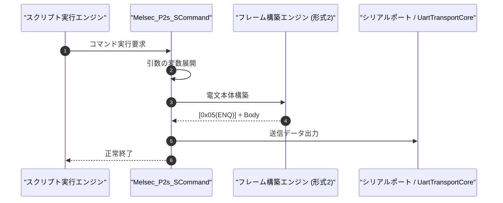

# コマンドリファレンス：Melsec_P2s_S

---

## 概要

**Melsec_P2s_S** は、三菱電機 MELSEC 計算機リンク **形式 2（サムチェックなし対話手順、末尾制御コードなし）** の要求電文フレームを構築し、先頭制御コード（`ENQ [0x05]`）を付与してシリアルポートへ送信するコマンドです。

形式 1 と異なり、サムチェックコード（2 桁 ASCII）の付加を省略する設定の計算機リンクユニットに対して使用します。

> 💡 **補足**: 形式 2 設定の MELSEC 計算機リンクユニットに対してデバイス読み出し（`BR` / `WR`）やデバイス書き込み（`BW` / `WW`）を要求する際に使用します。

---

## 💡 書式・パラメータ仕様

### コマンド構文

```csv
,SEQUENCE,Melsec_P2s_S, "<StationNo>", "<Command>", "<Data>"
```

### パラメータ（引数）一覧

| 引数位置 | パラメータ名 | 必須/任意 | 型・制約 | 説明 |
| :---: | :--- | :---: | :--- | :--- |
| 第1引数 | `StationNo` | **必須** | 2桁または4桁16進文字列（例: `"00"`, `"00FF"`） | 送信先の局番（2桁指定時は自局 PC 番号 `"FF"` が自動補完されます）を指定します。単一フレーム文字列の直接指定も可能です。 |
| 第2引数 | `Command` | 任意 | コマンド文字列（例: `"BR"`, `"WR"`, `"BW"`, `"WW"`） | 計算機リンクコマンド名を指定します。 |
| 第3引数 | `Data` | 任意 | 文字列（伝送待ち時間＋先頭デバイス＋点数＋書込値） | コマンドに続くデータ部（例: `"0D010001"`）を指定します。 |

---

## 🔄 特殊置換規約・分岐規約の適用

1. **変数展開（`$` / `@` / `#`）の完全サポート**:
   - 引数内の変数を動的に展開して電文を生成できます。
2. **サムチェック省略の電文構築**:
   - `ENQ (0x05) + 本文` の構造で送信され、サムチェックの計算・付加は行われません。

---

## 💡 動作例（正しい構文での記述例）

### スクリプト記述例

```csv
,SEQUENCE,Melsec_Mode, "9600,E,7,1", "NONE", "P2"
,SEQUENCE,Melsec_Open

; 局番00、D0100から1ワード読出要求(WR)を形式2で送信
,SEQUENCE,Melsec_P2s_S, "00", "WR", "0D010001"
,SEQUENCE,Melsec_Res_P2s_R, "00", "READ_VAL"

,SEQUENCE,Melsec_Close
,SEQUENCE,Exit
```

---

## 🔄 動作フロー（シーケンス図）



---

## 🚫 エラーハンドリング・安全設計

1. **パラメータ範囲検証**: 引数が指定範囲外の場合は直ちにエラーをログ出力し停止します。
2. **未接続時の安全措置**: 回線切断時やシミュレーションモード時は内部ログへ安全に記録されます。

