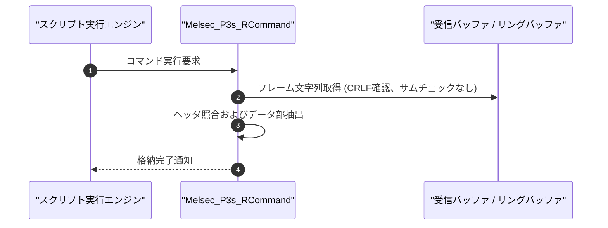

# コマンドリファレンス：Melsec_P3s_R

---

## 概要

**Melsec_P3s_R** は、三菱電機 MELSEC 計算機リンク **形式 3（CR/LF終端、サムチェックなし）** の要求電文を受信検証し、CR/LF 終端を確認の上で抽出データを指定のレジスタまたはセルへ格納するコマンドです。

形式 4 と異なり、サムチェック照合は行われません。

---

## 💡 書式・パラメータ仕様

### コマンド構文

```csv
,SEQUENCE,Melsec_P3s_R, "<StationNoOrHeader>", "<SizeNumOrCommand>", "<TargetOrDataLength>", "[Format]"
```

### パラメータ（引数）一覧

| 引数位置 | パラメータ名 | 必須/任意 | 型・制約 | 説明 |
| :---: | :--- | :---: | :--- | :--- |
| 第1引数 | `StationNoOrHeader` | **必須** | 文字列（例: `"00FF"`） | 期待する局番またはヘッダ文字列を指定します。 |
| 第2引数 | `SizeNumOrCommand` | **必須** | 数値または文字列 | データ長桁数またはコマンドを指定します。 |
| 第3引数 | `TargetOrDataLength` | **必須** | 文字列 | 抽出データの格納先レジスタ名、またはデータ長を指定します。 |
| 第4引数 | `Format` | 任意 | 文字列（`"HEX"` / `"DEC"` 等） | 抽出データの変換フォーマットを指定します。 |

---

## 💡 動作例

```csv
; 形式3で要求電文を受信し、RECV_BUFへ格納
,SEQUENCE,Melsec_P3s_R, "00FF", "2", "RECV_BUF"
```

---

## 🔄 動作フロー（シーケンス図）



