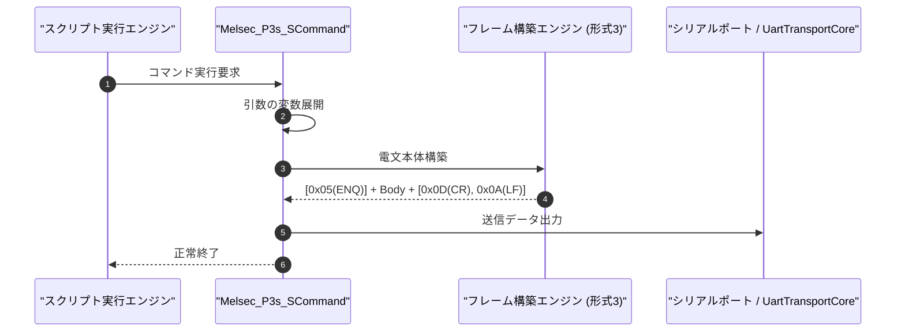

# コマンドリファレンス：Melsec_P3s_S

---

## 概要

**Melsec_P3s_S** は、三菱電機 MELSEC 計算機リンク **形式 3（CR/LF終端、サムチェックなし）** の要求電文フレームを構築し、先頭制御コード（`ENQ [0x05]`）および末尾の `CR+LF`（`0x0D 0x0A`）を付与してシリアルポートへ送信するコマンドです。

形式 4 と異なり、サムチェック（2 桁 ASCII）の付加を省略する設定の計算機リンクユニットに対して使用します。

---

## 💡 書式・パラメータ仕様

### コマンド構文

```csv
,SEQUENCE,Melsec_P3s_S, "<StationNo>", "<Command>", "<Data>"
```

### パラメータ（引数）一覧

| 引数位置 | パラメータ名 | 必須/任意 | 型・制約 | 説明 |
| :---: | :--- | :---: | :--- | :--- |
| 第1引数 | `StationNo` | **必須** | 2桁または4桁16進文字列（例: `"00"`, `"00FF"`） | 送信先の局番（2桁指定時は自局 PC 番号 `"FF"` が自動補完されます）を指定します。 |
| 第2引数 | `Command` | 任意 | コマンド文字列（例: `"BR"`, `"WR"`, `"BW"`, `"WW"`） | 計算機リンクコマンド名を指定します。 |
| 第3引数 | `Data` | 任意 | 文字列（伝送待ち時間＋先頭デバイス＋点数＋書込値） | コマンドに続くデータ部（例: `"0D010001"`）を指定します。 |

---

## 💡 動作例

```csv
,SEQUENCE,Melsec_Mode, "9600,E,7,1", "NONE", "P3"
,SEQUENCE,Melsec_Open

; 局番00、D0100から1ワード読出要求(WR)を形式3で送信
,SEQUENCE,Melsec_P3s_S, "00", "WR", "0D010001"
,SEQUENCE,Melsec_Res_P3s_R, "00", "READ_VAL"

,SEQUENCE,Melsec_Close
,SEQUENCE,Exit
```

---

## 🔄 動作フロー（シーケンス図）



