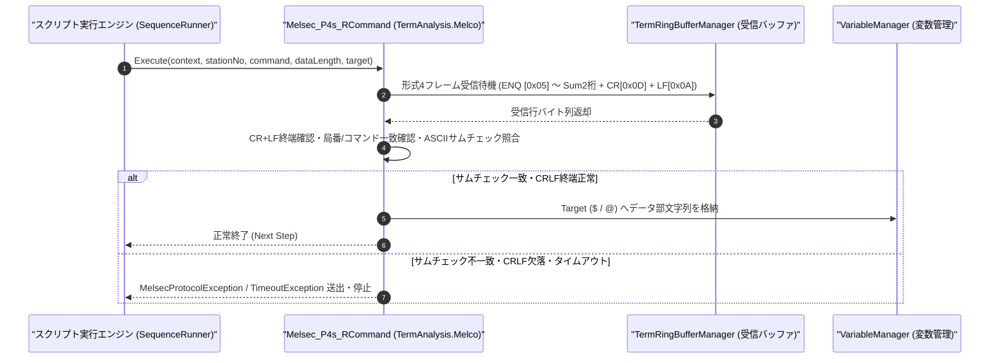

# コマンドリファレンス：Melsec_P4s_R

---

## 概要

**Melsec_P4s_R** は、三菱電機 MELSEC 計算機リンク **専用プロトコル形式 4（サムチェック付き、末尾 `CR+LF [0x0D, 0x0A]` あり）** において、外部マスターまたはシーケンサから送信される要求電文（`ENQ [0x05]` 開始〜`CR+LF` 終端フレーム）を受信・解析し、局番・コマンド・データ長・2 桁サムチェックおよび末尾 `CR+LF` デリミタの検証を行った上で、データ部を指定ターゲット変数へ格納するコマンドです。

> 💡 **補足**: プロトコル形式 4 は形式 1 のフレーム末尾に `CR+LF`（`0x0D 0x0A`）が付加された形式であり、シリアルモニタ上での行単位視認性に優れています。

---

## 💡 書式・パラメータ仕様

### コマンド構文

```csv
,SEQUENCE,Melsec_P4s_R, "<StationNo>", "<Command>", "<DataLength>", "<Target>"
```

### パラメータ（引数）一覧

| 引数位置 | パラメータ名 | 必須/任意 | 型・制約 | 説明 |
| :---: | :--- | :---: | :--- | :--- |
| 第1引数 | `StationNo` | **必須** | 2桁または4桁16進文字列（例: `"00"`, `"00FF"`） | 受信を期待する局番（Station No.）を指定します。 |
| 第2引数 | `Command` | **必須** | 2文字コマンド文字列（例: `"BR"`, `"WR"`, `"BW"`, `"WW"`） | 受信を期待する計算機リンクコマンド名を指定します。 |
| 第3引数 | `DataLength` | **必須** | 整数（文字数） | コマンドおよび伝送待ち時間に続くデータ部のバイト（文字）長を指定します。 |
| 第4引数 | `Target` | **必須** | 変数名（`$` / `@`） | 受信フレームから抽出したデータ部文字列を格納するターゲット変数を指定します。 |

---

## 🔄 特殊置換規約・分岐規約の適用

1. **変数展開（`$` / `@` / `#`）**:
   - 第 1〜第 3 引数には変数を指定可能です（例: `"$ST_NO"`, `"$CMD_TYPE"`）。
2. **レガシー別名互換**:
   - 旧表記の `MELSEC_P4S_R` や `MelsecP4sR` は内部正規化により本 `Melsec_P4s_R` コマンドへ統一マッピングされます。

---

## 💡 動作例（正しい構文での記述例）

### スクリプト記述例

```csv
,PARAM,REQ_DATA,

,SEQUENCE,Melsec_Mode, "9600,O,7,1", "NONE", "P4"
,SEQUENCE,Melsec_Open

; 局番00、ワード一括読出コマンド(WR)、データ部8文字の形式4フレーム(CRLF終端)を受信
,SEQUENCE,Melsec_P4s_R, "00", "WR", "8", "$REQ_DATA"
,SEQUENCE,Melsec_Close
,SEQUENCE,Exit
```

### 実行時の挙動・変数変化

1. 受信リングバッファから `ENQ (0x05)` + `"00FFWR0D010001"` + `Sum(2桁)` + `CR(0x0D) + LF(0x0A)` のフレーム到着を待機します。
2. 末尾 `CR+LF` の存在確認および 2 桁サムチェック照合に成功すると、データ部 `"0D010001"` が `$REQ_DATA` に格納されます。

---

## 🔄 動作フロー（シーケンス図）



---

## 🚫 エラーハンドリング・安全設計（仕様制限）

1. **サムチェックおよび `CR+LF` デリミタの二重検証**:
   - 形式 4 ではサムチェック 2 桁の直後に必ず `CR+LF`（`0x0D 0x0A`）が必要です。サム不一致またはデリミタ欠落時はエラーを送出し、破損データの取り込みを防止します。
2. **受信タイムアウト保護**:
   - 規定時間内に `CR+LF` 終端フレームが到着しない場合は `TimeoutException` を送出します。

---

## 🧪 ユニットテスト仕様

### テスト実行前提条件
- **対象クラス**: `TermAnalysis.Melco.Melsec_P4s_RCommand`（`Melsec_P4s_RCommand.cs`）
- **モック環境**: `TermRingBufferManager` に形式 4 フレームを投入できるテスト環境が構成されていること。

### テストケース一覧

| テストID | テスト観点 | 入力スクリプト | 期待される動作・検証項目 |
| :--- | :--- | :--- | :--- |
| `UT-MELSEC-P4SR-01` | 正常系（形式4要求受信） | `,SEQUENCE,Melsec_P4s_R, "00", "WR", "8", "$DATA"` | `ENQ`〜`Sum`+`CRLF` フレームからデータ部 8 文字が `$DATA` に格納されること。 |
| `UT-MELSEC-P4SR-02` | 異常系（サム不一致またはCRLF欠落） | 不正サムフレーム投入時 | `MelsecProtocolException` が送出され、`$DATA` が更新されないこと。 |
| `UT-MELSEC-P4SR-03` | 異常系（タイムアウト） | 受信データなし | `TimeoutException` が送出されること。 |

