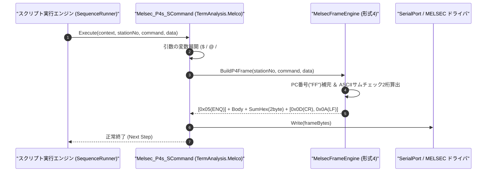

# コマンドリファレンス：Melsec_P4s_S

---

## 概要

**Melsec_P4s_S** は、三菱電機 MELSEC 計算機リンク **専用プロトコル形式 4（サムチェック付き、末尾 `CR+LF` あり）** の要求電文フレームを自動構築し、先頭制御コード（`ENQ [0x05]`）、2 桁 ASCII サムチェックコード、および末尾の `CR+LF`（`0x0D 0x0A`）を自動付与してシリアルポートへ送信するコマンドです。

> 💡 **補足**: 形式 4 設定の MELSEC 計算機リンクユニットに対してデバイス読み出し（`BR` / `WR`）やデバイス書き込み（`BW` / `WW`）を要求する際に使用します。

---

## 💡 書式・パラメータ仕様

### コマンド構文

```csv
,SEQUENCE,Melsec_P4s_S, "<StationNo>", "<Command>", "<Data>"
```

### パラメータ（引数）一覧

| 引数位置 | パラメータ名 | 必須/任意 | 型・制約 | 説明 |
| :---: | :--- | :---: | :--- | :--- |
| 第1引数 | `StationNo` | **必須** | 2桁または4桁16進文字列（例: `"00"`, `"00FF"`） | 送信先の局番（2桁指定時は自局 PC 番号 `"FF"` が自動補完されます）を指定します。 |
| 第2引数 | `Command` | **必須** | 2文字コマンド文字列（例: `"BR"`, `"WR"`, `"BW"`, `"WW"`） | 計算機リンクコマンド名を指定します。 |
| 第3引数 | `Data` | **必須** | 文字列（伝送待ち時間＋先頭デバイス＋点数＋書込値） | コマンドに続くデータ部（例: `"0D010001"`）を指定します。 |

---

## 🔄 特殊置換規約・分岐規約の適用

1. **変数展開（`$` / `@` / `#`）の完全サポート**:
   - 第 3 引数 `Data` に変数を埋め込むことで、任意のデバイスアドレスや書き込み値を動的に指定できます。
2. **サムチェックおよび `CR+LF` の自動付与**:
   - 局番からデータ部末尾までの ASCII コード加算値（下位 2 桁 HEX）を算出し、その直後に `CR+LF`（`0x0D 0x0A`）を付与して送信します（`CR+LF` 自体はサムチェック計算対象外です）。

---

## 💡 動作例（正しい構文での記述例）

### スクリプト記述例

```csv
,PARAM,D_ADDR,D0100
,PARAM,W_VAL,0064

,SEQUENCE,Melsec_Mode, "9600,O,7,1", "NONE", "P4"
,SEQUENCE,Melsec_Open

; 1. 局番00、D0100へ1ワード(0064h = 100)書込要求(WW)を形式4で送信
,SEQUENCE,Melsec_P4s_S, "00", "WW", "0$D_ADDR01$W_VAL"
,SEQUENCE,Melsec_Res_P4s_R, "00", "@ACK_RES"

; 2. 局番00、D0100から1ワード読出要求(WR)を形式4で送信し、読出値を確認
,SEQUENCE,Melsec_P4s_S, "00", "WR", "0$D_ADDR01"
,SEQUENCE,Melsec_Res_P4s_R, "00", "@READ_VAL"

,SEQUENCE,Melsec_Close
,SEQUENCE,Exit
```

### 実行時の挙動・変数変化

1. 1 回目の `Melsec_P4s_S` では、`[ENQ(0x05)] + "00FFWW0D0100010064" + [Sum2桁] + [CR][LF]` が構築・送信されます。
2. 2 回目の `Melsec_P4s_S` では、`[ENQ(0x05)] + "00FFWR0D010001" + [Sum2桁] + [CR][LF]` が送信されます。

---

## 🔄 動作フロー（シーケンス図）



---

## 🚫 エラーハンドリング・安全設計（仕様制限）

1. **回線未オープン時の送信防止**:
   - `Melsec_Open` が実行されていない状態で呼び出された場合、`InvalidOperationException` を送出して停止します。
2. **不正な局番・コマンド長の検証**:
   - 局番が 16 進表記でない場合やコマンド名が 2 文字でない場合は、`ArgumentException` を送出して不正電文の送出を防止します。

---

## 🧪 ユニットテスト仕様

### テスト実行前提条件
- **対象クラス**: `TermAnalysis.Melco.Melsec_P4s_SCommand`（`Melsec_P4s_SCommand.cs`）
- **モック環境**: `IMelsecTransportAdapter` モックが注入されていること。

### テストケース一覧

| テストID | テスト観点 | 入力スクリプト | 期待される動作・検証項目 |
| :--- | :--- | :--- | :--- |
| `UT-MELSEC-P4SS-01` | 正常系（形式4 WR要求送信） | `,SEQUENCE,Melsec_P4s_S, "00", "WR", "0D010001"` | 先頭 `0x05`、本体 `"00FFWR0D010001"`、2 桁サムチェック、末尾 `0x0D 0x0A` が付与されて送信されること。 |
| `UT-MELSEC-P4SS-02` | 変数展開付きWW送信 | `,SEQUENCE,Melsec_P4s_S, "00", "WW", "0D010001$VAL"` | `$VAL` 展開後の文字列に対するサムチェック＋`CR+LF` が送信されること。 |
| `UT-MELSEC-P4SS-03` | 異常系（未オープン時） | 未接続状態で `,SEQUENCE,Melsec_P4s_S, "00", "WR", "0D010001"` | 未接続エラーが送出されること。 |

