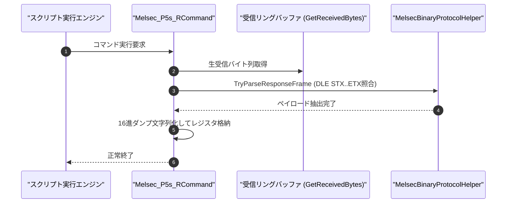

# コマンドリファレンス：Melsec_P5s_R

---

## 概要

**Melsec_P5s_R** は、三菱電機 MELSEC 計算機リンク **形式 5（バイナリコード通信方式）** の要求電文を受信検証し、DLE フレーミングおよびチェックサムを照合した上で、抽出したバイナリペイロードを 16 進ダンプ文字列としてターゲットへ格納するコマンドです。

---

## 💡 書式・パラメータ仕様

### コマンド構文

```csv
,SEQUENCE,Melsec_P5s_R, "<StationNoOrTarget>", "[TargetKey]"
```

### パラメータ（引数）一覧

| 引数位置 | パラメータ名 | 必須/任意 | 型・制約 | 説明 |
| :---: | :--- | :---: | :--- | :--- |
| 第1引数 | `StationNoOrTarget` | **必須** | 文字列（例: `"00"`, `"RECV_KEY"`） | 期待する局番（16進）、または格納先レジスタ名を指定します。 |
| 第2引数 | `TargetKey` | 任意 | 文字列（例: `"RECV_KEY"`） | 格納先レジスタ名を指定します（第1引数で局番を指定した場合）。 |

---

## 💡 動作例

```csv
; 形式5で局番00からのバイナリ要求を受信し、RECV_HEXへ格納
,SEQUENCE,Melsec_P5s_R, "00", "RECV_HEX"
```

---

## 🔄 動作フロー（シーケンス図）



