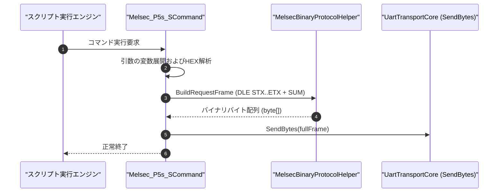

# コマンドリファレンス：Melsec_P5s_S

---

## 概要

**Melsec_P5s_S** は、三菱電機 MELSEC 計算機リンク **形式 5（バイナリコード通信方式）** の要求電文フレームを自動構築し、先頭制御コード（`DLE [0x10] + STX [0x02]`）、DLE エスケープ処理、終了制御コード（`DLE [0x10] + ETX [0x03]`）、および 2 バイト加算チェックサムを付与してシリアルポートへ送信するバイナリ通信専用コマンドです。

ASCII テキスト形式（形式 1〜4）と比べて電文長が約半分となり、大量データの高速転送や高速サンプリングに最適です。

---

## 💡 書式・パラメータ仕様

### コマンド構文

```csv
,SEQUENCE,Melsec_P5s_S, "<StationNoOrHexFrame>", "[Command]", "[Data]"
```

### パラメータ（引数）一覧

| 引数位置 | パラメータ名 | 必須/任意 | 型・制約 | 説明 |
| :---: | :--- | :---: | :--- | :--- |
| 第1引数 | `StationNoOrHexFrame` | **必須** | 16進ダンプ文字列（例: `"00"`, `"00FF04010000D*0000640002"`, `"10 02..."`） | 送信先局番、または送信する完全バイナリ電文（16進表現）を指定します。 |
| 第2引数 | `Command` | 任意 | 16進文字列（例: `"0401"`） | 計算機リンクコマンド（2バイト）を指定します。 |
| 第3引数 | `Data` | 任意 | 16進文字列（サブコマンド＋デバイス指定＋点数等） | コマンドに続く要求データ部を指定します。 |

---

## 🔄 特殊置換規約・バイナリ処理仕様

1. **HEX 文字列の自動バイナリ化**:
   - 引数に指定された 16 進文字列（空白・ハイフン区切り可）を生のバイト配列（`byte[]`）へ自動変換します。
2. **DLE フレーミングとエスケープ**:
   - `[DLE(0x10)][STX(0x02)] + 本文 + [DLE(0x10)][ETX(0x03)] + [SUM(2B)]` を自動構成します。
   - 本文中に `0x10` が現れた場合は自動的に `0x10 0x10` へ二重化エスケープされます。
3. **完全フレーム指定モード**:
   - 先頭がすでに `10 02` で始まっている場合は、多重ラッピングを防止しそのまま送出します。

---

## 💡 動作例（正しい構文での記述例）

### スクリプト記述例

```csv
,SEQUENCE,Melsec_Mode, "115200,E,8,1", "NONE", "P5"
,SEQUENCE,Melsec_Open

; 局番00、Qシリーズ一括読出コマンド(0401h)、D100から2点読出を形式5で送信
; 本文: 00(局番) + FF(PC) + 0401(コマンド) + 0000(サブ) + A8(Dレジスタ) + 000064(アドレス) + 0002(点数)
,SEQUENCE,Melsec_P5s_S, "00FF04010000A80000640002"
,SEQUENCE,Melsec_Res_P5s_R, "00", "PLC_D100", "DEC"

,SEQUENCE,Melsec_Close
,SEQUENCE,Exit
```

---

## 🔄 動作フロー（シーケンス図）



---

## 🚫 エラーハンドリング・安全設計

1. **不正なHEX文字列の検証**: 奇数文字長や16進以外の文字が含まれている場合は安全にエラー停止します。
2. **バイナリシミュレーション**: 実機未接続時もダンプログを安全にトレース出力します。

