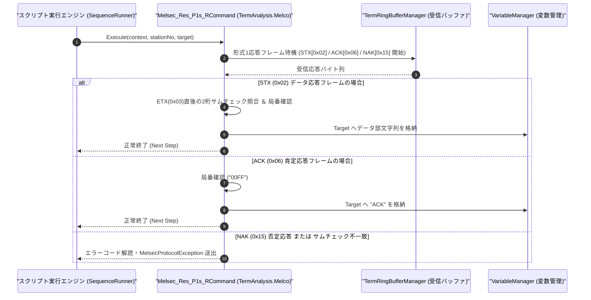

# コマンドリファレンス：Melsec_Res_P1s_R

---

## 概要

**Melsec_Res_P1s_R** は、`Melsec_P1s_S` で送信した要求電文に対する MELSEC シーケンサからの **専用プロトコル形式 1 応答電文**（データ応答フレーム `STX [0x02] ... ETX [0x03] + Sum2桁`、肯定応答 `ACK [0x06] ...`、または否定応答 `NAK [0x15] ...`）を受信・解析し、サムチェック照合後に読み出しデータ（または ACK/NAK ステータス）を指定ターゲット変数へ格納するコマンドです。

> 💡 **補足**: 読み出し要求（`BR` / `WR`）に対する `STX...ETX` データ応答と、書き込み要求（`BW` / `WW`）に対する `ACK` 応答の双方を自動判別して処理します。

---

## 💡 書式・パラメータ仕様

### コマンド構文

```csv
,SEQUENCE,Melsec_Res_P1s_R, "<StationNo>", "<Target>"
```

### パラメータ（引数）一覧

| 引数位置 | パラメータ名 | 必須/任意 | 型・制約 | 説明 |
| :---: | :--- | :---: | :--- | :--- |
| 第1引数 | `StationNo` | **必須** | 2桁または4桁16進文字列（例: `"00"`, `"00FF"`） | 応答元のシーケンサ局番を指定します。 |
| 第2引数 | `Target` | **必須** | 変数名（`$` / `@`） | 抽出した読み出しデータ文字列（`STX`〜`ETX` 間のデータ部）、または `ACK` 応答確認結果を格納するターゲット変数を指定します。 |

---

## 🔄 特殊置換規約・分岐規約の適用

1. **変数展開（`$` / `@` / `#`）**:
   - 第 1 引数 `StationNo` には変数を指定可能です（例: `"$TARGET_ST"`）。
2. **レガシー別名互換**:
   - 旧表記の `MELSEC_RES_P1S_R` や `MelsecResP1sR` は内部正規化により本コマンドへ統一マッピングされます。

---

## 💡 動作例（正しい構文での記述例）

### スクリプト記述例

```csv
,PARAM,D100_HEX,

,SEQUENCE,Melsec_Mode, "9600,O,7,1", "NONE", "P1"
,SEQUENCE,Melsec_Open

; 1. D0100から2ワード読出要求(WR)を形式1で送信
,SEQUENCE,Melsec_P1s_S, "00", "WR", "0D010002"

; 2. 形式1のSTX...ETX応答電文を受信し、2ワード分のHEX文字列(8文字)を $D100_HEX へ格納
,SEQUENCE,Melsec_Res_P1s_R, "00", "$D100_HEX"

; 3. シーケンサへ完了確認のACKを返す必要があるモードの場合は後続処理へ継続
,SEQUENCE,Melsec_Close
,SEQUENCE,Exit
```

### 実行時の挙動・変数変化

1. シーケンサから `[STX(0x02)] + "00FF" + "03E807D0" + [ETX(0x03)] + [Sum2桁]` が返却されます。
2. `Melsec_Res_P1s_R` は局番 `"00FF"` の一致および `STX` の次バイト〜`ETX` までのサムチェック 2 桁を検証し、データ部 `"03E807D0"` を `$D100_HEX` に格納します。

---

## 🔄 動作フロー（シーケンス図）



---

## 🚫 エラーハンドリング・安全設計（仕様制限）

1. **NAK（`0x15`）エラーコードの解読と通知**:
   - シーケンサから `NAK (0x15) + 局番 + PC番号 + エラーコード(2桁)` が返された場合、エラーコードを含めて例外を送出し、異常状態で次ステップへ進むことを防止します。
2. **サムチェック不一致の検出**:
   - `STX` 応答フレームのサムチェックが不一致の場合は、受信データを破棄して通信エラーを送出します。

---

## 🧪 ユニットテスト仕様

### テスト実行前提条件
- **対象クラス**: `TermAnalysis.Melco.Melsec_Res_P1s_RCommand`（`Melsec_Res_P1s_RCommand.cs`）
- **モック環境**: `TermRingBufferManager` に形式 1 応答フレームを投入できるテスト環境が構成されていること。

### テストケース一覧

| テストID | テスト観点 | 入力スクリプト | 期待される動作・検証項目 |
| :--- | :--- | :--- | :--- |
| `UT-MELSEC-RESP1-01` | 正常系（STXデータ応答受信） | `,SEQUENCE,Melsec_Res_P1s_R, "00", "$VAL"` | `[STX]00FF1234[ETX][Sum]` から `"1234"` が抽出され `$VAL` に格納されること。 |
| `UT-MELSEC-RESP1-02` | 正常系（ACK応答受信） | `,SEQUENCE,Melsec_Res_P1s_R, "00", "$VAL"` | `[ACK]00FF` 受信時に `$VAL` に `"ACK"` が格納され正常終了すること。 |
| `UT-MELSEC-RESP1-03` | 異常系（NAK応答受信） | `[NAK]00FF10` 受信時 | エラーコード `"10"` を含む `MelsecProtocolException` が送出されること。 |

