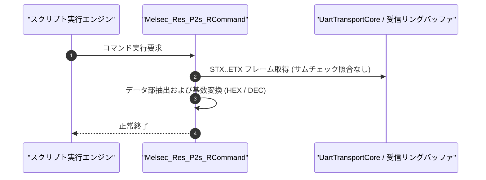

# コマンドリファレンス：Melsec_Res_P2s_R

---

## 概要

**Melsec_Res_P2s_R** は、三菱電機 MELSEC 計算機リンク **形式 2（サムチェックなし対話手順）** の応答電文を受信検証し、STX〜ETX で囲まれたデータ部（または ACK / NAK）を抽出して指定のセルまたはレジスタへ格納するコマンドです。

形式 1 と異なり、ETX 直後のサムチェック（2 桁 ASCII）の照合は省略されます。

---

## 💡 書式・パラメータ仕様

### コマンド構文

```csv
,SEQUENCE,Melsec_Res_P2s_R, "<StationNoOrHead>", "<TargetOrPoints>", "[LegacyDest]", "[Format]"
```

### パラメータ（引数）一覧

| 引数位置 | パラメータ名 | 必須/任意 | 型・制約 | 説明 |
| :---: | :--- | :---: | :--- | :--- |
| 第1引数 | `StationNoOrHead` | **必須** | 文字列（例: `"00"`） | 期待する局番または応答ヘッダを指定します。 |
| 第2引数 | `TargetOrPoints` | **必須** | 文字列 | 抽出データの格納先レジスタ名（または読出点数）を指定します。 |
| 第3引数 | `LegacyDest` | 任意 | 文字列 | 格納先レジスタ名（旧構文互換用）を指定します。 |
| 第4引数 | `Format` | 任意 | 文字列（`"HEX"` / `"DEC"` 等） | 取得データの基数変換フォーマットを指定します。 |

---

## 💡 動作例

```csv
; 形式2でD100の読出応答を受信し、10進数で格納
,SEQUENCE,Melsec_P2s_S, "00", "WR", "0D010001"
,SEQUENCE,Melsec_Res_P2s_R, "00", "PLC_D100", "", "DEC"
```

---

## 🔄 動作フロー（シーケンス図）



