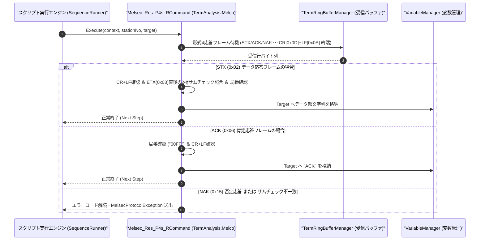

# コマンドリファレンス：Melsec_Res_P4s_R

---

## 概要

**Melsec_Res_P4s_R** は、`Melsec_P4s_S` で送信した要求電文に対する MELSEC シーケンサからの **専用プロトコル形式 4 応答電文**（`STX [0x02] ... ETX [0x03] + Sum2桁 + CR + LF`、`ACK [0x06] ... + CR + LF`、または `NAK [0x15] ... + CR + LF`）を受信・解析し、サムチェックおよび末尾 `CR+LF` デリミタ照合後に読み出しデータ（または ACK/NAK ステータス）を指定ターゲット変数へ格納するコマンドです。

> 💡 **補足**: プロトコル形式 4 の応答電文は、すべての応答フレーム（`STX` / `ACK` / `NAK`）の末尾に `CR+LF`（`0x0D 0x0A`）が付与されています。

---

## 💡 書式・パラメータ仕様

### コマンド構文

```csv
,SEQUENCE,Melsec_Res_P4s_R, "<StationNo>", "<Target>"
```

### パラメータ（引数）一覧

| 引数位置 | パラメータ名 | 必須/任意 | 型・制約 | 説明 |
| :---: | :--- | :---: | :--- | :--- |
| 第1引数 | `StationNo` | **必須** | 2桁または4桁16進文字列（例: `"00"`, `"00FF"`） | 応答元のシーケンサ局番を指定します。 |
| 第2引数 | `Target` | **必須** | 変数名（`$` / `@`） | 抽出した読み出しデータ文字列（`STX`〜`ETX` 間のデータ部）、または `ACK` 応答確認結果を格納するターゲット変数を指定します。 |

---

## 🔄 特殊置換規約・分岐規約の適用

1. **変数展開（`$` / `@` / `#`）**:
   - 第 1 引数 `StationNo` には変数を指定可能です。
2. **レガシー別名互換**:
   - 旧表記の `MELSEC_RES_P4S_R` や `MelsecResP4sR` は内部正規化により本コマンドへ統一マッピングされます。

---

## 💡 動作例（正しい構文での記述例）

### スクリプト記述例

```csv
,PARAM,D200_VAL,

,SEQUENCE,Melsec_Mode, "9600,O,7,1", "NONE", "P4"
,SEQUENCE,Melsec_Open

; 1. D0200から1ワード読出要求(WR)を形式4で送信
,SEQUENCE,Melsec_P4s_S, "00", "WR", "0D020001"

; 2. 形式4の応答電文(STX...ETX+Sum+CRLF)を受信し、データ部を $D200_VAL へ格納
,SEQUENCE,Melsec_Res_P4s_R, "00", "$D200_VAL"
,SEQUENCE,Judge, "$D200_VAL", "==", "0064", "MATCH_OK"

,SEQUENCE,Melsec_Close
,SEQUENCE,Exit

:MATCH_OK
,SEQUENCE,Msg_Box, "D0200の値が期待値(100)と一致しました"
,SEQUENCE,Melsec_Close
,SEQUENCE,Exit
```

### 実行時の挙動・変数変化

1. シーケンサから `[STX(0x02)] + "00FF0064" + [ETX(0x03)] + [Sum2桁] + [CR][LF]` が返却されます。
2. `Melsec_Res_P4s_R` は末尾 `CR+LF`・サムチェック 2 桁・局番 `"00FF"` を検証し、データ部 `"0064"` を `$D200_VAL` に格納します。

---

## 🔄 動作フロー（シーケンス図）



---

## 🚫 エラーハンドリング・安全設計（仕様制限）

1. **NAK（`0x15`）エラーコードの解読と通知**:
   - シーケンサから `NAK (0x15) + 局番 + PC番号 + エラーコード(2桁) + CR + LF` が返された場合、エラーコードを解読して例外を送出します。
2. **サムチェックおよび `CR+LF` 終端の検証**:
   - サムチェック不一致または末尾 `CR+LF` 欠落時は通信エラーとして処理し、不正データの変数格納を阻止します。

---

## 🧪 ユニットテスト仕様

### テスト実行前提条件
- **対象クラス**: `TermAnalysis.Melco.Melsec_Res_P4s_RCommand`（`Melsec_Res_P4s_RCommand.cs`）
- **モック環境**: `TermRingBufferManager` に形式 4 応答フレームを投入できるテスト環境が構成されていること。

### テストケース一覧

| テストID | テスト観点 | 入力スクリプト | 期待される動作・検証項目 |
| :--- | :--- | :--- | :--- |
| `UT-MELSEC-RESP4-01` | 正常系（STXデータ応答受信） | `,SEQUENCE,Melsec_Res_P4s_R, "00", "$VAL"` | `[STX]00FF0064[ETX][Sum][CR][LF]` から `"0064"` が抽出され `$VAL` に格納されること。 |
| `UT-MELSEC-RESP4-02` | 正常系（ACK応答受信） | `,SEQUENCE,Melsec_Res_P4s_R, "00", "$VAL"` | `[ACK]00FF[CR][LF]` 受信時に `$VAL` に `"ACK"` が格納されること。 |
| `UT-MELSEC-RESP4-03` | 異常系（NAK応答受信） | `[NAK]00FF10[CR][LF]` 受信時 | エラーコード `"10"` を含む `MelsecProtocolException` が送出されること。 |

