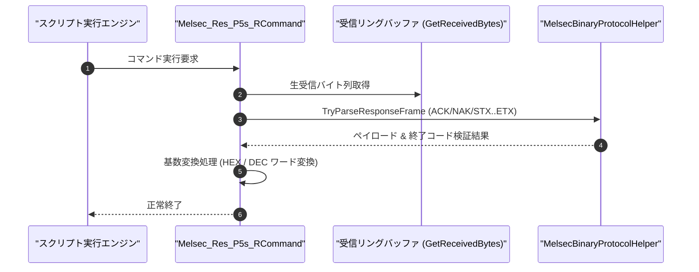

# コマンドリファレンス：Melsec_Res_P5s_R

---

## 概要

**Melsec_Res_P5s_R** は、三菱電機 MELSEC 計算機リンク **形式 5（バイナリコード通信方式）** の応答電文を受信検証し、DLE フレーミング・チェックサムおよび終了コード（正常 `0x0000`）を確認した上で、応答データを 16 進文字列（`HEX`）または 10 進整数（`DEC`）に変換して指定セルへ展開するコマンドです。

書込コマンドに対する正常応答（`DLE ACK [0x10 0x06]`）やエラー応答（`DLE NAK [0x10 0x15]`）の自動判定にも完全対応しています。

---

## 💡 書式・パラメータ仕様

### コマンド構文

```csv
,SEQUENCE,Melsec_Res_P5s_R, "<StationNoOrTarget>", "[TargetOrRadix]", "[RadixFormat]"
```

### パラメータ（引数）一覧

| 引数位置 | パラメータ名 | 必須/任意 | 型・制約 | 説明 |
| :---: | :--- | :---: | :--- | :--- |
| 第1引数 | `StationNoOrTarget` | **必須** | 文字列（例: `"00"`, `"PLC_D100"`） | 期待する局番（16進）、または格納先セル/レジスタ名を指定します。 |
| 第2引数 | `TargetOrRadix` | 任意 | 文字列（例: `"PLC_D100"`, `"DEC"`, `"HEX"`） | 格納先キー、または基数変換フォーマットを指定します。 |
| 第3引数 | `RadixFormat` | 任意 | 文字列（既定: `"HEX"`, `"DEC"` 可） | 取得データの基数変換フォーマットを指定します。`"DEC"` 指定時は 2 バイト単位で 10 進数値に変換します。 |

---

## 💡 動作例

```csv
; 形式5でD100からの2ワード読出応答を受信し、10進数値（カンマ区切り）でセル格納
,SEQUENCE,Melsec_P5s_S, "00FF04010000A80000640002"
,SEQUENCE,Melsec_Res_P5s_R, "00", "PLC_D100", "DEC"
```

---

## 🔄 動作フロー（シーケンス図）



