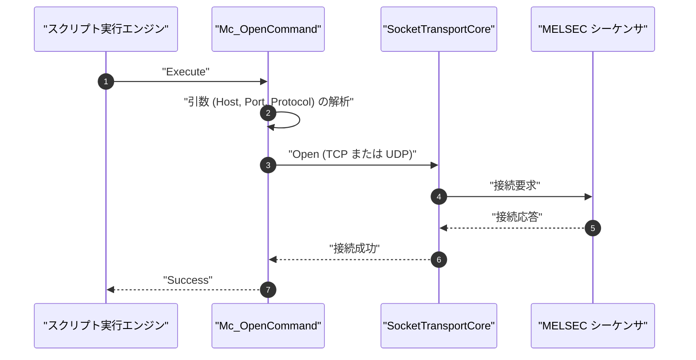

# コマンドリファレンス：Mc_Open

---

## 概要

**Mc_Open** は、設定値または引数で指定された接続先（IP アドレス / ホスト名、ポート番号、TCP / UDP プロトコル）に基づき、三菱電機 MELSEC MC プロトコル（3E フレーム）用の通信ソケットを開設するコマンドです。
実行時に Term 通信制御の排他選択モードを **MELSEC MC モード**（`TermAnalysis.MelcoMC.dll`）へ確定させます。

---

## 💡 書式・パラメータ仕様

### コマンド構文

```csv
,SEQUENCE,Mc_Open, "[Host:Port]", "[Protocol]"
```

※ 引数を省略した場合は、UI プロパティ設定画面（または `Mc_Mode`）の現在の設定値が自動適用されます。

### パラメータ（引数）一覧

| 引数位置 | パラメータ名 | 必須/任意 | 型・制約 | 説明 |
| :--- | :--- | :---: | :--- | :--- |
| 第 1 引数 | `Host:Port` | 任意 | 文字列（例: `"192.168.1.10:5000"` または `"192.168.1.10"`） | 接続先 PLC の IP アドレスまたはホスト名。コロン区切りでポート番号の同時指定も可能。 |
| 第 2 引数 | `Protocol` | 任意 | `"TCP"` または `"UDP"`（大文字小文字不問） | 通信トランスポート層プロトコル。省略時は `"TCP"`。 |

---

## 🔄 特殊置換規約・分岐規約の適用

1. **引数の省略動作**:
   - 引数なしで実行した場合、プロパティ画面等で設定された現在のホスト・ポートでソケット接続を開始します。
2. **大文字・小文字の非区別（Case-Insensitive）**:
   - `Mc_Open`、`MC_OPEN`、`mc_open` のいずれも同一コマンドとして正規化されます。
3. **排他ドメインの確定**:
   - 本コマンド実行以降、セッション内の通信プロトコルは MELSEC MC に固定され、シリアル COM や Modbus コマンドとの混在実行は排他制御によりブロックされます。

---

## 💡 動作例（正しい構文での記述例）

### スクリプト記述例

```csv
; 1. MELSEC MC プロトコル（IP: 192.168.1.10, Port: 5000, TCP）でオープン
,SEQUENCE,Mc_Open, "192.168.1.10:5000", "TCP"

; 2. D100 から 2 ワード読出
,SEQUENCE,Mc_ReadWord, "D100", 2, "@RCV_DATA"

; 3. ソケット切断
,SEQUENCE,Mc_Close
,SEQUENCE,Exit
```

---

## 🔄 動作フロー（シーケンス図）



