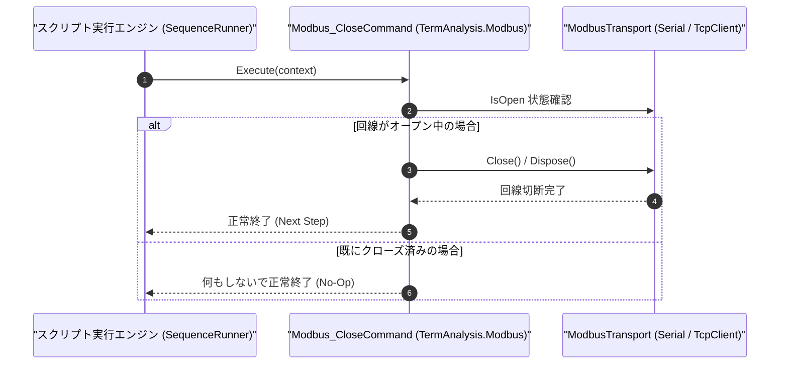

# コマンドリファレンス：Modbus_Close

---

## 概要

**Modbus_Close** は、現在オープンされている Modbus 通信回線（UART シリアルポートまたは Modbus TCP ソケット）を安全に切断し、通信リソースを解放するコマンドです。

> 💡 **補足**: シーケンス終了時には必ず `Modbus_Close` を呼び出してポートおよびソケットを解放してください。

---

## 💡 書式・パラメータ仕様

### コマンド構文

```csv
,SEQUENCE,Modbus_Close
```

### パラメータ（引数）一覧

| 引数位置 | パラメータ名 | 必須/任意 | 型・制約 | 説明 |
| :--- | :--- | :---: | :--- | :--- |
| （引数なし） | - | - | - | 現在接続中の Modbus 回線（UART または TCP）をクローズします。 |

---

## 🔄 特殊置換規約・分岐規約の適用

1. **引数なしコマンド**:
   - 引数を取らないため、変数展開（`$` / `#` / `@`）は使用しません。
2. **大文字・小文字の非区別（Case-Insensitive）**:
   - `Modbus_Close`、`MODBUS_CLOSE`、`modbus_close` のいずれも同一コマンドとして正規化されます。

---

## 💡 動作例（正しい構文での記述例）

### スクリプト記述例

```csv
,SEQUENCE,Modbus_Mode, "TCP"
,SEQUENCE,Modbus_Open
,SEQUENCE,Modbus_Write, "1", "06", "0010", "1234"
,SEQUENCE,Modbus_Close
,SEQUENCE,Exit
```

### 実行時の挙動・変数変化

1. `Modbus_Write` でレジスタ書き込みが完了した後、`Modbus_Close` により Modbus TCP コネクションが切断されます。

---

## 🔄 動作フロー（シーケンス図）



---

## 🚫 エラーハンドリング・安全設計（仕様制限）

1. **未接続時の安全な無視（No-Op 保証）**:
   - 未接続状態で `Modbus_Close` を実行してもエラーにはならず、安全に次のステップへ進みます。
2. **受信済みデータの保持**:
   - クローズ後も、直前の `Modbus_Read` で変数または `TermRingBufferManager` に格納されたデータは消去されず参照可能です。

---

## 🧪 ユニットテスト仕様

### テスト実行前提条件
- **対象クラス**: `TermAnalysis.Modbus.Modbus_CloseCommand`（`Modbus_CloseCommand.cs`）
- **モック環境**: `IModbusTransportAdapter` モックが注入されていること。

### テストケース一覧

| テストID | テスト観点 | 入力スクリプト | 期待される動作・検証項目 |
| :--- | :--- | :--- | :--- |
| `UT-MODBUS-CLOSE-01` | 正常クローズ | `,SEQUENCE,Modbus_Close`（接続中） | トランスポートの `IsOpen` が `false` になりリソースが解放されること。 |
| `UT-MODBUS-CLOSE-02` | 未接続時の再クローズ | `,SEQUENCE,Modbus_Close`（未接続時） | 例外が発生せず正常終了すること。 |

