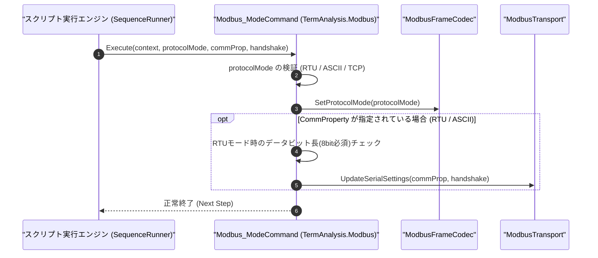

# コマンドリファレンス：Modbus_Mode

---

## 概要

**Modbus_Mode** は、Modbus 通信の伝送プロトコルモード（`RTU` / `ASCII` / `TCP`）、およびシリアル回線（`RTU` / `ASCII`）使用時の UART 通信条件（ボーレート・パリティ・データビット・ストップビット）とフロー制御を設定するコマンドです。

> 💡 **補足**: `RTU` 選択時はバイナリ＋CRC-16（8bit データ長必須）、`ASCII` 選択時は 16 進テキスト＋LRC（7bit/8bit 可）、`TCP` 選択時は MBAP ヘッダ＋TCP ソケット通信へ内部フレーミングエンジンを切り替えます。

---

## 💡 書式・パラメータ仕様

### コマンド構文

```csv
,SEQUENCE,Modbus_Mode, "<ProtocolMode: RTU / ASCII / TCP>", "[CommProperty]", "[Handshake]"
```

### パラメータ（引数）一覧

| 引数位置 | パラメータ名 | 必須/任意 | 型・制約 | 説明 |
| :---: | :--- | :---: | :--- | :--- |
| 第1引数 | `ProtocolMode` | **必須** | `RTU` / `ASCII` / `TCP` | Modbus の伝送フレーム方式を指定します。 |
| 第2引数 | `CommProperty` | 任意 | `"Baud,Parity,DataBits,StopBits"`（例: `"19200,E,8,1"`） | `RTU` または `ASCII` モード時の UART 通信条件を指定します。`TCP` モード時または省略時は現在値（UI 設定値）を維持します。 |
| 第3引数 | `Handshake` | 任意 | `NONE` / `RTSCTS` / `XONXOFF` | シリアル通信時のフロー制御方式を指定します。省略時は現在値を維持します。 |

---

## 🔄 特殊置換規約・分岐規約の適用

1. **カンマを含む第2引数の保護**:
   - `"19200,E,8,1"` や `"9600,E,7,1"` のようにカンマを含む UART 条件は、ダブルクォーテーション `""` で囲んで記述します。
2. **変数展開（`$` / `@` / `#`）**:
   - 各引数には変数を指定可能です（例: `"$MB_PROTO"`, `"$UART_PROP"`）。

---

## 💡 動作例（正しい構文での記述例）

### スクリプト記述例

```csv
; 1. Modbus RTUモード（19200bps, 偶数パリティ, 8bit, Stop 1）に設定
,SEQUENCE,Modbus_Mode, "RTU", "19200,E,8,1", "NONE"
,SEQUENCE,Modbus_Open
,SEQUENCE,Modbus_Read, "1", "03", "0000", "1", "$RTU_VAL"
,SEQUENCE,Modbus_Close

; 2. Modbus ASCIIモード（9600bps, 偶数パリティ, 7bit, Stop 1）に切り替え
,SEQUENCE,Modbus_Mode, "ASCII", "9600,E,7,1", "NONE"
,SEQUENCE,Modbus_Open
,SEQUENCE,Modbus_Read, "1", "03", "0000", "1", "$ASC_VAL"
,SEQUENCE,Modbus_Close

; 3. Modbus TCPモードに切り替え（IPとポートはUI設定を使用）
,SEQUENCE,Modbus_Mode, "TCP"
,SEQUENCE,Modbus_Open
,SEQUENCE,Modbus_Read, "1", "03", "0000", "1", "$TCP_VAL"
,SEQUENCE,Modbus_Close
,SEQUENCE,Exit
```

### 実行時の挙動・変数変化

1. 1 回目の `Modbus_Mode` では RTU バイナリフレーミング（CRC-16）と 8 データビット UART 設定が適用されます。
2. 2 回目の `Modbus_Mode` では ASCII フレーミング（`:` 開始、LRC、`CR+LF` 終端）と 7 データビット UART 設定に切り替わります。
3. 3 回目の `Modbus_Mode` では TCP ソケット（MBAP ヘッダ付与、CRC なし）に切り替わります。

---

## 🔄 動作フロー（シーケンス図）



---

## 🚫 エラーハンドリング・安全設計（仕様制限）

1. **Modbus RTU モードにおけるデータビット 7bit 指定の防止**:
   - Modbus 標準仕様上、`RTU`（バイナリ）モードは 8bit データ長が必須です。`RTU` モードでデータビット `7`（例: `"9600,E,7,1"`）が指定された場合は、`ArgumentException` を送出してフレーム破損を未然に防止します。
2. **未定義プロトコルモードの拒否**:
   - 第 1 引数に `RTU` / `ASCII` / `TCP` 以外の文字列が指定された場合は即座にエラーを送出します。

---

## 🧪 ユニットテスト仕様

### テスト実行前提条件
- **対象クラス**: `TermAnalysis.Modbus.Modbus_ModeCommand`（`Modbus_ModeCommand.cs`）
- **モック環境**: `IModbusTransportAdapter` および `ModbusFrameCodec` が注入されていること。

### テストケース一覧

| テストID | テスト観点 | 入力スクリプト | 期待される動作・検証項目 |
| :--- | :--- | :--- | :--- |
| `UT-MODBUS-MODE-01` | RTUモード設定 | `,SEQUENCE,Modbus_Mode, "RTU", "19200,E,8,1", "NONE"` | フレーミングが `RTU`、UART が `19200,E,8,1` に設定されること。 |
| `UT-MODBUS-MODE-02` | TCPモード設定 | `,SEQUENCE,Modbus_Mode, "TCP"` | フレーミングが `TCP`（MBAP ヘッダ）に切り替わること。 |
| `UT-MODBUS-MODE-03` | 異常系（RTUで7bit指定） | `,SEQUENCE,Modbus_Mode, "RTU", "9600,E,7,1"` | `ArgumentException` が送出され、RTU 7bit 設定が拒否されること。 |

