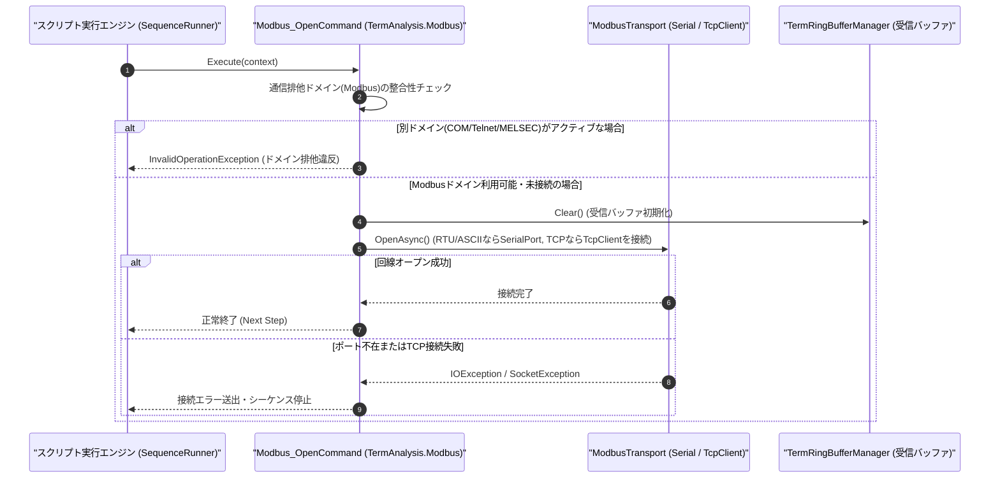

# コマンドリファレンス：Modbus_Open

---

## 概要

**Modbus_Open** は、Term アプリケーションの UI 設定および `Modbus_Mode` で指定された伝送モード（`RTU` / `ASCII` の場合は UART シリアルポート、`TCP` の場合は TCP ソケット回線）をオープンし、Modbus マスター通信セッションを開始するコマンドです。
実行時に Term 通信制御の排他選択モードを **Modbus モード**（`TermAnalysis.Modbus.dll`）へ確定させます。

> 💡 **補足**: 使用する COM ポート番号や接続先 IP アドレスは PC 環境設定（UI 設定値）から取得し、プロトコル種別（RTU / ASCII / TCP）に応じて下位トランスポートを自動選択します。RTU / ASCII モードでは物理 COM ポートのほか、公式無償ツール **[c2c](https://github.com/Monaca-App/c2c)** が公開中の仮想 COM ポート（例: `COM10` ⇔ `COM11`）も透過的にオープン可能です。

---

## 💡 書式・パラメータ仕様

### コマンド構文

```csv
,SEQUENCE,Modbus_Open
```

### パラメータ（引数）一覧

| 引数位置 | パラメータ名 | 必須/任意 | 型・制約 | 説明 |
| :--- | :--- | :---: | :--- | :--- |
| （引数なし） | - | - | - | UI 設定および `Modbus_Mode` の設定に基づいて Modbus 回線（UART または TCP）をオープンします。 |

---

## 🔄 特殊置換規約・分岐規約の適用

1. **引数なしコマンド**:
   - 引数を取らないため、変数展開（`$` / `#` / `@`）は使用しません。
2. **大文字・小文字の非区別（Case-Insensitive）**:
   - `Modbus_Open`、`MODBUS_OPEN`、`modbus_open` のいずれも同一コマンドとして正規化されます。
3. **排他ドメインの確定**:
   - 本コマンド実行以降、セッション内の通信プロトコルは Modbus に固定され、COM / Telnet / MELSEC コマンドとの混在実行は排他制御によりブロックされます。

---

## 💡 動作例（正しい構文での記述例）

### スクリプト記述例

```csv
; 1. Modbus RTUモード（38400bps, Even, 8bit, Stop 1）を設定して回線オープン
,SEQUENCE,Modbus_Mode, "RTU", "38400,E,8,1", "NONE"
,SEQUENCE,Modbus_Open

; 2. スレーブ局番1の保持レジスタ(FC03) 開始アドレス0から2ワード読出
,SEQUENCE,Modbus_Read, "1", "03", "0000", "2", "@REG_DATA"
,SEQUENCE,Modbus_Close
,SEQUENCE,Exit
```

### 実行時の挙動・変数変化

1. `Modbus_Mode` により `RTU` フレーム形式および UART 通信条件（`38400,E,8,1`）が設定されます。
2. `Modbus_Open` によりシリアルポートが開かれ、Modbus RTU フレーム送受信エンジンが待機状態になります。

---

## 🔄 動作フロー（シーケンス図）



---

## 🚫 エラーハンドリング・安全設計（仕様制限）

1. **二重オープンの安全な扱い（Idempotent 制御）**:
   - すでに Modbus 回線がオープンされている状態で再実行された場合、エラーとせず安全に継続します。
2. **他通信ドメインとの排他保護**:
   - 同一シーケンス内で `Com_Open` や `Telnet_Open` 等と併用された場合は、排他制御エラーとして即座に検出・遮断します。

---

## 🧪 ユニットテスト仕様

### テスト実行前提条件
- **対象クラス**: `TermAnalysis.Modbus.Modbus_OpenCommand`（`Modbus_OpenCommand.cs`）
- **モック環境**: `IModbusTransportAdapter` モックが注入されていること。

### テストケース一覧

| テストID | テスト観点 | 入力スクリプト | 期待される動作・検証項目 |
| :--- | :--- | :--- | :--- |
| `UT-MODBUS-OPEN-01` | 正常オープン（RTU） | `,SEQUENCE,Modbus_Open` | モックトランスポートがオープン状態になり、排他ドメインが `Modbus` に設定されること。 |
| `UT-MODBUS-OPEN-02` | 大文字小文字非区別 | `,SEQUENCE,modbus_open` | `Modbus_OpenCommand` が正常に呼び出されること。 |
| `UT-MODBUS-OPEN-03` | 異常系（排他違反） | `Com_Open` 後に `,SEQUENCE,Modbus_Open` | `InvalidOperationException` が送出され、混在が阻止されること。 |

