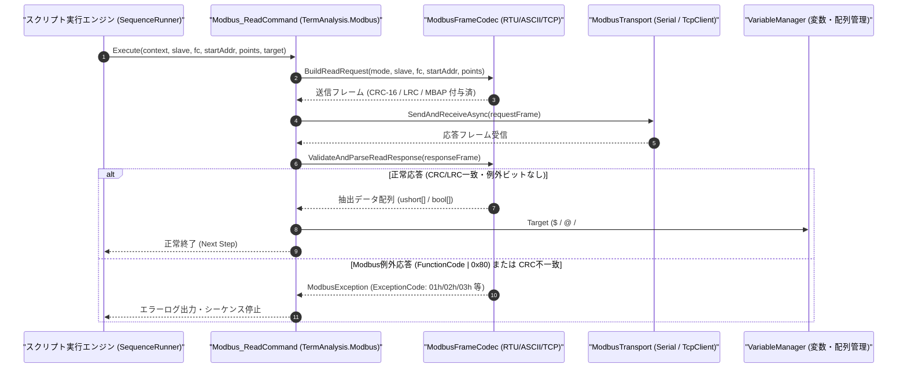

# コマンドリファレンス：Modbus_Read

---

## 概要

**Modbus_Read** は、指定されたスレーブ局番（Slave ID）の Modbus 機器に対して読み出しファンクションコード（FC01: コイル読出、FC02: 入力ステータス読出、FC03: 保持レジスタ読出、FC04: 入力レジスタ読出）の要求フレームを自動生成・送信し、応答フレームのエラーチェック（CRC-16 / LRC / MBAP ヘッダ検証）を行った上で、読み出したデータ値を指定ターゲット変数（または配列）へ格納するコマンドです。

> 💡 **補足**: `Modbus_Mode` の設定（`RTU` / `ASCII` / `TCP`）に応じて、CRC-16 計算、`:` 開始＋LRC＋CRLF 変換、または 7 バイト MBAP ヘッダ付与をすべて内部で自動処理します。

---

## 💡 書式・パラメータ仕様

### コマンド構文

```csv
,SEQUENCE,Modbus_Read, "<SlaveAddr>", "<FuncCode>", "<StartAddr>", "<Points>", "<Target>"
```

### パラメータ（引数）一覧

| 引数位置 | パラメータ名 | 必須/任意 | 型・制約 | 説明 |
| :---: | :--- | :---: | :--- | :--- |
| 第1引数 | `SlaveAddr` | **必須** | 整数または16進表記（`1`〜`247`、TCP時はUnit ID） | 通信対象のスレーブアドレス（局番）を指定します。 |
| 第2引数 | `FuncCode` | **必須** | `"01"` / `"02"` / `"03"` / `"04"`（または整数 `1`〜`4`） | 読み出し用 Modbus ファンクションコードを指定します（`03`: 保持レジスタ、`04`: 入力レジスタ等）。 |
| 第3引数 | `StartAddr` | **必須** | 整数または4桁16進（例: `"0000"`, `"100"`） | 読み出し開始レジスタアドレス（0オリジン相対アドレス）を指定します。 |
| 第4引数 | `Points` | **必須** | 整数（`1`〜`125` ワード / ビット時は `1`〜`2000`） | 読み出す点数（ワード数またはビット数）を指定します。 |
| 第5引数 | `Target` | **必須** | 変数名（`$` / `@`）または配列名（`#`） | 読み出したデータ（複数点の場合はカンマ区切り文字列、または配列要素）の格納先を指定します。 |

---

## 🔄 特殊置換規約・分岐規約の適用

1. **変数展開（`$` / `@` / `#`）の完全サポート**:
   - 第 1〜第 4 引数には変数を指定して動的にアドレスや点数を変更できます（例: `"$SLAVE_ID"`, `"$START_REG"`）。
2. **格納先ターゲット（第 5 引数）の振り分け**:
   - スカラー変数（`$VAL` / `@VAL`）を指定した場合：読み出したワード値（16進4桁または10進文字列）がカンマ区切り（例: `"01F4,0064"`）で格納されます。
   - 配列（`#REG_ARR`）を指定した場合：各ワード値が `#REG_ARR[0]`, `#REG_ARR[1]`, ... に個別に格納されます。

---

## 💡 動作例（正しい構文での記述例）

### スクリプト記述例

```csv
,PARAM,SLAVE_ID,1
,PARAM,TEMP_PV,0

,SEQUENCE,Modbus_Mode, "RTU", "19200,E,8,1", "NONE"
,SEQUENCE,Modbus_Open

; 1. スレーブ1の保持レジスタ(FC03) アドレス0000hから1ワード読み出して $TEMP_PV へ格納
,SEQUENCE,Modbus_Read, "$SLAVE_ID", "03", "0000", "1", "$TEMP_PV"

; 2. スレーブ1の入力レジスタ(FC04) アドレス0010hから4ワード読み出して配列 #SENSOR_VAL へ格納
,SEQUENCE,Array_Init, "#SENSOR_VAL", "4"
,SEQUENCE,Modbus_Read, "$SLAVE_ID", "04", "0010", "4", "#SENSOR_VAL"

,SEQUENCE,Modbus_Close
,SEQUENCE,Exit
```

### 実行時の挙動・変数変化

1. 1 回目の `Modbus_Read` では、RTU フレーム `[01][03][00][00][00][01][84][0A]` が送信され、応答フレームの CRC-16 検証後にデータ値が `$TEMP_PV` に格納されます。
2. 2 回目の `Modbus_Read` では、4 ワード分の応答データが `#SENSOR_VAL[0]` 〜 `#SENSOR_VAL[3]` にそれぞれ格納されます。

---

## 🔄 動作フロー（シーケンス図）



---

## 🚫 エラーハンドリング・安全設計（仕様制限）

1. **CRC-16 / LRC / MBAP トランザクション ID の厳格検証**:
   - 受信フレームのチェックサム不一致やデータ長不整合を検出した場合は、破損データを変数へ書き込まずに通信エラー例外を送出します。
2. **Modbus 例外応答（Exception Response）の識別**:
   - スレーブ機器からファンクションコード最上位ビットが `1`（例: `0x83`）の例外応答が返された場合、例外コード（`01`: 不正機能、`02`: 不正データアドレス、`03`: 不正データ値等）を解読してログ出力します。

---

## 🧪 ユニットテスト仕様

### テスト実行前提条件
- **対象クラス**: `TermAnalysis.Modbus.Modbus_ReadCommand`（`Modbus_ReadCommand.cs`）
- **モック環境**: 疑似応答フレームを返す `IModbusTransportAdapter` モックが注入されていること。

### テストケース一覧

| テストID | テスト観点 | 入力スクリプト | 期待される動作・検証項目 |
| :--- | :--- | :--- | :--- |
| `UT-MODBUS-READ-01` | 正常系（FC03・RTU 1ワード読出） | `,SEQUENCE,Modbus_Read, "1", "03", "0000", "1", "$VAL"` | 正しい CRC-16 付き要求が送信され、応答データが `$VAL` に格納されること。 |
| `UT-MODBUS-READ-02` | 正常系（FC04・複数ワード配列格納） | `,SEQUENCE,Modbus_Read, "1", "04", "0010", "3", "#ARR"` | 3 ワードの応答データが `#ARR[0]`〜`#ARR[2]` に格納されること。 |
| `UT-MODBUS-READ-03` | 異常系（CRC不一致／例外応答） | 破損応答または例外応答 `0x83 0x02` 受信時 | 変数が汚染されず、Modbus 例外エラーとして検出・停止すること。 |

