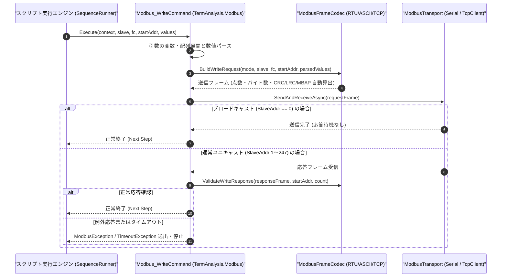

# コマンドリファレンス：Modbus_Write

---

## 概要

**Modbus_Write** は、指定されたスレーブ局番（Slave ID）の Modbus 機器に対して書き込みファンクションコード（FC05: 単一コイル書込、FC06: 単一保持レジスタ書込、FC15/`0F`: 複数コイル書込、FC16/`10`: 複数保持レジスタ書込）の要求フレームを自動生成・送信し、スレーブからの正常エコー応答（または書き込み点数応答）を検証するコマンドです。

> 💡 **補足**: 書き込みデータ（第 4 引数 `Values`）にカンマ区切りで複数値を指定した場合、FC16（`10h`）のバイト数・点数フィールドおよび CRC-16 / LRC / MBAP ヘッダをすべて自動計算してフレームを構築します。

---

## 💡 書式・パラメータ仕様

### コマンド構文

```csv
,SEQUENCE,Modbus_Write, "<SlaveAddr>", "<FuncCode>", "<StartAddr>", "<Values>"
```

### パラメータ（引数）一覧

| 引数位置 | パラメータ名 | 必須/任意 | 型・制約 | 説明 |
| :---: | :--- | :---: | :--- | :--- |
| 第1引数 | `SlaveAddr` | **必須** | 整数または16進表記（`0`〜`247`、`0`はブロードキャスト） | 通信対象のスレーブアドレス（局番）を指定します。 |
| 第2引数 | `FuncCode` | **必須** | `"05"` / `"06"` / `"0F"`(`"15"`) / `"10"`(`"16"`) | 書き込み用 Modbus ファンクションコードを指定します（`06`: 単一レジスタ書込、`10`: 複数レジスタ書込等）。 |
| 第3引数 | `StartAddr` | **必須** | 整数または4桁16進（例: `"0000"`, `"200"`） | 書き込み開始レジスタアドレス（0オリジン相対アドレス）を指定します。 |
| 第4引数 | `Values` | **必須** | 数値・16進文字列（複数時はカンマ区切り `"100,200"`）または配列名 `#ARR` | 書き込むデータ値を指定します。複数ワードをカンマ区切りで指定する場合はダブルクォーテーション `""` で囲みます。 |

---

## 🔄 特殊置換規約・分岐規約の適用

1. **カンマ区切り複数データの保護**:
   - FC16（`10h`）で複数ワードを書き込む際、`"000A,0014,001E"` のようにダブルクォーテーションで囲むことで単一の第 4 引数として渡されます。
2. **変数・配列展開（`$` / `@` / `#`）**:
   - 第 4 引数に `$SET_VAL` などのスカラー変数、または `#WRITE_ARRAY` のような配列識別子を直接指定して一括書き込みを行うことができます。

---

## 💡 動作例（正しい構文での記述例）

### スクリプト記述例

```csv
,PARAM,TARGET_RPM,1500

,SEQUENCE,Modbus_Mode, "RTU", "19200,E,8,1", "NONE"
,SEQUENCE,Modbus_Open

; 1. 単一保持レジスタ書込 (FC06): アドレス0001hへ $TARGET_RPM (1500) を書き込む
,SEQUENCE,Modbus_Write, "1", "06", "0001", "$TARGET_RPM"

; 2. 複数保持レジスタ書込 (FC16 / 10h): アドレス0010hから3ワード連続書き込み
,SEQUENCE,Modbus_Write, "1", "10", "0010", "100,200,300"

,SEQUENCE,Modbus_Close
,SEQUENCE,Exit
```

### 実行時の挙動・変数変化

1. 1 回目の `Modbus_Write` では FC06 フレームが送信され、スレーブからの同一フレームエコーバック応答の CRC-16 が検証されます。
2. 2 回目の `Modbus_Write` では FC16（`0x10`）フレームとして点数 `3`、バイト数 `6` が自動計算されて送信され、応答の書き込み完了点数（`3` ワード）が照合されます。

---

## 🔄 動作フロー（シーケンス図）



---

## 🚫 エラーハンドリング・安全設計（仕様制限）

1. **ファンクションコードとデータ点数の整合性検証**:
   - 単一書き込み（FC05 / FC06）に対して 2 個以上の値が指定された場合、送信前に `ArgumentException` を送出してプロトコル違反を防止します。
2. **ブロードキャスト（局番 `0`）時の応答待機スキップ**:
   - スレーブアドレスに `"0"`（RTU/ASCII ブロードキャスト）が指定された場合は、スレーブからの応答が返らない仕様であるため、送信完了後に応答待機を行わず規定ディレイのみで次ステップへ進みます。

---

## 🧪 ユニットテスト仕様

### テスト実行前提条件
- **対象クラス**: `TermAnalysis.Modbus.Modbus_WriteCommand`（`Modbus_WriteCommand.cs`）
- **モック環境**: `IModbusTransportAdapter` モックが注入されていること。

### テストケース一覧

| テストID | テスト観点 | 入力スクリプト | 期待される動作・検証項目 |
| :--- | :--- | :--- | :--- |
| `UT-MODBUS-WRITE-01` | 正常系（FC06 単一書込） | `,SEQUENCE,Modbus_Write, "1", "06", "0001", "1500"` | FC06 要求フレーム（値 `0x05DC`）が送信され、エコー応答確認後に正常終了すること。 |
| `UT-MODBUS-WRITE-02` | 正常系（FC16 複数書込） | `,SEQUENCE,Modbus_Write, "1", "10", "0010", "10,20"` | 点数 `2`・バイト数 `4` の FC16 フレームが構築・送信されること。 |
| `UT-MODBUS-WRITE-03` | 異常系（FC06に複数値指定） | `,SEQUENCE,Modbus_Write, "1", "06", "0001", "10,20"` | 送信前に `ArgumentException` が送出されること。 |

