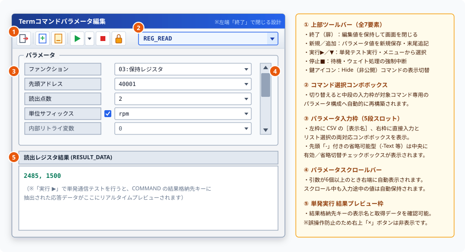

# コマンド編集画面取扱説明書 (User Manual)

👉 [← メイン画面取扱説明書に戻る](./メイン画面取扱説明書.Md)  
👉 [→ プロパティ設定画面取扱説明書](./プロパティ設定画面取扱説明書.Md) ／ [→ Excelアドイン取扱説明書](./Excelアドイン取扱説明書.Md)

---

本書は、Term 通信制御・シーケンス実行システムにおいて、選択したマクロコマンドの引数（パラメータ）の入力・単発テスト実行・応答結果のテキスト保存、および Excel ワークシートへのシーケンス配置を行う **「コマンド編集画面（Termコマンドパラメータ編集）」** の取扱説明書です。

---

# 目次

- [第 1 章 概要と 2 つの使い方](#第-1-章-概要と-2-つの使い方)
  - [1.1 本画面の役割](#11-本画面の役割)
  - [1.2 2 通りの開き方と動作の違い](#12-2-通りの開き方と動作の違い)
  - [1.3 タイトルバー右上に `×` ボタンが無い理由](#13-タイトルバー右上に--ボタンが無い理由)
- [第 2 章 画面の構成と各部の詳細](#第-2-章-画面の構成と各部の詳細)
  - [2.1 画面全体イメージ](#21-画面全体イメージ)
  - [2.2 上部ツールバー（全 7 要素）の詳細](#22-上部ツールバー全-7-要素の詳細)
  - [2.3 コマンド選択・パラメータ入力エリア・結果欄の詳細](#23-コマンド選択パラメータ入力エリア結果欄の詳細)
- [第 3 章 実践ガイド（2 つの基本ワークフロー）](#第-3-章-実践ガイド2-つの基本ワークフロー)
  - [3.1 手順 1：PLC 読出コマンドを単発テスト実行して結果を保存する](#31-手順-1plc-読出コマンドを単発テスト実行して結果を保存する)
  - [3.2 手順 2：Excel シートへ 2 行 1 ステップのシーケンス行を配置する](#32-手順-2excel-シートへ-2-行-1-ステップのシーケンス行を配置する)
- [第 4 章 設定の自動保存・復元とトラブルシューティング（FAQ）](#第-4-章-設定の自動保存復元とトラブルシューティングfaq)

---

# 第 1 章 概要と 2 つの使い方

## 1.1 本画面の役割

**コマンド編集画面 ** （ウィンドウタイトル： **「Termコマンドパラメータ編集」** ）は、登録されているマクロスクリプト（CSV 定義）からコマンドを選択し、そのコマンドに必要なパラメータ（ポート名、送信文字列、デバイス番地、読出点数、タイムアウト値など）を画面上で入力・確認するための専用エディタです。

CSV の定義に応じて入力欄（テキストボックスや選択肢ドロップダウン）が自動生成され、6 個以上のパラメータを持つコマンドでもスクロールバーを使って安全に編集できます。

## 1.2 2 通りの開き方と動作の違い

1. **メイン画面から開く場合（単発テスト・デバッグ用）**:
   * メイン画面ツールバーの **「コマンドパラメータ設定」** アイコンをクリックして開きます。
   * Excel シートに並べる前に、パラメータを変えながら **`実行`** ボタンで単発テストを行い、実機や仮想機器（TermEmulator）から期待どおりの応答が返るかを確認できます。
2. **Excel アドインから開く場合（シートへのシーケンス配置用）**:
   * Excel のリボン **`[アドイン]` ➔ `[Term制御]` ➔ `[シーケンス配置]`** をクリックし、「タスク番号の選択」ダイアログで対象タスク（`P1`〜`P10`）を選ぶと、本画面がモーダル表示されます。
   * 配置したいコマンドを選んでパラメータの初期値を設定し、左端の **`終了`** ボタンで閉じると、Excel シートの選択セルへ **2 行 1 ステップのシーケンス行** が自動生成されます。

## 1.3 タイトルバー右上に `×` ボタンが無い理由

> [!NOTE]
> **誤破棄防止の安全設計**  
> 入力途中のパラメータ値を誤って破棄する操作ミスを防ぐため、タイトルバー右上の `×` ボタンは意図的に非表示としています。画面を閉じる際は、必ずツールバー左端の **`終了`** ボタンを使用してください。

---

# 第 2 章 画面の構成と各部の詳細

## 2.1 画面全体イメージ

画面は上から **① 上部ツールバー（7 要素） ** 、 **② コマンド選択コンボボックス ** 、 **③ パラメータ設定エリア（最大 5 段同時表示＋スクロールバー） ** 、 **④ 下部・結果／応答テキスト欄** で構成されています。

---

## 2.2 上部ツールバー（全 7 要素）の詳細

| ボタン / 要素名 | 有効タイミング・状態変化 | 詳しい機能と利用シーン |
| :--- | :--- | :--- |
| **`終了`** | 常時クリック可能 | 編集中のパラメータ値を内部保持したまま画面を閉じます。 ※Excel アドインの **`[シーケンス配置]`** から開いている場合は、ここで選択・編集したコマンドとパラメータ値を用いて Excel シートへの自動配置へ進みます。 |
| **`新規`** | 常時クリック可能 | 画面下部の「結果／応答テキスト欄」の文字列（空欄時は現在コマンドの最終パラメータ値）を、 **Shift_JIS** 形式で新しいテキストファイルへ上書き保存します。 ※元の CSV マクロ定義ファイルを上書きする機能ではありません。 |
| **`追加`** | 常時クリック可能 | 「結果／応答テキスト欄」の文字列（空欄時は最終パラメータ値）を、指定した既存テキストファイルの末尾へ **Shift_JIS** 形式で追記保存します。複数回の単発実行結果を 1 つのファイルへ蓄積したいときに便利です。 |
| **`実行`** | 待機時にクリック可能 | 現在入力しているパラメータ値を使って選択中コマンドを単発実行します。実行結果は画面下部の結果テキスト欄へ表示されます（エラー発生時はエラー詳細を表示）。 |
| **`コマンド選択` (`▼`)** | ドロップダウン選択 | 現在有効なすべてのマクロスクリプトから、編集・実行したいコマンドを素早く切り替えます。 |
| **`停止`** | コマンド実行中のみ有効 | 実行中の通信送信、プロンプト待機（`Com_WaitPrompt` / `Telnet_WaitPrompt` 等）、または待機コマンドを緊急強制中断します。相手機器が無応答で戻らないときに使用します。 |
| **`表示切替`** | ** 施錠アイコン ** ＝ 公開のみ ** 開錠アイコン ** ＝ 全表示 | 非公開属性（`Hide`）が付いた内部サブルーチンコマンドを表示するか隠すかをトグル切替し、切り替えた状態を **`Setting.xml`（`VisibleCont`）へ即座に保存 ** します。 ・ ** 施錠 **: 公開コマンドのみ表示（通常運用での誤選択防止） ・ ** 開錠**: 非公開コマンドも含めて全表示（開発・デバッグ向け） |

---

## 2.3 コマンド選択・パラメータ入力エリア・結果欄の詳細

### 1. コマンド選択コンボボックス
編集・実行対象とするコマンドを選びます。切り替えると同時に、中央のパラメータ設定エリアがそのコマンドに必要な項目名・入力枠・ドロップダウン選択肢へ自動で切り替わります。

### 2. パラメータ設定エリアとスクロールバー
* 中央のパラメータ設定枠には最大 5 段分の入力行が同時表示されます。
* パラメータ数が 6 個以上あるコマンドでは、右側の **スクロールバー** が有効になり、上下スクロールで全項目を編集できます。
* スクロール操作を行っても、画面外へ移動した項目の入力値は自動的に内部保持されるため消えることはありません。

### 3. 下部・結果／応答テキスト欄
* **`実行`** ボタンでコマンドを実行した結果の戻り値（読み出したレジスタ値や応答文字列）またはエラーメッセージが表示されます。
* 表示されたテキストは選択コピーできるほか、ツールバーの **`新規`** / **`追加`** ボタンでファイル出力できます。

---

# 第 3 章 実践ガイド（2 つの基本ワークフロー）

## 3.1 手順 1：PLC 読出コマンドを単発テスト実行して結果を保存する

仮想 PLC（TermEmulator）または実機 PLC から `D100` レジスタの値を 1 回だけ読み出して確認する手順です。

1. メイン画面で通信モードとプロパティ（接続先 IP や COM ポート）を設定しておきます。
2. メイン画面ツールバーの **「コマンドパラメータ設定」** アイコンをクリックして本画面を開きます。
3. コマンド選択コンボから **`Mc_ReadWord`** （または **`Modbus_Read`** / **`Fins_ReadWord`** / **`Kv_ReadWord`** 等）を選択します。
4. 中央のパラメータ欄に、たとえば「開始デバイス: **`D100`** 」「点数: **`1`** 」と入力します。
5. ツールバーの **`実行`** ボタンをクリックします。
6. 通信が成功すると、画面下部の結果テキスト欄に読み出した値（例: `1234`）が表示されます。
7. 結果をテキストファイルへ保存したい場合は **`新規`** （追記なら **`追加`** ）をクリックして保存先を指定し、最後に左端の **`終了`** ボタンで画面を閉じます。

---

## 3.2 手順 2：Excel シートへ 2 行 1 ステップのシーケンス行を配置する

1. Excel シート上でコマンドを配置したいセル（例: `A5`）を選択します。
2. リボンの **`[アドイン]` ➔ `[Term制御]` ➔ `[シーケンス配置]`** をクリックし、「タスク番号の選択」ダイアログで対象タスク（例: `P1`）を選択します。
3. 本画面（コマンド編集画面）が開いたら、コマンド選択コンボで目的のコマンドを選び、パラメータの初期値を入力します。
4. ツールバー左端の **`終了`** ボタンをクリックすると画面が閉じ、Excel シートへ実行ボタン・待機時間・コマンド名・結果・公開パラメータ列が 2 行構成で自動配置されます。

---

# 第 4 章 設定の自動保存・復元とトラブルシューティング（FAQ）

### 自動保存される情報
* **ウィンドウ位置・サイズ**: タスク別の `Setting.xml`（`Point` セクション）へ自動保存・復元されます。
* **非公開コマンド表示状態**: `表示切替` の施錠／開錠状態は全タスク共通の `Common / Properties / VisibleCont` へ即時保存されます。
* **入力中パラメータ値**: スクロール時や画面を閉じた後も自動的に保持されます。

### よくある質問（FAQ）

#### Q1. 画面を閉じる `×` ボタンが右上にありません。
* 編集途中のパラメータを誤って破棄しないための仕様です。ツールバー左端の **`終了`** ボタンで閉じてください。

#### Q2. CSV に定義した内部サブルーチンコマンドがリストに表示されません。
* ツールバー右端の **`表示切替`** ボタンが「施錠（隠蔽中）」になっている可能性があります。クリックして「開錠（全表示）」へ切り替えてください。

#### Q3. パラメータが多くてスクロールしたら、上に入力した値が消えてしまいませんか？
* 消えません。スクロール操作を行った場合でも、入力した値は内部バッファに自動保持されます。

#### Q4. `実行` ボタンを押しても「接続されていません」等のエラーになります。
* `Modbus_Read` や `Mc_ReadWord` 等のデータ送受信コマンドを実行する前に、対応するオープンコマンド（`Modbus_Open` / `Mc_Open` 等）を実行して回線を開いているか確認してください（`RS-232C` モードの場合はメイン画面で「ポートを開く」が緑 LED になっているか、または `Com_Open` を実行済みか確認してください）。
