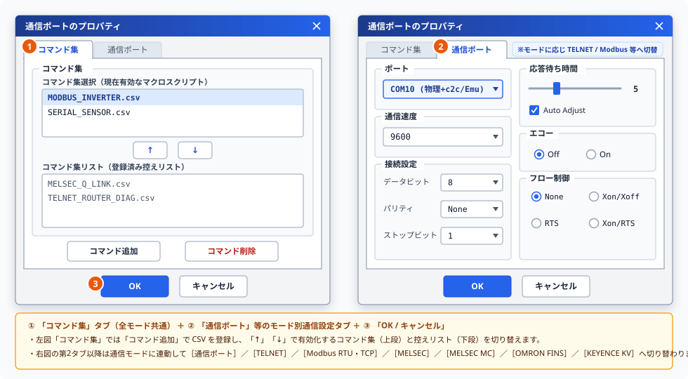

# プロパティ設定画面取扱説明書 (User Manual)

👉 [← メイン画面取扱説明書に戻る](./メイン画面取扱説明書.Md)  
👉 [→ コマンド編集画面取扱説明書](./コマンド編集画面取扱説明書.Md) ／ [→ Excelアドイン取扱説明書](./Excelアドイン取扱説明書.Md)

---

本書は、Term 通信制御システムにおいて、マクロスクリプト（コマンド集）の登録・有効化、および全 7 通信プロトコル（RS-232C シリアル / Telnet / Modbus RTU・TCP / MELSEC 計算機リンク / MELSEC MC プロトコル / OMRON FINS・HostLink / KEYENCE KV 上位リンク）の接続条件を設定する **「プロパティ設定画面（通信ポートのプロパティ）」** の総合取扱説明書です。

---

# 目次

- [第 1 章 概要・タブ表示の仕組みと保存の最重要ルール](#第-1-章-概要タブ表示の仕組みと保存の最重要ルール)
  - [1.1 本画面の役割と開き方](#11-本画面の役割と開き方)
  - [1.2 画面全体イメージ](#12-画面全体イメージ)
  - [1.3 【最重要】`[OK]` ボタンは「今開いているタブ 1 つだけ」を保存します](#13-最重要ok-ボタンは今開いているタブ-1-つだけを保存します)
- [第 2 章 共通タブおよび通信アドイン別設定タブ](#第-2-章-共通タブおよび通信アドイン別設定タブ)
  - [2.1 「コマンド集」タブ（全モード共通・常時表示）](#21-コマンド集タブ全モード共通常時表示)
  - [2.2 通信アドイン別設定タブ（各アドイン専用取扱説明書）](#22-通信アドイン別設定タブ各アドイン専用取扱説明書)
- [第 3 章 画面上の全ボタン一覧](#第-3-章-画面上の全ボタン一覧)
- [第 4 章 共通操作ガイド（コマンド集の登録と 2 ステップ保存）](#第-4-章-共通操作ガイドコマンド集の登録と-2-ステップ保存)
- [第 5 章 設定の自動保存・監査ログとトラブルシューティング（FAQ）](#第-5-章-設定の自動保存監査ログとトラブルシューティングfaq)

---

# 第 1 章 概要・タブ表示の仕組みと保存の最重要ルール

## 1.1 本画面の役割と開き方

**プロパティ設定画面 ** （ウィンドウタイトル： **「通信ポートのプロパティ」 ** ）は、メイン画面の **`[通信ポート(C)] ➔ [プロパティ(P)]`** またはツールバーの ** 「プロパティ」** アイコンから開きます。

本画面は、常に第 1 タブとして表示される **「コマンド集」タブ ** と、メイン画面の **`[通信モード(M)]`** で選択されているモードに連動して切り替わる ** プロトコル別設定タブ（全 8 タブ）** で構成されています。設定内容はタスク別の `Setting.xml`（`Monaca Term` / `Monaca Term-2`〜`Monaca Term-10`）へ保存されます。

## 1.2 画面全体イメージ

## 1.3 【最重要】`[OK]` ボタンは「今開いているタブ 1 つだけ」を保存します

> [!IMPORTANT]
> **複数タブを変更するときの必須手順**  
> 他のタブに入力途中の値が残っていた場合の誤上書きを防ぐため、画面下部の **`[OK]`** ボタンは ** 「クリックした時点で前面に表示されているタブ 1 つだけ」** を検証して `Setting.xml` へ保存する仕様になっています。
>
> したがって、「コマンド集」タブと「通信ポート（または各 PLC プロトコル）」タブの両方を変更したい場合は、以下の **2 ステップ** で操作してください。
> 1. 1 つ目のタブ（例: `コマンド集`）を編集し、 **`[OK]`** をクリックして保存確定する（画面が閉じます）。
> 2. 再度メイン画面からプロパティを開き、2 つ目のタブ（例: `通信ポート`）を編集して **`[OK]`** をクリックして保存確定する。

---

# 第 2 章 共通タブおよび通信アドイン別設定タブ

## 2.1 「コマンド集」タブ（全モード共通・常時表示）

機器やプロトコルごとのマクロスクリプト（CSV / TXT）を管理し、メイン画面・コマンド編集画面・Excel アドインで使用するコマンド群を選び出すタブです（図中 **①** 、`Command` セクションへ保存）。

* **上段：`コマンド集選択`（現在有効）**:
  ここに並んでいるスクリプトに含まれるコマンドが、メイン画面の実行ドロップダウン、コマンド編集画面、および Excel の「シーケンス配置」で利用可能になります（スクリプト内の `TITLE` 名、未定義時はファイル名を表示）。
* **下段：`コマンド集リスト`（控えリスト）**:
  **`コマンド追加`** で新しく読み込んだスクリプトは、まずこの下段リストへ入ります。中央の **`[ ↑ ]`** ボタンで上段へ移動すると有効化され、 **`[ ↓ ]`** ボタンで下段へ戻すと一時無効化（控えへ退避）されます。

> [!TIP]
> **`.csv` ファイルを選ぶときの注意**:
> **`コマンド追加`** を押して開くファイル選択ダイアログの初期フィルタは `*.txt` になっています。マクロスクリプトの **`.csv` ファイル** を選ぶ際は、ファイル選択ダイアログ右下のファイル種類プルダウンを **`すべてのファイル (*.*)`** へ切り替えてください。

---

## 2.2 通信アドイン別設定タブ（各アドイン専用取扱説明書）

メイン画面の **`[通信モード(M)]`** で選択したモードに応じて、導入済みアドイン専用のプロパティ設定タブが動的に表示されます。各アドイン固有の画面構成・設定項目・接続手順は、以下のアドイン別取扱説明書を参照してください。

| 通信モード | 表示される専用タブ | 対象アドイン | 専用取扱説明書 |
| :--- | :--- | :--- | :--- |
| **`RS-232C`** | `通信ポート` タブ | `TermAddIn_Comm` | [Comm アドイン取扱説明書](./Comm/Comm取扱説明書.Md) |
| **`TELNET`** | `TELNET` タブ | `TermAddIn_Telnet` | [Telnet アドイン取扱説明書](./Telnet/Telnet取扱説明書.Md) |
| **`MODBUS`** | `Modbus RTU` / `Modbus TCP` タブ（最大 32 CH） | `TermAddIn_Modbus` | [Modbus アドイン取扱説明書](./Modbus/Modbus取扱説明書.Md) |
| **`MELSEC`** | `MELSEC` タブ（計算機リンク 形式 1〜5） | `TermAddIn_Melco` | [Melco アドイン取扱説明書](./Melco/Melco取扱説明書.Md) |
| **`MELSEC MC`** | `MELSEC MC` タブ（QnA 互換 3E） | `TermAddIn_MelcoMC` | [MelcoMC アドイン取扱説明書](./MelcoMC/MelcoMC取扱説明書.Md) |
| **`OMRON FINS / Sysmac`** | `OMRON FINS` タブ（UDP / TCP / HostLink） | `TermAddIn_Omron` | [Omron アドイン取扱説明書](./Omron/Omron取扱説明書.Md) |
| **`KEYENCE KV 上位リンク`** | `KEYENCE KV` タブ（TCP / UDP / Serial） | `TermAddIn_Keyence` | [Keyence アドイン取扱説明書](./Keyence/Keyence取扱説明書.Md) |
| **`LXI_RAW`** | `LXI Raw` タブ（SCPI Raw Socket `5025`） | `TermAddIn_LxiRaw` | [LxiRaw アドイン取扱説明書](./LxiRaw/LxiRaw取扱説明書.Md) |
| **`LXI_VXI11`** | `LXI VXI-11` タブ（ONC RPC / `111`） | `TermAddIn_LxiVxi11` | [LxiVxi11 アドイン取扱説明書](./LxiVxi11/LxiVxi11取扱説明書.Md) |
| **`LXI_HISLIP`** | `LXI HiSLIP` タブ（TCP `4880` / TLS 2.0） | `TermAddIn_LxiHiSlip` | [LxiHiSlip アドイン取扱説明書](./LxiHiSlip/LxiHiSlip取扱説明書.Md) |
| **`LXI_EVENT`** | `LXI Event` タブ（UDP `5044` / Event Logs） | `TermAddIn_LxiEvent` | [LxiEvent アドイン取扱説明書](./LxiEvent/LxiEvent取扱説明書.Md) |
| **`LXI_SYNC`** | `LXI Sync` タブ（IEEE 1588 PTPv2 / WTB） | `TermAddIn_LxiSync` | [LxiSync アドイン取扱説明書](./LxiSync/LxiSync取扱説明書.Md) |
| **`LXI_MULTI`** | `LXI Multi` タブ（複数 LXI 機器エイリアス管理） | `TermAddIn_LxiMulti` | [LxiMulti アドイン取扱説明書](./LxiMulti/LxiMulti取扱説明書.Md) |

---

# 第 3 章 画面上の全ボタン一覧

| ボタン名 | 配置場所 | 詳しい動作内容 |
| :--- | :--- | :--- |
| **`コマンド追加`** | 「コマンド集」タブ | ファイル選択ダイアログを開き、マクロスクリプトを下段の控えリストへ追加します（`.csv` 選択時は右下のファイル種類を `すべてのファイル (*.*)` へ切替）。 |
| **`コマンド削除`** | 「コマンド集」タブ | 下段の控えリストで選択中のスクリプトを削除します（※上段の有効項目を削除したい場合は、先に `[ ↓ ]` で下段へ移動してください）。 |
| **`[ ↑ ]`** / **`[ ↓ ]`** | 「コマンド集」タブ | 下段（控え）と上段（有効）の間でスクリプトを移動し、有効／無効を切り替えます。 |
| **`OK`** | ダイアログ最下部 | ** 現在前面に表示されているタブ 1 つだけ** の入力値を検証し、`Setting.xml` へ保存して画面を閉じます。 |
| **`キャンセル`** | ダイアログ最下部 | 現在表示中タブの未保存変更を破棄し、保存済み設定へ戻して画面を閉じます。 |

---

# 第 4 章 共通操作ガイド（コマンド集の登録と 2 ステップ保存）

`[OK]` は表示中 1 タブのみ保存するため、「コマンド集」タブと「通信アドイン専用タブ」の両方を設定する場合は以下の 2 ステップで行います。

1. **ステップ 1（コマンド集の登録）**:
   1. メイン画面で **`[通信ポート(C)] ➔ [プロパティ(P)]`** を開き、 **「コマンド集」** タブを表示します。
   2. **`コマンド追加`** をクリックし、ダイアログ右下の種類を **`すべてのファイル (*.*)`** に変えて対象 `.csv` ファイルを選択します。
   3. 下段リストに追加された項目を選び、 **`[ ↑ ]`** ボタンで上段の `コマンド集選択` へ移動します。
   4. 下部の **`[OK]`** をクリックして保存確定します（いったん画面が閉じます）。
2. **ステップ 2（各通信アドイン専用タブの設定）**:
   1. メイン画面の **`[通信モード(M)]`** で使用する通信モードを選択したうえで、再度 **`[通信ポート(C)] ➔ [プロパティ(P)]`** を開きます。
   2. 表示された専用タブ（`通信ポート` / `TELNET` / `Modbus` / `MELSEC` / `MELSEC MC` / `OMRON FINS` / `KEYENCE KV` 等）で接続先や条件を入力し、 **`[OK]`** をクリックして保存確定します。
   3. 各通信モード固有の設定手順・具体例は、第 2 章（§2.2）の各アドイン専用取扱説明書を参照してください。

---

# 第 5 章 設定の自動保存・監査ログとトラブルシューティング（FAQ）

### 保存先と監査ログ
* ウィンドウ座標 `(X, Y)` および各タブの通信パラメータは、タスク別の **`%USERPROFILE%\Desktop\Monaca\Setting.xml`** へ保存されます。
* `[OK]` 確定時の設定変更差分は、既定 **`%USERPROFILE%\Desktop\Monaca\info.log`** へ `- SAVE     -` 区分で自動記録されます。

### よくある質問（FAQ）

#### Q1. 「コマンド集」と「通信ポート」の両方を編集して `[OK]` を押したのに、片方が元に戻ってしまいました。
* **`[OK]` ボタンは現在開いている 1 タブのみを保存する仕様** です。1 つ目のタブで `[OK]` を押して確定した後、再度プロパティを開いて 2 つ目のタブで `[OK]` を押してください。

#### Q2. `コマンド追加` を押しても `.csv` ファイルが一覧に表示されません。
* ファイル選択ダイアログの初期フィルタが `*.txt` になっています。ダイアログ右下のプルダウンを **`すべてのファイル (*.*)`** へ切り替えてください。

#### Q3. 通信中にボーレートや COM ポートを変更して `[OK]` したのに反映されません。
* すでに回線がオープンされている状態では、既存の接続パラメータのまま維持されます。一度「ポートを閉じる」（または `*_Close` コマンド）で切断してから、再度オープンしてください。

#### Q4. `c2c` や `TermEmulator` で作った仮想 COM ポート（`COM10` や `COM20` 等）がドロップダウンに出てきません。
* `c2c` または `TermEmulator` が稼働中（待受中）であることを確認したうえで、プロパティ設定画面を一度閉じて開き直す（または `[ 更新 ]` / `[ 再検索 ]` ボタンを押す）と最新の公開仮想 COM ポートが一覧に反映されます。
