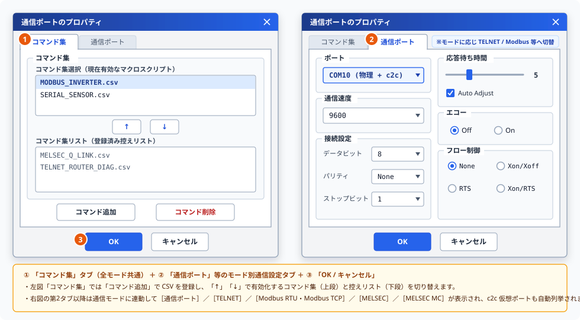

# プロパティ設定画面取扱説明書 (User Manual)

本ドキュメントは、Term 通信制御システムにおけるマクロスクリプト（コマンド集）の登録および各種通信プロトコル（COM シリアル / Telnet / Modbus / MELSEC 計算機リンク / MELSEC MCプロトコル）の通信パラメータを編集するための設定画面 **「プロパティ設定画面」** の取扱説明書です。

---

## 📖 1. 概要
プロパティ設定画面（`TermPropertiesForm`）は、共通プロパティ基底（`PropertyDialogBase`）を継承した動的プラグインホスト画面であり、システムで使用するコマンド定義ファイル（CSV）や各通信インターフェースの接続条件を一元管理します。
構成定義ファイル（`TermProperties.json`）に基づき、導入されている通信プラグインのタブを動的にロードして表示し、設定内容を `Setting.xml` へ保存します。

---

## 🗂️ 2. タブ構成と機能説明
プロパティ設定画面（ウィンドウタイトル： **「通信ポートのプロパティ」** ）は、全モード共通の第 1 タブ **「コマンド集」** と、メイン画面の「通信モード」に連動して切り替わる通信プロトコル別タブで構成されています。設定したい内容に応じてタブを切り替えて操作します。

### 🔘 ① 「コマンド集」タブ（コマンド選択：`TermAnalysis.dll`）
システムで使用するマクロスクリプト（CSV コマンド定義ファイル）を選択・管理するための全モード共通タブです（上図 左側 **①** ）。
*   **コマンド集の登録・有効化切替**: 下部の **「コマンド追加」** で機器やプロトコルごとのマクロスクリプト（CSV ファイル）を登録し、中央の **`[ ↑ ]`** / **`[ ↓ ]`** ボタンで上段の **「コマンド集選択（現在有効）」** と下段の **「コマンド集リスト（控え）」** を切り替えます。
*   **コマンド定義の即時反映**: 有効化されて **`[ OK ]`** （ **③** ）で確定されたコマンド集は `TermList`（共通 `CommandManager`）へ読み込まれ、メイン画面の「コマンド実行」、コマンド編集画面、および Excel アドインの「シーケンス配置」ドロップダウンへ即座に反映されます。

### 🔘 ② 「通信ポート」タブ（シリアル通信：`TermAnalysis.Comm.dll`）
RS-232C / UART シリアル通信（[`Com_Open`](./Comm/Com_Open.Md) 等の `Com_*` コマンド）で使用する COM ポートの通信条件を設定するタブです（上図 右側 **②** ）。
*   **ポート (Port)**: 使用する PC の物理 COM ポート番号（`COM1` 〜 `COM256`）または公式無償ツール **[c2c](https://github.com/Monaca-App/c2c)** が公開中の仮想 COM ポート（例: `COM10`, `COM11` 等、自然順で自動列挙）を選択します。
*   **通信速度 (Baud Rate)**: 通信ボーレート（例: `9600`, `19200`, `38400`, `57600`, `115200` bps 等）を指定します。
*   **接続設定**: **データビット** （`7` / `8`）、 **パリティ** （`None` / `Odd` / `Even`）、および **ストップビット** （`1` / `1.5` / `2`）を指定します。
*   **応答待ち時間・エコー・フロー制御**: 応答待ち時間スライダー（`0`〜`20` および `Auto Adjust` 自動調整）、ローカルエコー（`Off` / `On`）、およびフロー制御（`None` / `Xon/Xoff` / `RTS` / `Xon/RTS`）を設定します。

### 🔘 ③ 「TELNET」タブ（`TermAnalysis.Telnet.dll`）
TCP/IP ネットワーク経由の Telnet 通信（[`Telnet_Open`](./Telnet/Telnet_Open.Md) 等の `Telnet_*` コマンド）で使用する接続先パラメータを設定するタブです。
*   **TELNET 接続設定**: 接続先 **ホスト / IPアドレス** （例: `192.168.0.10`）および **ポート番号** （標準 `23`、`[ 標準 (23) ]` ワンクリック設定ボタン付き）を設定します。
*   **通信パラメータ設定**: 接続タイムアウト（秒）、送信改行コード（`CRLF` / `CR` / `LF`）、およびローカルエコー有効有無を設定します。

### 🔘 ④ 「Modbus RTU」 / 「Modbus TCP」タブ（`Monaca.ModBus.dll`）
産業用 Modbus プロトコル通信（[`Modbus_Open`](./Modbus/Modbus_Open.Md) 等の `Modbus_*` コマンド）で使用する 32 チャネル（`CH01`〜`CH32`、`[ 全CHへ複製 ]` 対応）の接続条件を設定するタブです。
*   **「Modbus RTU」タブ**: 使用 COM ポート（`[ 更新 ]` ボタンで物理 COM と **[c2c](https://github.com/Monaca-App/c2c)** 仮想 COM を再スキャン可能）、ボーレート、データ長、パリティ、ストップビット、フロー制御、`DTR` / `RTS` 信号有効、送受信タイムアウト（ms）、リトライ回数、およびスレーブアドレス（`1` 〜 `247`）を設定します。
*   **「Modbus TCP」タブ**: 接続先ホスト/IP、TCP ポート番号（標準 `502`、`[ 標準 (502) ]` ボタン付き）、Unit ID、`KeepAlive 有効`、リトライ回数、および接続・送受信タイムアウト（ms）を設定します。

### 🔘 ⑤ 「MELSEC」タブ（`TermAnalysis.Melco.dll`）
三菱電機 MELSEC 計算機リンク通信（[`Melsec_Open`](./Melco/Melsec_Open.Md) 等の `Melsec_*` コマンド）で使用する通信条件を設定するタブです。
*   **プロトコル形式・局番設定**: 形式1〜形式5（`形式1` 〜 `形式5`）、対象シーケンサの局番号（0〜31）、PC番号（0〜255）、およびサムチェック自動照合を設定します。
*   **シリアル通信・タイムアウト設定**: 使用 COM ポート（物理 COM または **[c2c](https://github.com/Monaca-App/c2c)** 仮想 COM ポート）、ボーレート、データ長・パリティ、および待機・タイムアウト時間（ms）を設定します。

### 🔘 ⑥ 「MELSEC MC」タブ（`TermAnalysis.MelcoMC.dll`）
三菱電機 MELSEC MCプロトコル通信（[`Mc_Open`](./MelcoMC/Mc_Open.Md) 等の `Mc_*` コマンド）で使用するネットワーク通信条件を設定するタブです。
*   **通信プロトコル方式**: Ethernet 上の **TCP** または **UDP** ソケット通信を選択します。
*   **接続先ホスト / IP アドレス**: 接続先 PLC / Ethernet ユニットの IPv4 アドレス（例: `192.168.0.250`）を指定します。
*   **ポート番号**: 接続先 PLC で設定された通信ポート番号（例: `5000` / `5001` 等）を指定します。
*   **3E ルーティング情報**: ネットワーク番号、PC番号、要求先ユニットI/O番号、要求先ユニット局番、および監視タイマー値（250ms単位）を設定します。

---

## 🛠️ 3. 画面上のボタン説明 (個別機能)
画面下部に配置された共通操作ボタンおよび「コマンド選択」タブ内の操作ボタンの説明です。

### 🔘 コマンド追加 / 参照 ボタン（「コマンド選択」タブ内）
*   **機能**: 新しいマクロスクリプト（CSV ファイル）を参照してコマンド集リストに登録します。
*   **用途**: 制御対象機器や検査項目ごとのマクロ定義ファイルを追加し、Excel シートやメイン画面から呼び出せるようにしたい場合に使用します。

### 🔘 コマンド削除 ボタン（「コマンド選択」タブ内）
*   **機能**: 選択中のマクロスクリプト定義をリストから削除します。
*   **用途**: 使用しなくなったコマンド集の設定を取り除きたい場合に使用します。

### 🔘 確定 (OK) ボタン
*   **機能**: 現在アクティブなタブおよびコマンド選択で編集した設定内容を設定ファイル（`Setting.xml`）に保存・確定したうえで、プロパティ設定画面を閉じます。
*   **用途**: 変更した COM ポート番号、ボーレート、IP アドレス、または登録したコマンド集をシステムへ反映させたい場合にクリックします。

### 🔘 取消 (キャンセル) ボタン
*   **機能**: 今回画面を開いてから行った変更内容を破棄し、設定ファイルを更新せずに画面を閉じます。
*   **用途**: 誤って設定を変更してしまった場合や、変更を取りやめたい場合にクリックします。

---

## 💾 4. 設定の自動保存・復元と安全保護機能
本画面では、ユーザーの利便性と通信中の安全性を高めるため、以下の自動制御を行っています。

### ① 通信ポート接続中の編集ロック保護
*   メイン画面で通信ポートが接続中（オープン状態）である場合、誤動作や通信破綻を防止するため、プロパティ設定画面は `PortOpenStateProvider` による周期監視（1000ms 間隔）によって接続状態を自動検知し、通信パラメータの競合変更を安全に防止します。通信条件を変更する際は、一度ポートを「切断（クローズ）」してから設定を行ってください。

### ② 画面の表示位置の自動保存・復元
*   プロパティ設定画面を閉じる際、画面上の表示位置（座標）を自動的に設定ファイルへ保存します。次回起動時は、前回の表示位置に自動的に復元されます。

### ③ 確定時の設定変更履歴（監査ログ）自動記録
*   「確定」ボタンを押して通信ポート条件やコマンド定義を更新した際、変更前と変更後の差分内容が自動的に監査ログファイルへ記録されます（既定ではデスクトップの `Monaca\info.log` ですが、メイン画面のメニュー [環境設定...] ➔ [エラー履歴] から保存先やファイル名を変更可能です）。
*   複数人で共有する検査 PC 環境でも、いつ・どの通信設定が変更されたかの証跡が確実に残るため、安心して運用・保守を行えます。

