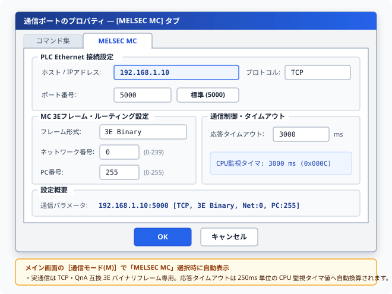
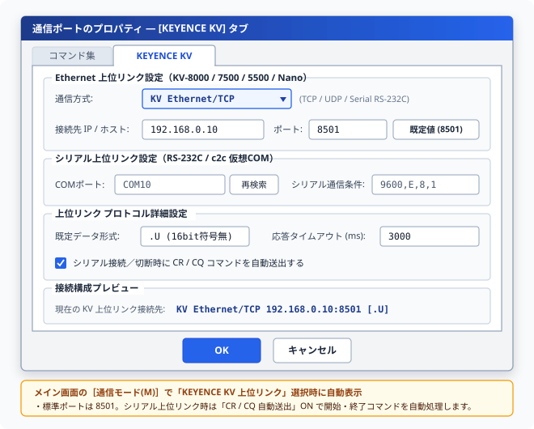

# プロパティ設定画面取扱説明書 (User Manual)

👉 [← メイン画面取扱説明書に戻る](./メイン画面取扱説明書.Md)  
👉 [→ コマンド編集画面取扱説明書](./コマンド編集画面取扱説明書.Md) ／ [→ Excelアドイン取扱説明書](./Excelアドイン取扱説明書.Md)

---

本書は、Term 通信制御システムにおいて、マクロスクリプト（コマンド集）の登録・有効化、および全 7 通信プロトコル（RS-232C シリアル / Telnet / Modbus RTU・TCP / MELSEC 計算機リンク / MELSEC MC プロトコル / OMRON FINS・HostLink / KEYENCE KV 上位リンク）の接続条件を設定する **「プロパティ設定画面（通信ポートのプロパティ）」** の総合取扱説明書です。

---

# 目次

- [第 1 章 概要・タブ表示の仕組みと保存の最重要ルール](#第-1-章-概要タブ表示の仕組みと保存の最重要ルール)
  - [1.1 本画面の役割と開き方](#11-本画面の役割と開き方)
  - [1.2 画面全体イメージ](#12-画面全体イメージ)
  - [1.3 【最重要】`[OK]` ボタンは「今開いているタブ 1 つだけ」を保存します](#13-最重要ok-ボタンは今開いているタブ-1-つだけを保存します)
- [第 2 章 全 8 タブの設定項目詳細リファレンス](#第-2-章-全-8-タブの設定項目詳細リファレンス)
  - [2.1 ① 「コマンド集」タブ（全モード共通・常時表示）](#21--コマンド集タブ全モード共通常時表示)
  - [2.2 ② 「通信ポート」タブ（RS-232C シリアル通信）](#22--通信ポートタブrs-232c-シリアル通信)
  - [2.3 ③ 「TELNET」タブ（Telnet ネットワーク通信）](#23--telnetタブtelnet-ネットワーク通信)
  - [2.4 ④ 「Modbus RTU」／「Modbus TCP」タブ（Modbus 通信・最大 32 CH）](#24--modbus-rtumodbus-tcpタブmodbus-通信最大-32-ch)
  - [2.5 ⑤ 「MELSEC」タブ（三菱電機 MELSEC 計算機リンク）](#25--melsecタブ三菱電機-melsec-計算機リンク)
  - [2.6 ⑥ 「MELSEC MC」タブ（三菱電機 MELSEC MC 3E）](#26--melsec-mcタブ三菱電機-melsec-mc-3e)
  - [2.7 ⑦ 「OMRON FINS」タブ（オムロン FINS / HostLink）](#27--omron-finsタブオムロン-fins--hostlink)
  - [2.8 ⑧ 「KEYENCE KV」タブ（キーエンス KV 上位リンク）](#28--keyence-kvタブキーエンス-kv-上位リンク)
- [第 3 章 画面上の全ボタン一覧](#第-3-章-画面上の全ボタン一覧)
- [第 4 章 実践ガイド（目的別の設定手順 3 パターン）](#第-4-章-実践ガイド目的別の設定手順-3-パターン)
  - [4.1 手順 1：CSV マクロスクリプトを登録し、`COM10` のシリアル条件を設定する](#41-手順-1csv-マクロスクリプトを登録しcom10-のシリアル条件を設定する)
  - [4.2 手順 2：TermEmulator の仮想 MELSEC MC 3E（ローカル PC）へ接続する](#42-手順-2termemulator-の仮想-melsec-mc-3eローカル-pcへ接続する)
  - [4.3 手順 3：Modbus TCP の複数チャネル（CH01〜CH32）を効率よく設定する](#43-手順-3modbus-tcp-の複数チャネルch01ch32を効率よく設定する)
- [第 5 章 設定の自動保存・監査ログとトラブルシューティング（FAQ）](#第-5-章-設定の自動保存監査ログとトラブルシューティングfaq)

---

# 第 1 章 概要・タブ表示の仕組みと保存の最重要ルール

## 1.1 本画面の役割と開き方

**プロパティ設定画面 ** （ウィンドウタイトル： **「通信ポートのプロパティ」 ** ）は、メイン画面の **`[通信ポート(C)] ➔ [プロパティ(P)]`** またはツールバーの ** 「プロパティ」** アイコンから開きます。

本画面は、常に第 1 タブとして表示される **「コマンド集」タブ ** と、メイン画面の **`[通信モード(M)]`** で選択されているモードに連動して切り替わる ** プロトコル別設定タブ（全 8 タブ）** で構成されています。設定内容はタスク別の `Setting.xml`（`Monaca Term` / `Monaca Term-2`〜`Monaca Term-10`）へ保存されます。

## 1.2 画面全体イメージ

## 1.3 【最重要】`[OK]` ボタンは「今開いているタブ 1 つだけ」を保存します

> [!IMPORTANT]
> **複数タブを変更するときの必須手順**  
> 他のタブに入力途中の値が残っていた場合の誤上書きを防ぐため、画面下部の **`[OK]`** ボタンは ** 「クリックした時点で前面に表示されているタブ 1 つだけ」** を検証して `Setting.xml` へ保存する仕様になっています。
>
> したがって、「コマンド集」タブと「通信ポート（または各 PLC プロトコル）」タブの両方を変更したい場合は、以下の **2 ステップ** で操作してください。
> 1. 1 つ目のタブ（例: `コマンド集`）を編集し、 **`[OK]`** をクリックして保存確定する（画面が閉じます）。
> 2. 再度メイン画面からプロパティを開き、2 つ目のタブ（例: `通信ポート`）を編集して **`[OK]`** をクリックして保存確定する。

---

# 第 2 章 全 8 タブの設定項目詳細リファレンス

## 2.1 ① 「コマンド集」タブ（全モード共通・常時表示）

機器やプロトコルごとのマクロスクリプト（CSV / TXT）を管理し、メイン画面・コマンド編集画面・Excel アドインで使用するコマンド群を選び出すタブです（図中 **①** 、`Command` セクションへ保存）。

* **上段：`コマンド集選択`（現在有効）**:
  ここに並んでいるスクリプトに含まれるコマンドが、メイン画面の実行ドロップダウン、コマンド編集画面、および Excel の「シーケンス配置」で利用可能になります（スクリプト内の `TITLE` 名、未定義時はファイル名を表示）。
* **下段：`コマンド集リスト`（控えリスト）**:
  **`コマンド追加`** で新しく読み込んだスクリプトは、まずこの下段リストへ入ります。中央の **`[ ↑ ]`** ボタンで上段へ移動すると有効化され、 **`[ ↓ ]`** ボタンで下段へ戻すと一時無効化（控えへ退避）されます。

> [!TIP]
> **`.csv` ファイルを選ぶときの注意**:
> **`コマンド追加`** を押して開くファイル選択ダイアログの初期フィルタは `*.txt` になっています。マクロスクリプトの **`.csv` ファイル ** を選ぶ際は、ファイル選択ダイアログ右下のファイル種類プルダウンを **`すべてのファイル (*.*)`** へ切り替えてください。

---

## 2.2 ② 「通信ポート」タブ（RS-232C シリアル通信）

メイン画面で **`RS-232C`** モードを選択しているときに表示され、[`Com_Open`](./Comm/Com_Open.Md) 等のシリアル通信条件を設定します（図中 **②** 、`Comm` セクションへ保存）。

| 項目名 | 設定値・範囲（既定値） | 詳しい意味と設定のポイント |
| :--- | :--- | :--- |
| **`ポート`** | 物理 COM / `c2c`・`TermEmulator` 仮想 COM / `COM1`〜`COM16`（直接入力可） | 接続先のシリアルポート名を選びます。`c2c` や `TermEmulator` のドライバレス仮想 COM が稼働中の場合は、そのポート名（例: `COM10`、`COM20`）が自動で候補へ追加されます。 |
| **`通信速度`** | `1200`〜`460800` bps（代表値: `9600`, `115200`） | 相手機器のボーレート（bps）に合わせます。 |
| **`データビット`** | `5` / `6` / `7` / `8`（一般機器は `8`） | 1 文字あたりのデータビット長です。一般的な計測器・マイコンは `8`、旧来の PLC 計算機リンク等では `7` が多く使われます。 |
| **`パリティ`** | `None` / `Even` / `Odd` / `Mark` / `Space` | 誤り検出ビットの方式です（一般機器は `None`、PLC 系は `Even` が多く使われます）。 |
| **`ストップビット`** | `One` / `OnePointFive` / `Two` | 1 文字終端のストップビット長です（通常は `One`）。 |
| **`応答待ち時間`** | `0`〜`20` 秒（既定 `3` 秒）＋ `自動調整` チェック | `Com_WaitPrompt` 等のプロンプト待機コマンドがタイムアウトするまでの秒数です。`自動調整` を ON にすると、タイムアウト発生時に待ち時間を自動加算して再試行しやすくします。 |
| **`エコー`** | `なし` / `あり` | ターミナル画面で入力した文字をローカル側でもエコー表示するかどうかを選びます（相手機器がエコーバックしない場合に `あり` にします）。 |
| **`フロー制御`** | `なし` / `Xon/Xoff` / `RTS` / `Xon/RTS` | 相手機器のハードウェア／ソフトウェアフロー制御仕様に合わせます（迷った場合はまず `なし` から試してください）。 |

---

## 2.3 ③ 「TELNET」タブ（Telnet ネットワーク通信）

メイン画面で **`TELNET`** モードを選択しているときに表示され、[`Telnet_Open`](./Telnet/Telnet_Open.Md) 等のネットワーク接続条件を設定します（`Telnet` / `ModeSetting` セクションへ保存）。

| 項目名 | 設定値・範囲（既定値） | 詳しい意味と設定のポイント |
| :--- | :--- | :--- |
| **`ホスト / IP アドレス`** | IPv4 アドレスまたはホスト名（既定 `192.168.0.1`） | 接続先機器の IP アドレスを指定します。同一 PC 上の TermEmulator（SCPI 計測器や Telnet 仮想サーバー）へ接続する場合は **`127.0.0.1`** を入力します。 |
| **`ポート番号`** | `1`〜`65535`（既定 `23`、`[ 標準 (23) ]` ボタン付） | Telnet 標準ポートは `23` です。SCPI 計測器や生ソケット機器の場合は相手機器のポート番号（例: `5025`、`2323`）を入力します。 |
| **`タイムアウト`** | `1`〜`60` 秒（既定 `5` 秒） | 接続確立および応答待機のタイムアウト秒数です。 |
| **`改行コード`** | `CRLF`（既定） / `CR` / `LF` | コマンド送信時に末尾へ付与する改行コードを選択します。 |
| **`ローカルエコー`** | チェックボックス（ON / OFF） | 送信文字をローカル表示するかどうかを切り替えます。 |

---

## 2.4 ④ 「Modbus RTU」／「Modbus TCP」タブ（Modbus 通信・最大 32 CH）

メイン画面で **`MODBUS`** モードを選択しているときに、 **「Modbus RTU」** と **「Modbus TCP」** の 2 タブが同時に表示されます（[`Modbus_Open`](./Modbus/Modbus_Open.Md) 対応）。

* **最大 32 チャネル管理（`CH01`〜`CH32`） **: 上部のチャネル選択から最大 32 系統の機器設定を個別に保持でき、 **`[ 全CHへ複製 ]`** ボタンを使うと現在のチャネル設定を全 32 チャネルへ一括コピーしてからアドレスだけ微調整できます。

| タブ名 | 主な設定項目とポイント |
| :--- | :--- |
| **`Modbus RTU`** | ・ **COM ポート** （物理 COM または `c2c` / `TermEmulator` 仮想 COM） ・ **シリアル条件** （ボーレート、データ長、パリティ、ストップビット、フロー制御、`DTR` / `RTS` 信号線有効） ・ **通信制御** （送受信タイムアウト ms、リトライ回数、スレーブアドレス `1`〜`247`） |
| **`Modbus TCP`** | ・ ** 接続先ホスト / IP** （ローカルテスト時は `127.0.0.1`） ・ **TCP ポート** （標準 `502`、`[ 標準 (502) ]` ボタン付） ・ **通信制御** （Unit ID、`KeepAlive 有効`、リトライ回数、接続・送受信タイムアウト ms） |

---

## 2.5 ⑤ 「MELSEC」タブ（三菱電機 MELSEC 計算機リンク）

メイン画面で **`MELSEC`** モードを選択しているときに表示され、[`Melsec_Open`](./Melco/Melsec_Open.Md) 等のシリアル計算機リンク条件を設定します（`MELSEC` セクションへ保存）。

| 項目名 | 設定値・範囲（既定値） | 詳しい意味と設定のポイント |
| :--- | :--- | :--- |
| **`プロトコル形式`** | `形式1 (P1)` / `形式4 (P4)` 等 | 三菱電機シーケンサ側の計算機リンク設定に合わせます（一般に `形式4` は末尾 `CR+LF` 付き、`形式1` は `CR+LF` なし）。 |
| **`局番` / `PC 番号` / `リトライ`** | 局番 `0`〜`31`（`0`）・PC 番号 `0`〜`255`（`255`）・リトライ `0`〜`10`（`3`） | 接続先 PLC の局番号と PC 番号（自局は通常 `255` ＝ `0xFF`）を指定します。 |
| **`COM ポート` / `回線条件`** | COM ポート、速度（既定 `9600`）、データ `7`・パリティ `Even`・ストップ `1`、フロー・`DTR`/`RTS` | シリアル回線条件を PLC 側ユニット設定と一致させます。 |
| **`タイムアウト`** | `100`〜`60000` ms（既定 `3000` ms） | 電文応答待機のタイムアウト時間です。 |

---

## 2.6 ⑥ 「MELSEC MC」タブ（三菱電機 MELSEC MC 3E）

メイン画面で **`MELSEC MC`** モードを選択しているときに表示され、[`Mc_Open`](./MelcoMC/Mc_Open.Md) 等の Ethernet MC プロトコル条件を設定します（`MELSEC_MC` セクションへ保存）。

| 項目名 | 設定値・範囲（既定値） | 詳しい意味と設定のポイント |
| :--- | :--- | :--- |
| **`ホスト / IP アドレス`** | IP アドレス（既定 `192.168.1.10`） | PLC の Ethernet ユニット IP アドレスを指定します（ローカルの TermEmulator 接続時は `127.0.0.1`）。 |
| **`ポート番号`** | `1`〜`65535`（既定 `5000`、`[ 標準 (5000) ]` ボタン付） | PLC 側で開放した MC プロトコル用 TCP ポート番号を指定します（実通信は TCP・QnA 互換 3E バイナリフレーム専用）。 |
| **`ネットワーク番号` / `PC 番号`** | ネットワーク `0`〜`239`（`0`）・PC 番号 `0`〜`255`（`255` ＝ `0xFF`） | 自局直結時は通常 `NW=0`、`PC=255` を指定します。 |
| **`タイムアウト`** | `100`〜`60000` ms（既定 `3000` ms） | 応答タイムアウト時間です（MC フレーム内の CPU 監視タイマ値へ 250 ms 単位で自動換算されます）。 |

---

## 2.7 ⑦ 「OMRON FINS」タブ（オムロン FINS / HostLink）

メイン画面で **`OMRON FINS / Sysmac`** モードを選択しているときに表示され、[`Fins_Open`](./Omron/Fins_Open.Md) 等の条件を設定します（`OMRON_FINS` セクションへ保存）。

| 項目名 | 設定値・範囲（既定値） | 詳しい意味と設定のポイント |
| :--- | :--- | :--- |
| **`通信方式`** | `FINS/UDP`（既定） / `FINS/TCP` / `Serial (HostLink)` | 接続形態に合わせて選択します。選択に応じて Ethernet 欄またはシリアル欄の必要な入力項目が有効になります。 |
| **`Ethernet 設定`** | IP アドレス（既定 `192.168.250.1`）・ポート `9600`（`[ 標準 (9600) ]` ボタン付） | FINS/UDP または FINS/TCP 接続時の宛先を指定します。 |
| **`シリアル (HostLink) 設定`** | COM ポート（`[ 更新 ]` ボタン付）・条件（既定 `9600,E,7,2` 等） | HostLink（Sysmac Way）シリアル接続時に使用します。 |
| **`FINS ルーティング・局番・タイムアウト`** | `DNA`（`0`〜`127`）・`DA1`（`0`〜`254`）・`SA1`（`0`〜`254`、既定 `1`）・ユニット/局番（`0`〜`31`）・タイムアウト（既定 `3000` ms） | 下部の ** 「設定概要」欄** に現在の接続構成がわかりやすく要約表示されるため、保存前の最終確認に活用してください。 |

---

## 2.8 ⑧ 「KEYENCE KV」タブ（キーエンス KV 上位リンク）

メイン画面で **`KEYENCE KV 上位リンク`** モードを選択しているときに表示され、[`Kv_Open`](./Keyence/Kv_Open.Md) 等の条件を設定します（`KEYENCE_KV` セクションへ保存）。

| 項目名 | 設定値・範囲（既定値） | 詳しい意味と設定のポイント |
| :--- | :--- | :--- |
| **`通信方式`** | `KV Ethernet/TCP`（既定） / `KV Ethernet/UDP` / `Serial (RS-232C)` | KV シリーズ PLC の接続形態を選択します。 |
| **`Ethernet 設定`** | IP アドレス（既定 `192.168.0.10`）・ポート `8501`（`[ 既定値 (8501) ]` ボタン付） | Ethernet 上位リンクの接続先を指定します（標準ポートは `8501`）。 |
| **`シリアル設定`** | COM ポート（`[ 再検索 ]` ボタン付）・条件（既定 `9600,E,8,1` 等） | RS-232C 上位リンク接続時に使用します。 |
| **`プロトコル詳細`** | 既定データ形式（`.U`/`.S`/`.H`/`.D`/`.L`）・タイムアウト（既定 `3000` ms）・`CR / CQ 自動送出`（既定 ON） | 下部の ** 「接続構成プレビュー」欄** で接続パラメータを確認できます。シリアル接続時は `CR / CQ 自動送出` を ON にしておくと開始・終了コマンドを自動処理します。 |

---

# 第 3 章 画面上の全ボタン一覧

| ボタン名 | 配置場所 | 詳しい動作内容 |
| :--- | :--- | :--- |
| **`コマンド追加`** | 「コマンド集」タブ | ファイル選択ダイアログを開き、マクロスクリプトを下段の控えリストへ追加します（`.csv` 選択時は右下のファイル種類を `すべてのファイル (*.*)` へ切替）。 |
| **`コマンド削除`** | 「コマンド集」タブ | 下段の控えリストで選択中のスクリプトを削除します（※上段の有効項目を削除したい場合は、先に `[ ↓ ]` で下段へ移動してください）。 |
| **`[ ↑ ]`** / **`[ ↓ ]`** | 「コマンド集」タブ | 下段（控え）と上段（有効）の間でスクリプトを移動し、有効／無効を切り替えます。 |
| **`OK`** | ダイアログ最下部 | ** 現在前面に表示されているタブ 1 つだけ** の入力値を検証し、`Setting.xml` へ保存して画面を閉じます。 |
| **`キャンセル`** | ダイアログ最下部 | 現在表示中タブの未保存変更を破棄し、保存済み設定へ戻して画面を閉じます。 |

---

# 第 4 章 実践ガイド（目的別の設定手順 3 パターン）

## 4.1 手順 1：CSV マクロスクリプトを登録し、`COM10` のシリアル条件を設定する

`[OK]` は表示中 1 タブのみ保存するため、以下の 2 ステップで行います。

1. **ステップ 1（コマンド集の登録）**:
   1. メイン画面で **`[通信ポート(C)] ➔ [プロパティ(P)]`** を開き、 ** 「コマンド集」** タブを表示します。
   2. **`コマンド追加`** をクリックし、ダイアログ右下の種類を **`すべてのファイル (*.*)`** に変えて対象 `.csv` ファイルを選択します。
   3. 下段リストに追加された項目を選び、 **`[ ↑ ]`** ボタンで上段の `コマンド集選択` へ移動します。
   4. 下部の **`[OK]`** をクリックして保存確定します（いったん画面が閉じます）。
2. **ステップ 2（通信ポートの設定）**:
   1. もう一度 **`[通信ポート(C)] ➔ [プロパティ(P)]`** を開き、 ** 「通信ポート」** タブへ切り替えます。
   2. `ポート` に **`COM10`** 、`通信速度` に **`9600`** を選択し、 **`[OK]`** をクリックして保存確定します。

---

## 4.2 手順 2：TermEmulator の仮想 MELSEC MC 3E（ローカル PC）へ接続する

1. メイン画面の上部メニュー **`[通信モード(M)] ➔ [MELSEC MC]`** を選択します。
2. **`[通信ポート(C)] ➔ [プロパティ(P)]`** を開き、自動表示された ** 「MELSEC MC」** タブをクリックします。
3. `ホスト / IP アドレス` に **`127.0.0.1`** 、`ポート番号` に **`5000`** （`[ 標準 (5000) ]` ボタンでも可）を入力し、 **`[OK]`** をクリックして保存します。

---

## 4.3 手順 3：Modbus TCP の複数チャネル（CH01〜CH32）を効率よく設定する

1. メイン画面で **`[通信モード(M)] ➔ [MODBUS]`** を選択し、プロパティ画面の ** 「Modbus TCP」** タブを開きます。
2. `CH01` に共通となるポート番号（`502`）・タイムアウト（`3000` ms）・リトライ回数を設定し、 **`[ 全CHへ複製 ]`** ボタンをクリックします。
3. 続けて `CH02`, `CH03` ... を選び、異なる IP アドレスや Unit ID だけを書き換えて **`[OK]`** で保存します。

---

# 第 5 章 設定の自動保存・監査ログとトラブルシューティング（FAQ）

### 保存先と監査ログ
* ウィンドウ座標 `(X, Y)` および各タブの通信パラメータは、タスク別の **`%USERPROFILE%\Desktop\Monaca\Setting.xml`** へ保存されます。
* `[OK]` 確定時の設定変更差分は、既定 **`%USERPROFILE%\Desktop\Monaca\info.log`** へ `- SAVE     -` 区分で自動記録されます。

### よくある質問（FAQ）

#### Q1. 「コマンド集」と「通信ポート」の両方を編集して `[OK]` を押したのに、片方が元に戻ってしまいました。
* **`[OK]` ボタンは現在開いている 1 タブのみを保存する仕様** です。1 つ目のタブで `[OK]` を押して確定した後、再度プロパティを開いて 2 つ目のタブで `[OK]` を押してください。

#### Q2. `コマンド追加` を押しても `.csv` ファイルが一覧に表示されません。
* ファイル選択ダイアログの初期フィルタが `*.txt` になっています。ダイアログ右下のプルダウンを **`すべてのファイル (*.*)`** へ切り替えてください。

#### Q3. 通信中にボーレートや COM ポートを変更して `[OK]` したのに反映されません。
* すでに回線がオープンされている状態では、既存の接続パラメータのまま維持されます。一度「ポートを閉じる」（または `*_Close` コマンド）で切断してから、再度オープンしてください。

#### Q4. `c2c` や `TermEmulator` で作った仮想 COM ポート（`COM10` や `COM20` 等）がドロップダウンに出てきません。
* `c2c` または `TermEmulator` が稼働中（待受中）であることを確認したうえで、プロパティ設定画面を一度閉じて開き直す（または `[ 更新 ]` / `[ 再検索 ]` ボタンを押す）と最新の公開仮想 COM ポートが一覧に反映されます。
