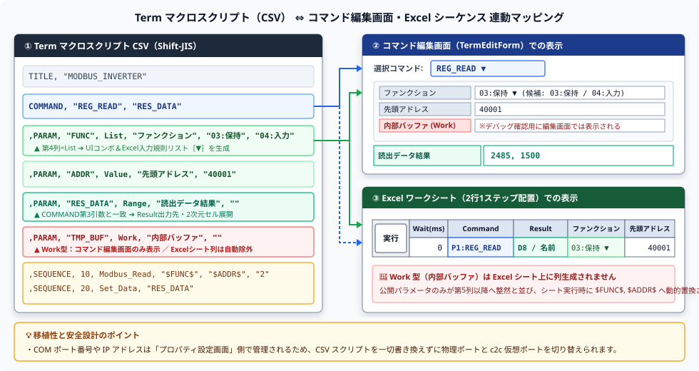

# マクロスクリプト取扱説明書 (User Manual)

> [!IMPORTANT]
> **基本フォーマットおよび表記言語・文字コード・AI生成仕様**  
> * **表記言語の原則（多言語化対応とデフォルト言語）**:  
>   多言語化を意識した設計とし、スクリプト内のコメント、パラメータ表示名、およびダイアログメッセージ等の設定値文字列は、マニュアル原本が英語等であっても、特に指定がない限り **日本語をデフォルトとして適切に翻訳して記述・設定** してください。
> * **文字コード（エンコーディング）の原則**:  
>   Term マクロスクリプトファイルは、 **CSV形式** で保存されます。 **CSVを日本語で記述する場合は、日本語Excelの制限（互換性維持および文字化け防止）から、必ず Shift-JIS (CP932) で記載・保存** してください。  
>   編集およびファイル保存時には、文字コードが Shift-JIS であることを必ず確認してください。
> * **AI生成元の明記規約（スクリプトおよびAI指示書・他者再現性の保証）**:  
>   AIによって Term マクロスクリプト（CSV）や自動生成指示書（Markdown）を作成・編集した場合は、トレーサビリティ・品質管理および **他者が同一条件で生成結果を再現できるよう** 、 **「実行環境（エージェント／IDE名）」と「自身のAIエンジン（モデル名・エディション／ティア）」の双方を正確に判別できる名称（例: `Antigravity (Gemini 4 Argon (Medium))`）を必ず明記** してください（エージェント名のみの記載や、推測・例示丸写しによる不正確なモデル名の記載は厳禁。コンテキスト圧縮時は会話ログ `transcript.jsonl` 内の `USER_SETTINGS_CHANGE` で実際の `Model Selection` を必ず確認すること）。
> * **個人情報・開発環境絶対パスの完全排除規約**:  
>   開発環境固有の絶対パス（`<LOCAL_DIR>\...` 等）、ローカルファイルURIスキーム、およびユーザー名（`<USER_DIR>\...`）を絶対に含めてはなりません。ファイル参照やMarkdownリンクを記述する場合は、必ず同一ディレクトリまたはプロジェクトからの **完全な相対パス（`./...`, `../...`）** を使用してください。

---

## 📌 1. 階層構造の基本規約
解析エンジン（`TermAnalysis` / `SequenceParser`）は、行頭の文字列（第1フィールド）の状態を基準に、親ブロックとサブコマンドの親子関係を判別します。

### ⚠️ 行頭による認識ルール

* **親ブロックの開始宣言**:  
  行頭にキーワード（`GENERAL` / `TITLE` / `COMMAND`）がある行。
* **サブコマンドの定義（子）**:  
  行頭が「空（ホワイトスペース 或いは カンマ `,` から始まる）」で、第2フィールドにキーワード（`PARAM` / `SEQUENCE`）が続く行。直前で宣言された親ブロックに帰属します。
* **コメント行**:  
  それ以外の行（`;` や `#` から始まる行、完全な空行）は無視されます。

---

## 🏢 2. 親ブロックとサブコマンドの帰属関係一覧
ファイル内は大きく分けて「① タイトル・共通定義ブロック」と「② コマンド定義ブロック」の2つの階層構造で構成されます。

### ① タイトル・共通定義ブロック（`GENERAL` / `TITLE`）
共通サブルーチンや制御対象システム・機器の名称を定義する最上階層です。

* `GENERAL`
  * `GENERAL, "GENERAL"`（共通コマンド開始）［行頭記述］
* `TITLE`
  * `TITLE, "[対象機器・システム名称]"`［行頭記述］
  * ※ Term では使用する COM ポート番号や接続先 IP アドレス・TCP ポート番号は PC アプリ側の「プロパティ設定画面（UI）」で一元管理されるため、マクロスクリプト側は物理ポート番号に依存しない高い移植性を持ちます。そのため、事前検証時はプロパティ設定画面で公式無償ツール **[c2c](https://github.com/Monaca-App/c2c)** の仮想 COM ポート（例: `COM10`）を選択するだけで、マクロスクリプトを 1 行も書き換えることなく実機なしの折り返しテストを実行できます。

### ② コマンド定義ブロック（`COMMAND`）
自動化マクロとして実行したい処理枠と、内部で使う変数、および具体的な実行手順を定義する階層です。

* `COMMAND`
  * `COMMAND, "[マクロ名]", "[結果格納先キー（任意）]"`［行頭記述］
  * ├── `,PARAM`（マクロ内で使用する変数・型・表示名・初期値の定義）
  * └── `,SEQUENCE`（実際に実行する処理ステップ・引数の定義）
  * ※ `[結果格納先キー]` はオプションです。マクロから出力データを Excel の結果セル（Result）へ返したい場合のみ指定し、出力がない場合は省略可能です。

---

## 📝 3. 各サブコマンドの記述仕様・パラメータ構成

### 1️⃣ PARAM（変数・パラメータ定義）

| サブコマンド | パラメータ構成 | 説明 |
| :--- | :--- | :--- |
| **`PARAM`** | `,PARAM, [パラメータキー], [★データ型], [表示名], [値/選択肢...]` | コマンド内で使用する変数の型、表示名、初期値、選択肢を定義。 |

> [!CAUTION]
> **【最重要】`[表示名]` および `[値/選択肢...]` の省略・欠落厳禁（CRITICALエラー防止）**  
> `PARAM` 定義行は、解析エンジンがカンマ区切りでパースする際、 **最低でも第5フィールド（表示名）まで、通常は第6フィールド（初期値）までが存在することを前提** としています。  
> どのようなデータ型（`Range` や `Work` を含む）であっても、必ず第5フィールドに `[表示名]`、第6フィールドに `[初期値]`（不要時は `""`）を明記してください。また、`COMMAND` ブロック配下（`PARAM`, `SEQUENCE`）は可変長フィールドであるため、 **行末へのコメント記述は一切禁止** です。

#### 📋 各フィールドの位置と役割

| フィールド位置 | 項目名 | 必須性 | 説明・指定例 |
| :---: | :--- | :---: | :--- |
| 第1フィールド | （空白） | **必須** | 行頭カンマ（`,`）で開始（子要素を示す）。 |
| 第2フィールド | `PARAM` | **必須** | サブコマンド識別子。 |
| 第3フィールド | `[パラメータキー]` | **必須** | コマンド内で参照する変数名（例: `"1"`, `"SLAVE_ID"`, `"REG_ADDR"`）。 |
| 第4フィールド | `[★データ型]` | **必須** | `Text`, `List`, `Range`, `Value`（または `Number`）, `Label`, `Work` のいずれか。 |
| 第5フィールド | `[表示名]` | **必須** | UIやExcelシート上段セルに表示される名称。省略不可。 |
| 第6フィールド | `[初期値]` | **必須** | 変数の初期値（List型の場合は初期選択肢）。不要な場合は `""` を記述。 |
| 第7フィールド以降 | `[選択肢2, 3...]` | 任意 | List型の場合の2番目以降のドロップダウン選択肢。 |

#### 💡 PARAM サブコマンドにおける「★データ型」詳細仕様

| 指定キーワード | 説明・UIおよびExcel上の挙動 |
| :--- | :--- |
| **`Text`** | 自由なテキスト入力を許可するスタイル。汎用文字列や送信コマンド電文用。 |
| **`List`** | ドロップダウンリスト（ComboBox / Excel 入力規則リスト）からの選択を提供するスタイル。 |
| **`Range`** | 範囲指定・結果展開用のスタイル。カンマ・改行区切りの配列データを Excel セルへ縦横2次元に自動展開します。 |
| **`Value` / `Number`** | 数値または16進データ入力を要求するスタイル。レジスタ番号、点数、設定値用。 |
| **`Label`** | ジャンプ先ラベルまたは結果出力ラベルを指定するスタイル。 |
| **`Work`** | 内部ワーク変数・バッファ領域を指定するスタイル。※Excelアドイン側では入力セルが生成されず非表示となります。 |

### 2️⃣ SEQUENCE（処理手順定義）

| サブコマンド | パラメータ構成 | 説明 |
| :--- | :--- | :--- |
| **`SEQUENCE`** | `,SEQUENCE, [ステップキー], [コマンド名], [引数1], [引数2]...` | 実際に実行する処理ステップと、渡す引数リストを定義。 |

* **動的置換**: 引数内で `$PARAMキー$`（例: `$1$`, `$REG_ADDR$`）のようにパラメータキーの両端を `$` で囲むと、実行時に PARAM の値へと動的置換されます。
* **条件ジャンプ**: ジャンプ先を指定する場合は、ターゲットとなるステップキー（ラベル名）を指定します（例: `#10#`, `#ERROR#` またはステップ番号）。
* **共通コマンド指定**: `Call`, `Param_Set`, `Param_Get` 等でマクロ名の先頭に `@` を付与すると、`GENERAL` として登録された共通マクロを対象とします。

### 3️⃣ CSV マクロスクリプトと GUI（コマンド編集画面・Excel シート）の連動イメージ

CSV マクロスクリプトで定義した `COMMAND`・`PARAM`・`SEQUENCE` の各要素は、以下のように **「コマンド編集画面」** および **「Excel 2 行シーケンス」** の各 UI コントロール・セル列へ自動的にマッピングされます。



---

## 🔌 4. Term 5大通信ドメインの統一ライフサイクルと排他切替

Term の通信制御コマンドは、以下の **5 つの通信機能ドメイン（単一 DLL）** に整理されており、いずれも **`<Domain>_Open` ➔ `<Domain>_Mode` ➔ 送受信コマンド ➔ `<Domain>_Close`** という統一されたライフサイクルで動作します。

| ドメイン区分 | 単一 DLL 名 | オープン / クローズ / モード | 主な送受信・制御コマンド |
| :--- | :--- | :--- | :--- |
| **① COM シリアル通信** | `TermAnalysis.Comm.dll` | [`Com_Open`](./Comm/Com_Open.Md)<br>[`Com_Close`](./Comm/Com_Close.Md)<br>[`Com_Mode`](./Comm/Com_Mode.Md) | [`Com_Send`](./Comm/Com_Send.Md)<br>[`Com_SendFile`](./Comm/Com_SendFile.Md)<br>[`Com_WaitPrompt`](./Comm/Com_WaitPrompt.Md) |
| **② Telnet 通信** | `TermAnalysis.Telnet.dll` | [`Telnet_Open`](./Telnet/Telnet_Open.Md)<br>[`Telnet_Close`](./Telnet/Telnet_Close.Md)<br>[`Telnet_Mode`](./Telnet/Telnet_Mode.Md) | [`Telnet_Send`](./Telnet/Telnet_Send.Md)<br>[`Telnet_SendFile`](./Telnet/Telnet_SendFile.Md)<br>[`Telnet_WaitPrompt`](./Telnet/Telnet_WaitPrompt.Md) |
| **③ Modbus 通信** | `TermAnalysis.Modbus.dll` | [`Modbus_Open`](./Modbus/Modbus_Open.Md)<br>[`Modbus_Close`](./Modbus/Modbus_Close.Md)<br>[`Modbus_Mode`](./Modbus/Modbus_Mode.Md) | [`Modbus_Read`](./Modbus/Modbus_Read.Md)<br>[`Modbus_Write`](./Modbus/Modbus_Write.Md) |
| **④ MELSEC 計算機リンク** | `TermAnalysis.Melco.dll` | [`Melsec_Open`](./Melco/Melsec_Open.Md)<br>[`Melsec_Close`](./Melco/Melsec_Close.Md)<br>[`Melsec_Mode`](./Melco/Melsec_Mode.Md) | 高水準: [`Melsec_ReadWord`](./Melco/Melsec_ReadWord.Md) / [`Melsec_WriteWord`](./Melco/Melsec_WriteWord.Md) / [`Melsec_ReadBit`](./Melco/Melsec_ReadBit.Md) / [`Melsec_WriteBit`](./Melco/Melsec_WriteBit.Md) / [`Melsec_Loopback`](./Melco/Melsec_Loopback.Md)<br>形式1〜5: [`Melsec_P1s_S`](./Melco/Melsec_P1s_S.Md)〜[`Melsec_P5s_S`](./Melco/Melsec_P5s_S.Md) 等 送受信 |
| **⑤ MELSEC MC プロトコル** | `TermAnalysis.MelcoMC.dll` | [`Mc_Open`](./MelcoMC/Mc_Open.Md)<br>[`Mc_Close`](./MelcoMC/Mc_Close.Md)<br>[`Mc_Mode`](./MelcoMC/Mc_Mode.Md) | 高水準: [`Mc_ReadWord`](./MelcoMC/Mc_ReadWord.Md) / [`Mc_WriteWord`](./MelcoMC/Mc_WriteWord.Md) / [`Mc_ReadBit`](./MelcoMC/Mc_ReadBit.Md) / [`Mc_WriteBit`](./MelcoMC/Mc_WriteBit.Md)<br>汎用電文: [`Mc_Send`](./MelcoMC/Mc_Send.Md) / [`Mc_Receive`](./MelcoMC/Mc_Receive.Md) |

---

## 🚀 5. マクロコマンド詳細リファレンス（全83コマンド）

### 5.1 COM ポート通信制御系（`Comm`：全6コマンド）
* [**Com_Open**](./Comm/Com_Open.Md) / [**Com_Close**](./Comm/Com_Close.Md)
  * **概要**: PC アプリ環境設定（UI）で指定された COM ポートをオープンして回線接続を確立（`Com_Open`）、または切断・解放（`Com_Close`）します。
  * **書式**: `,SEQUENCE, [ステップキー], Com_Open` / `,SEQUENCE, [ステップキー], Com_Close`
* [**Com_Mode**](./Comm/Com_Mode.Md)
  * **概要**: 通信条件（ボーレート・パリティ・データ長・ストップビット）、フロー制御（ハンドシェイク）、送信終端デリミタ（`TXCR` / `TXCRLF` / `NON`）、および受信データモード（`ASCII` / `BIN`）を一括または個別に動的設定します。
  * **書式**: `,SEQUENCE, [ステップキー], Com_Mode, [設定パラメータ...]`
  * **指定例**: `,SEQUENCE, 10, Com_Mode, "9600,N,8,1", "NON", "TXCRLF", "ASCII"`
* [**Com_Send**](./Comm/Com_Send.Md)
  * **概要**: COM ポートへ文字列電文を送信します（設定された改行デリミタを自動付与）。エラー確認モード付き送信にも対応します。
  * **書式**: `,SEQUENCE, [ステップキー], Com_Send, [送信文字列]`
* [**Com_SendFile**](./Comm/Com_SendFile.Md)
  * **概要**: 指定したテキストファイルを読み込み、行単位で COM ポートへ逐次送信します。
  * **書式**: `,SEQUENCE, [ステップキー], Com_SendFile, [ファイルパス]`
* [**Com_WaitPrompt**](./Comm/Com_WaitPrompt.Md)
  * **概要**: 指定したプロンプト文字列が受信されるまで待機し、タイムアウト発生時は指定ラベルへジャンプします。
  * **書式**: `,SEQUENCE, [ステップキー], Com_WaitPrompt, [待機プロンプト文字列], [タイムアウト(ms)], [タイムアウト時ジャンプ先ラベル]`

### 5.2 Telnet 通信制御系（`Telnet`：全6コマンド）
* [**Telnet_Open**](./Telnet/Telnet_Open.Md) / [**Telnet_Close**](./Telnet/Telnet_Close.Md)
  * **概要**: PC アプリ環境設定（UI）の IP アドレス・TCP ポートへ Telnet ソケット接続を確立（`Telnet_Open`）、または切断・解放（`Telnet_Close`）します。
  * **書式**: `,SEQUENCE, [ステップキー], Telnet_Open` / `,SEQUENCE, [ステップキー], Telnet_Close`
* [**Telnet_Mode**](./Telnet/Telnet_Mode.Md)
  * **概要**: 送信終端デリミタ（`TXCR` / `TXCRLF` / `NON`）、データモード（`ASCII` / `BIN`）、および NVT 制御コード（`IAC`）フィルタを動的設定します。
  * **書式**: `,SEQUENCE, [ステップキー], Telnet_Mode, [設定パラメータ...]`
* [**Telnet_Send**](./Telnet/Telnet_Send.Md) / [**Telnet_SendFile**](./Telnet/Telnet_SendFile.Md) / [**Telnet_WaitPrompt**](./Telnet/Telnet_WaitPrompt.Md)
  * **概要**: Telnet ソケットへの文字列電文送信（`Telnet_Send`）、テキストファイル逐次送信（`Telnet_SendFile`）、およびプロンプト受信待機（`Telnet_WaitPrompt`）を実行します。

### 5.3 Modbus 通信制御系（`Modbus`：全5コマンド）
* [**Modbus_Open**](./Modbus/Modbus_Open.Md) / [**Modbus_Close**](./Modbus/Modbus_Close.Md)
  * **概要**: PC アプリ環境設定（UI）に基づき Modbus 通信回線（UART シリアルまたは TCP ソケット）を接続オープン（`Modbus_Open`）、または切断（`Modbus_Close`）します。
* [**Modbus_Mode**](./Modbus/Modbus_Mode.Md)
  * **概要**: Modbus 伝送モード（`RTU` / `ASCII` / `TCP`）および通信条件を一括または個別に設定します。
* [**Modbus_Read**](./Modbus/Modbus_Read.Md)
  * **概要**: 指定スレーブの保持レジスタ（FC03）または入力レジスタ（FC04）から指定点数分のデータを読み出し、格納先パラメータへ格納します。
  * **書式**: `,SEQUENCE, [ステップキー], Modbus_Read, [スレーブ局番], [ファンクション(3/4)], [開始アドレス], [点数], [格納先変数]`
* [**Modbus_Write**](./Modbus/Modbus_Write.Md)
  * **概要**: 指定スレーブの単一または複数レジスタへ値を書き込みます（CRC-16 / LRC / MBAP ヘッダ自動付与）。
  * **書式**: `,SEQUENCE, [ステップキー], Modbus_Write, [スレーブ局番], [開始アドレス], [書込データ...]`

### 5.4 三菱電機 MELSEC 計算機リンク通信制御系（`Melco`：全23コマンド）
* **回線制御・通信条件（3コマンド）**:
  * [**Melsec_Open**](./Melco/Melsec_Open.Md) / [**Melsec_Close**](./Melco/Melsec_Close.Md) / [**Melsec_Mode**](./Melco/Melsec_Mode.Md): 回線接続・切断・通信モードおよびプロトコル形式（形式1〜5）設定
* **高水準デバイス操作・診断（5コマンド）**:
  * [**Melsec_ReadWord**](./Melco/Melsec_ReadWord.Md): ワード単位でのデバイス一括読出
  * [**Melsec_WriteWord**](./Melco/Melsec_WriteWord.Md): ワード単位でのデバイス一括書込
  * [**Melsec_ReadBit**](./Melco/Melsec_ReadBit.Md): ビット単位でのデバイス一括読出
  * [**Melsec_WriteBit**](./Melco/Melsec_WriteBit.Md): ビット単位でのデバイス一括書込
  * [**Melsec_Loopback**](./Melco/Melsec_Loopback.Md): 計算機リンク回線の折り返し交信診断（ループバックテスト）
* **プロトコル形式送受信（形式1〜5：計15コマンド）**:
  * [**Melsec_P1s_S**](./Melco/Melsec_P1s_S.Md) / [**Melsec_P1s_R**](./Melco/Melsec_P1s_R.Md) / [**Melsec_Res_P1s_R**](./Melco/Melsec_Res_P1s_R.Md): 形式1（プロトコル1）電文送信・要求受信・応答受信検証
  * [**Melsec_P2s_S**](./Melco/Melsec_P2s_S.Md) / [**Melsec_P2s_R**](./Melco/Melsec_P2s_R.Md) / [**Melsec_Res_P2s_R**](./Melco/Melsec_Res_P2s_R.Md): 形式2（プロトコル2）電文送信・要求受信・応答受信検証
  * [**Melsec_P3s_S**](./Melco/Melsec_P3s_S.Md) / [**Melsec_P3s_R**](./Melco/Melsec_P3s_R.Md) / [**Melsec_Res_P3s_R**](./Melco/Melsec_Res_P3s_R.Md): 形式3（プロトコル3）電文送信・要求受信・応答受信検証
  * [**Melsec_P4s_S**](./Melco/Melsec_P4s_S.Md) / [**Melsec_P4s_R**](./Melco/Melsec_P4s_R.Md) / [**Melsec_Res_P4s_R**](./Melco/Melsec_Res_P4s_R.Md): 形式4（プロトコル4）電文送信・要求受信・応答受信検証
  * [**Melsec_P5s_S**](./Melco/Melsec_P5s_S.Md) / [**Melsec_P5s_R**](./Melco/Melsec_P5s_R.Md) / [**Melsec_Res_P5s_R**](./Melco/Melsec_Res_P5s_R.Md): 形式5（プロトコル5）電文送信・要求受信・応答受信検証

### 5.5 三菱電機 MELSEC MCプロトコル通信制御系（`MelcoMC`：全9コマンド）
* **回線制御・通信条件（3コマンド）**:
  * [**Mc_Open**](./MelcoMC/Mc_Open.Md) / [**Mc_Close**](./MelcoMC/Mc_Close.Md) / [**Mc_Mode**](./MelcoMC/Mc_Mode.Md): Ethernet（TCP/UDP）経由の MCプロトコル回線オープン・切断・通信条件設定
* **高水準デバイス操作（4コマンド）**:
  * [**Mc_ReadWord**](./MelcoMC/Mc_ReadWord.Md): ワード単位でのデバイス一括読出（MC 3E フレーム Qna 互換コマンド `0401`/サブ `0000`）
  * [**Mc_WriteWord**](./MelcoMC/Mc_WriteWord.Md): ワード単位でのデバイス一括書込（MC 3E フレーム Qna 互換コマンド `1401`/サブ `0000`）
  * [**Mc_ReadBit**](./MelcoMC/Mc_ReadBit.Md): ビット単位でのデバイス一括読出（MC 3E フレーム Qna 互換コマンド `0401`/サブ `0001`）
  * [**Mc_WriteBit**](./MelcoMC/Mc_WriteBit.Md): ビット単位でのデバイス一括書込（MC 3E フレーム Qna 互換コマンド `1401`/サブ `0001`）
* **汎用MCフレーム送受信（2コマンド）**:
  * [**Mc_Send**](./MelcoMC/Mc_Send.Md): 任意コマンド電文の MC 3E フレーム送信（ヘッダ自動生成付加）
  * [**Mc_Receive**](./MelcoMC/Mc_Receive.Md): MC 3E 応答フレームの受信・終了コード判定・データ部抽出

### 5.6 共通基盤コマンド系（`Core`：全34コマンド）
* **データ・ワーク処理（`Work`：5コマンド）**:
  * [**Set_Data**](./Core/Work/Set_Data.Md): 受信ワークバッファから `sscanf` / `sprintf` 書式でデータを抽出・整形して変数へ格納（行追記対応）。
  * [**Get_Line**](./Core/Work/Get_Line.Md) / [**Skip_Line**](./Core/Work/Skip_Line.Md) / [**Skip_Data**](./Core/Work/Skip_Data.Md): 受信バッファからの指定行抽出、先頭行スキップ、指定パターンスキップ。
  * [**Time_Stamp**](./Core/Work/Time_Stamp.Md): 受信ログ・ワークバッファへのミリ秒タイムスタンプ（`[ yyyy/MM/dd HH:mm:ss.fff ]`）自動付与の ON / OFF 切替。
* **パラメータ・呼出・ループ制御（`Param`：12コマンド）**:
  * [**Param_Set**](./Core/Param/Param_Set.Md) / [**Param_Get**](./Core/Param/Param_Get.Md) / [**Param_Move**](./Core/Param/Param_Move.Md): パラメータへの値設定、取得、コピー転送。
  * [**Param_Add**](./Core/Param/Param_Add.Md) / [**Param_Mul**](./Core/Param/Param_Mul.Md) / [**Param_Div**](./Core/Param/Param_Div.Md) / [**Param_Mod**](./Core/Param/Param_Mod.Md): 四則演算・剰余計算（ゼロ除算保護・基数フォーマット維持）。
  * [**Call**](./Core/Param/Call.Md) / [**Exit**](./Core/Param/Exit.Md) / [**Loop**](./Core/Param/Loop.Md) / [**Next**](./Core/Param/Next.Md) / [**Break**](./Core/Param/Break.Md): サブルーチン呼出・復帰、および回数指定ループ制御。
* **配列操作（`Array`：7コマンド）**:
  * [**Array_Init**](./Core/Array/Array_Init.Md) / [**Array_Set**](./Core/Array/Array_Set.Md) / [**Array_Get**](./Core/Array/Array_Get.Md) / [**Array_Split**](./Core/Array/Array_Split.Md) / [**Array_Join**](./Core/Array/Array_Join.Md) / [**Array_Replace**](./Core/Array/Array_Replace.Md) / [**Array_Transpose**](./Core/Array/Array_Transpose.Md)
* **シーケンス・フロー制御・対話（`Sequence`：5コマンド）**:
  * [**Jump**](./Core/Sequence/Jump.Md) / [**Judge**](./Core/Sequence/Judge.Md) / [**Wait**](./Core/Sequence/Wait.Md) / [**Ext_Call**](./Core/Sequence/Ext_Call.Md) / [**Msg_Box**](./Core/Sequence/Msg_Box.Md)
* **ファイル制御（`File`：5コマンド）**:
  * [**Read_File**](./Core/File/Read_File.Md) / [**Write_File**](./Core/File/Write_File.Md) / [**Append_File**](./Core/File/Append_File.Md) / [**Read_Line**](./Core/File/Read_Line.Md) / [**Write_Line**](./Core/File/Write_Line.Md)

---

## 💡 6. 記述サンプル

```csv
; ==============================================================================
; Term Macro Script Sample
; 生成AI: Antigravity (Gemini 2.5 Pro)
; 対象システム: シリアル通信・MELSEC プロトコル4 レジスタ読出サンプル
; ==============================================================================
TITLE, "シーケンサ・シリアルデータ収集"

; ==========================================
; コマンド定義ブロック 1: 通信ポート接続 (PORT_OPEN)
; ==========================================
COMMAND, "PORT_OPEN"
,SEQUENCE, 10, Com_Mode, "57600,O,8,1", "NON", "TXCRLF", "ASCII"
,SEQUENCE, 20, Com_Open
,SEQUENCE, 30, Exit

; ==========================================
; コマンド定義ブロック 2: MELSEC プロトコル4 レジスタ読出 (NUM_READ)
; ==========================================
COMMAND, "NUM_READ", "RESULT_DATA"
,PARAM, HEADER, Text, "フレームヘッダ", "F90000FF00"
,PARAM, CMD_STR, Text, "実行コマンド", "04010000ZR"
,PARAM, DEV_ADDR, Text, "デバイス先頭番号", "008020"
,PARAM, POINTS, Text, "読出点数", "0001"
,PARAM, RESULT_DATA, Range, "読出データ結果", ""
,SEQUENCE, 10, Melsec_P4s_S, "$HEADER$$CMD_STR$$DEV_ADDR$$POINTS$"
,SEQUENCE, 20, Melsec_Res_P4s_R, "$HEADER$", "$POINTS$", "RESULT_DATA", "%X"
,SEQUENCE, 30, Exit

; ==========================================
; コマンド定義ブロック 3: 通信ポート切断 (PORT_CLOSE)
; ==========================================
COMMAND, "PORT_CLOSE"
,SEQUENCE, 10, Com_Close
,SEQUENCE, 20, Exit
```

---

## 🎯 7. 出力前チェックリスト（セルフバリデーション）

- [ ] スクリプト最先頭のヘッダコメントおよび自動生成AI指示書の冒頭に **他者が再現できるよう自身のAIエンジン（モデル名・ティア等）を正確に判別できる名称（`<エージェント名> (<AIエンジン名>)`）** および対象機器・プロトコル情報が記載されているか？（推測や例示の丸写しではなく、実際の `Model Selection` 設定値と一致しているか？）
- [ ] **日本語を含むCSVスクリプトは、日本語Excelの制限に準拠して Shift-JIS (CP932) で記載・保存されているか？**
- [ ] `PARAM` や `SEQUENCE` の行の先頭は、すべて漏れなくカンマ（`,`）から始まっているか？
- [ ] **すべての `PARAM` 行において `[表示名]`（第5フィールド）および `[初期値]`（第6フィールド）が省略・欠落せずに記述されているか？**
- [ ] `PARAM` や `SEQUENCE` の行の末尾に、`; コメント` が残っていないか？
- [ ] 引数内の変数置換は `$` で正しく囲まれているか？
- [ ] 引数内に生カンマが含まれる場合は `","` のように二重引用符で囲まれているか？
- [ ] **ドキュメントおよびスクリプト内に、開発環境固有の絶対パスや個人名が含まれておらず、完全な相対パス（`./...`, `../...`）になっているか？**

