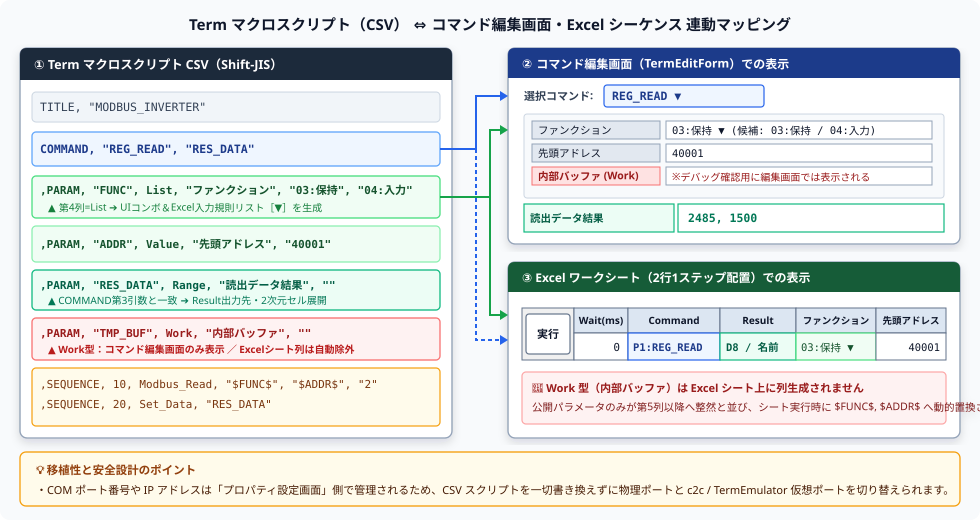

# マクロスクリプト取扱説明書 (User Manual)

> [!IMPORTANT]
> **基本フォーマットおよび表記言語・文字コード・AI生成仕様**  
> * **表記言語の原則（多言語化対応とデフォルト言語）** :  
>   多言語化を意識した設計とし、スクリプト内のコメント、パラメータ表示名、およびダイアログメッセージ等の設定値文字列は、機器マニュアル原本が英語等であっても、特に指定がない限り **日本語をデフォルトとして適切に翻訳して記述・設定** してください。
> * **文字コード（エンコーディング）の原則** :  
>   Term マクロスクリプトファイルは、 **CSV形式** で保存されます。 **CSVを日本語で記述する場合は、日本語Excelの制限（互換性維持および文字化け防止）から、必ず Shift-JIS (CP932) ＋ CRLF で記載・保存** してください。編集およびファイル保存時には、文字コードが Shift-JIS であることを必ず確認してください（なお、自動生成指示書などの Markdown 文書は **UTF-8 with BOM ＋ CRLF** で保存してください）。
> * **AI生成元の明記規約（スクリプトおよびAI指示書・他者再現性の保証）** :  
>   AIによって Term マクロスクリプト（CSV）や、 **自動生成された Term マクロスクリプト自動生成指示書（`*_prompt.md` 等）** を作成・編集した場合は、トレーサビリティ・品質管理および **他者が同一条件で生成結果を再現できるよう** 、 **「実行環境（エージェント／IDE名）」と「自身のAIエンジン（モデル名・エディション／ティア）」の双方を正確に判別できる名称** を必ず明記してください。  
>   * **マクロスクリプト（CSV）** : 最先頭のヘッダコメント（最先頭行付近）に `; 生成AI: <エージェント名> (<AIエンジン名>)` の形式で明記（例: `; 生成AI: Antigravity (Gemini 4 Carbon (Medium))` 等）。  
>   * **AI指示書（Markdown）** : ファイル冒頭（タイトル直後の注記ブロック等）に `> **生成AI**: <エージェント名> (<AIエンジン名>)` の形式で明記（例: `> **生成AI**: Antigravity (Gemini 4 Carbon (Medium))` 等）。  
>   * **【厳禁事項とAIエンジン判別手順】** :  
>     1. エージェント名のみ（例: ❌ `Antigravity` のみ）の記載は、使用したAIエンジンが判別できず他者が再現不能となるため **絶対禁止** とします。  
>     2. 本書やテンプレート内の記載例（例示文字列）の丸写し、または事前学習知識からの推測・ハルシネーションによる不正確なモデル名（例: ❌ 架空のバージョン等）の記載は **絶対禁止** とします。  
>     3. AIは記述前に必ずセッションのモデル選択情報（Antigravity 環境では `<USER_SETTINGS_CHANGE>` の `Model Selection` 設定値、コンテキスト要約後は会話ログ `transcript.jsonl` 内の `USER_SETTINGS_CHANGE` 記録値）を参照・突合し、実際に稼働している自身のAIエンジン名称を一字一句正確に転記してください（環境から判別できない場合は推測せず、必ず `ask_question` ツールでユーザーに確認すること）。
> * **個人情報・開発環境絶対パス・機密情報の完全排除規約** :  
>   AIによって Term マクロスクリプト（CSV）、自動生成指示書（Markdown）、および関連ドキュメントを作成・編集する場合は、開発環境固有の絶対パス（`<LOCAL_DIR>\...` 等）、ローカルファイルURIスキーム、個人名（`<USER_DIR>\...`）、および実運用パスワード等の機密文字列を絶対に含めてはなりません（Telnet パスワード等の初期値は必ず空文字 `""` とすること）。ファイル参照や Markdown リンクを記述する場合は、必ず同一ディレクトリまたはプロジェクトからの **完全な相対パス（`./...`, `../...`）** を使用し、例示が必要な場合は汎用プレースホルダー（`<APP_DIR>`, `./Log/` 等）を使用してください。

---

## 目次

- [📌 1. 階層構造の基本規約](#-1-階層構造の基本規約)
- [🏢 2. 親ブロックとサブコマンドの帰属関係一覧](#-2-親ブロックとサブコマンドの帰属関係一覧)
- [📝 3. 各サブコマンドの記述仕様・パラメータ構成](#-3-各サブコマンドの記述仕様パラメータ構成)
  - [1️⃣ PARAM（変数・パラメータ定義）](#1️⃣-param変数パラメータ定義)
  - [2️⃣ SEQUENCE（処理手順定義）および特殊規約](#2️⃣-sequence処理手順定義および特殊規約)
- [🔌 4. Term 7大通信ドメインの統一ライフサイクルと排他切替](#-4-term-7大通信ドメインの統一ライフサイクルと排他切替)
- [🚀 5. マクロコマンド詳細リファレンス（全130コマンド）](#-5-マクロコマンド詳細リファレンス全130コマンド)
  - [5.1 COM ポート通信制御系（Comm：全6コマンド）](#51-com-ポート通信制御系comm全6コマンド)
  - [5.2 Telnet / TCPソケット通信制御系（Telnet：全6コマンド）](#52-telnet--tcpソケット通信制御系telnet全6コマンド)
  - [5.3 Modbus 通信制御系（Modbus：全5コマンド）](#53-modbus-通信制御系modbus全5コマンド)
  - [5.4 三菱電機 MELSEC 計算機リンク通信制御系（Melco：全23コマンド）](#54-三菱電機-melsec-計算機リンク通信制御系melco全23コマンド)
  - [5.5 三菱電機 MELSEC MCプロトコル通信制御系（MelcoMC：全9コマンド）](#55-三菱電機-melsec-mcプロトコル通信制御系melcomc全9コマンド)
  - [5.6 オムロン FINS / Sysmac・HostLink 通信制御系（Omron：全9コマンド）](#56-オムロン-fins--sysmachostlink-通信制御系omron全9コマンド)
  - [5.7 キーエンス KV 上位リンク通信制御系（Keyence：全9コマンド）](#57-キーエンス-kv-上位リンク通信制御系keyence全9コマンド)
  - [5.8 共通基盤：外部マクロ・変数・ループ・数式演算系（Param：全17コマンド）](#58-共通基盤外部マクロ変数ループ数式演算系param全17コマンド)
  - [5.9 共通基盤：配列バッファ操作系（Array：全7コマンド）](#59-共通基盤配列バッファ操作系array全7コマンド)
  - [5.10 共通基盤：シーケンス・エラートラップ・高度待機・UI対話系（Sequence：全17コマンド）](#510-共通基盤シーケンスエラートラップ高度待機ui対話系sequence全17コマンド)
  - [5.11 共通基盤：データ・ワーク処理およびファイル制御系（Work 全5 ／ File 全5コマンド）](#511-共通基盤データワーク処理およびファイル制御系work-全5--file-全5コマンド)
  - [5.12 共通基盤：Excel シート順序制御エクステンションおよび透過ポート通信系（Excel 全8 ／ Port 全4コマンド）](#512-共通基盤excel-シート順序制御エクステンションおよび透過ポート通信系excel-全8--port-全4コマンド)
- [💡 6. 代表記述サンプル（対話型シリアル通信 ＆ 産業用PLC通信）](#-6-代表記述サンプル対話型シリアル通信--産業用plc通信)
- [⚙️ Termマクロスクリプト 自動生成システムルールセット](#️-termマクロスクリプト-自動生成システムルールセット)

---

## 📌 1. 階層構造の基本規約
マクロスクリプトの解析機能は、行頭の文字列（第1フィールド）の状態を基準に、親ブロックとサブコマンドの親子関係を判別します。

### ⚠️ 行頭による認識ルール

* **親ブロックの開始宣言** :  
  行頭（第1フィールドの1文字目）にキーワード（`GENERAL` / `TITLE` / `COMMAND`）がある行。
* **サブコマンドの定義（子）** :  
  行頭が「空（ホワイトスペース 或いは カンマ `,` から始まる）」で、第2フィールドにキーワード（`PARAM` / `SEQUENCE`）が続く行。直前で宣言された親ブロックに帰属します。
* **コメント行** :  
  それ以外の行（親ブロックやサブコマンドに一致しない行、`;` や `#` から始まる行、完全な空行）は無視されます。

---

## 🏢 2. 親ブロックとサブコマンドの帰属関係一覧
ファイル内は大きく分けて「① タイトル・共通定義ブロック」と「② コマンド定義ブロック」の2つの階層構造で構成されます。

### ① タイトル・共通定義ブロック（`GENERAL` / `TITLE`）
共通サブルーチンや制御対象システム・機器の名称を定義する最上階層です。

* `GENERAL`
  * `GENERAL, "GENERAL"`（共通コマンド開始）［行頭記述］
  * └── 複数の通信機器・プロトコル間で共通利用する汎用サブルーチン群を登録する際に使用します（呼び出し時は先頭に `@` を付与）。
* `TITLE`
  * `TITLE, "[対象機器・システム名称]"`［行頭記述］
  * └── 配下にハードウェア固定サブコマンドは持たず、通信条件や接続先はすべて UI 設定または `COMMAND` 内の `PARAM`（動的パラメータ）として柔軟に管理します。

> [!TIP]
> **環境非依存のポート管理と、公式無償ツール（`c2c` / `TermEmulator`）による実機ゼロ検証**  
> * Term では使用する既定 COM ポート番号や接続先 IP アドレス・TCP ポート番号を PC アプリ側の **[プロパティ設定画面](./プロパティ設定画面取扱説明書.Md)** （タスク `P1`〜`P10` 単位）または Excel シート上の公開パラメータセルで管理するため、マクロスクリプト本体は特定の PC 環境に依存しない高い移植性を持ちます。  
> * 事前検証時は、ドライバ不要の仮想ヌルモデム＆8ピン結線モニター **[c2c](https://github.com/Monaca-App/c2c)** （[操作説明書](https://github.com/Monaca-App/c2c/blob/main/Manual/c2c操作説明書.Md)）および 6 種産業用 PLC 仮想スレーブ＆自動モック対応の **[TermEmulator](https://github.com/Monaca-App/TermEmulator)** （[操作説明書](https://github.com/Monaca-App/TermEmulator/blob/main/Manual/TermEmulator操作説明書.Md)）を併用することで、実機やクロスケーブルが一切ない環境でもマクロスクリプトを 1 行も書き換えることなく全 7 プロトコルの通信・異常系テストを完結できます。

### ② コマンド定義ブロック（`COMMAND`）
自動化マクロとして実行したい処理枠と、内部で使う変数、および具体的な実行手順を定義する階層です。

* `COMMAND`
  * `COMMAND, "[マクロ名]", "[結果格納先キー（任意）]"`［行頭記述］
  * ├── `,PARAM`（マクロ内で使用する変数・型・表示名・初期値・選択肢の定義）
  * └── `,SEQUENCE`（実際に実行する処理ステップ・引数の定義）
  * ※ `[結果格納先キー]` はオプションです。マクロから出力データを Excel の結果セル（`Result` 列または名前定義セル）へ返したい場合のみ指定し、出力がない設定・オープン・クローズ用コマンドでは省略可能です。

### ③ CSV マクロスクリプトと GUI（コマンド編集画面・Excel シート）の総合連動イメージ

1 つの Term マクロスクリプト（CSV）を登録するだけで、`COMMAND`・`PARAM`・`SEQUENCE` の各要素から **[コマンド編集画面](./コマンド編集画面取扱説明書.Md)** の入力スロットと **[Excel アドイン](./Excelアドイン取扱説明書.Md)** の 2 行シーケンス（タスク識別プレフィックス `P1:`〜`P10:` 対応）が自動的に連動生成されます。



<!-- PDF出力時改ページを追加する。 -->
<div style="page-break-before:always"></div>

## 📝 3. 各サブコマンドの記述仕様・パラメータ構成

`COMMAND` ブロック配下のサブコマンド（`PARAM`, `SEQUENCE`）はすべて第2フィールドに記述します。フィールドが可変長であるため、 **行末へのコメント（`; ...`）の記載は一切禁止** です。

### 1️⃣ PARAM（変数・パラメータ定義）

| サブコマンド | パラメータ構成 | 説明 |
| :--- | :--- | :--- |
| **`PARAM`** | `,PARAM, [パラメータキー], [★データ型], [表示名], [値/選択肢...]` | コマンド内で使用する変数の型、表示名、初期値、選択肢を定義。 |

> [!CAUTION]
> **【最重要】`[表示名]` および `[値/選択肢...]` の省略・欠落厳禁（初期値ずれバグ防止）**  
> `PARAM` 定義行は、カンマ区切りで読み込まれる際、 **第5フィールドを `[表示名]`、第6フィールドを `[初期値]`（第7フィールド以降を追加選択肢）** として順序通りに割り当てます（4フィールド以下で記述された場合も境界保護によりクラッシュはしませんが、表示名がキー名で補完され初期値が空になります）。  
> 特に、表示名を省略して値を詰めて5フィールドで記述（例: `,PARAM, "CNT", Work, "0"`）した場合、 **`"0"` が第5フィールドの「表示名」として解釈され、肝心の第6フィールド「初期値」が空文字 `""` になってしまう論理不具合** が生じます。 **どのようなデータ型（`Range` や `Work` を含む）であっても、必ず第5フィールドに `[表示名]`、第6フィールドに `[初期値]`（不要時は `""`）の全6フィールド以上を明記してください** 。

#### 📋 各フィールドの位置と役割

| フィールド位置 | 項目名 | 必須性 | 説明・指定例 |
| :---: | :--- | :---: | :--- |
| 第1フィールド | （空白） | **必須** | 行頭カンマ（`,`）で開始（子要素を示す）。スペース字下げは不可。 |
| 第2フィールド | `PARAM` | **必須** | サブコマンド識別子。 |
| 第3フィールド | `[パラメータキー]` | **必須** | コマンド内で参照する変数名（例: `"HOST_IP"`, `"SLAVE_ID"`, `"RESULT_DATA"`）。 |
| 第4フィールド | `[★データ型]` | **必須** | `Text`, `List`, `Range`, `Number`, `Label`, `Work` のいずれか。 |
| 第5フィールド | `[表示名]` | **必須** | UIやExcelシート上段セルに表示される名称。内部変数や結果格納先でも省略不可。 |
| 第6フィールド | `[初期値]` | **必須** | 変数の初期値（`List` 型の場合は初期選択肢）。不要な場合も必ず `""` を記述。 |
| 第7フィールド以降 | `[選択肢2, 3...]` | 任意 | `List` 型の場合の2番目以降のドロップダウン選択肢。 |

#### ❌ 誤った記述例（NG）と ⭕ 正しい記述例（OK）

| データ型 | 判定 | 記述例 | 問題点 / 解説 |
| :--- | :---: | :--- | :--- |
| **`Range`** <br>(結果格納先) | ❌ | `,PARAM, "RESULT_DATA", Range` | **【規約違反】** 表示名・初期値が欠落（4フィールド）。パーサー境界保護によりクラッシュは防がれますが、UI表示名・初期値定義が不完全となります。 |
| | ⭕ | `,PARAM, "RESULT_DATA", Range, "読出データ結果", ""` | **正常** 。第5フィールドに表示名、第6フィールドに空文字初期値 `""` が正しく定義されています。 |
| **`Work`** <br>(内部変数) | ❌ | `,PARAM, "RETRY_CNT", Work, "0"` | **【不具合】** 表示名が欠落し、`"0"` が表示名として解釈され初期値が空になります。 |
| | ⭕ | `,PARAM, "RETRY_CNT", Work, "リトライ回数", "0"` | **正常** 。第5フィールドに表示名、第6フィールドに初期値 `"0"` が設定されます。 |
| **`List`** <br>(選択肢) | ❌ | `,PARAM, "UART_COND", List, "通信条件", "9600,N,8,1", "19200,E,8,1"` | **【不具合】** Excel 入力規則はカンマ `,` を選択肢区切りとして扱うため、選択肢内の生カンマでリストが分裂します。 |
| | ⭕ | `,PARAM, "BAUD", List, "ボーレート", "9600", "19200", "38400", "57600", "115200"` | **正常** 。ボーレート・パリティ・データ長・ストップビットを個別 `List` パラメータに分離して定義します。 |
| **`Number`** <br>(数値) | ❌ | `,PARAM, "POINTS", Number, "10"` | **【不具合】** `"10"` が表示名になり、初期値が空になります。 |
| | ⭕ | `,PARAM, "POINTS", Number, "読出点数", "10"` | **正常** 。第5=表示名、第6=初期値。 |

#### 💡 PARAM サブコマンドにおける「★データ型」詳細仕様

| 指定キーワード | 説明・UIおよびExcel上の挙動 |
| :--- | :--- |
| **`Text`** | 自由なテキスト入力を許可するスタイル。IPアドレス、デバイスアドレス番号、送信コマンド電文、カンマ区切り複数書込値（`"100,200"` 等）に使用します。 |
| **`List`** | ドロップダウンリスト（コマンド編集画面の選択欄および Excel シートの入力規則リスト）からの選択を提供するスタイル。 |
| **`Range`** | 範囲指定・結果展開用のスタイル。カンマ・改行区切りの配列データを Excel セルへ縦横2次元テーブルとして自動展開します。 |
| **`Number`** | 数値または16進データ入力を要求するスタイル。局番、点数、待機時間、閾値用（※旧表記 `Value` は静的構文検証エラーとなるため、必ず `Number` を指定してください）。 |
| **`Label`** | ジャンプ先ラベルまたは結果出力ラベルを指定するスタイル。 |
| **`Work`** | 内部ワーク変数・受信一時バッファを指定するスタイル。 **※Excelアドイン側では公開パラメータ列が生成されず非表示** となるため、Excel シート上から変更したいパラメータには絶対に使用せず `Text` / `List` / `Number` を使用してください。 |

> [!IMPORTANT]
> **【必須規約】通信経路・デバイス要素の機能別分離と `List` 型選択化の鉄則**  
> 通信条件やデバイス指定を1つの固定文字列に埋め込まず、機能要素ごとに独立した `PARAM` として分離してください。さらに、以下のような **プロトコル規格や機器仕様によって取り得る文字列（識別子・コード）が決まっているパラメータは、`Text` ではなく必ず `List` 型で定義** し、UI および Excel ドロップダウンから安全に選択できるようにしてください（Excel 入力規則の仕様上、各選択肢文字列内に生カンマ `,` を含めないこと）。  
> * **シリアル通信条件** : ボーレート（`"9600"`, `"19200"`, `"38400"`, `"57600"`, `"115200"`）、パリティ（`"N"`, `"E"`, `"O"`）、データ長（`"8"`, `"7"`）、ストップビット（`"1"`, `"2"`）、フロー制御（`"NONE"`, `"RTSCTS"`, `"XONXOFF"`, `"RTSXON"`）  
> * **対話通信設定（`Comm` / `Telnet`）** : 送信終端デリミタ（`"TXCRLF"`, `"TXCR"`, `"NON"`）、受信データモード（`"ASCII"`, `"BIN"`）、NVT IAC フィルタ（`"ON"`, `"OFF"`）  
> * **トランスポート・フレーム形式** : プロトコル（`"TCP"`, `"UDP"`, `"Serial"` または `"RTU"`, `"ASCII"`, `"TCP"`；※`MelcoMC` は `"TCP"`・`"Binary"` 専用）、読出書式（`"DEC"`, `"HEX"`, `"SIGNED"`, `"RAW"`）、KV データ形式サフィックス（`".U"`, `".S"`, `".H"`, `".D"`, `".L"`）  
> * **PLC デバイス種別・ファンクション** : Modbus ファンクション（`"FC03"`, `"FC04"` ／ `"FC06"`, `"FC16"` 等）、MELSEC 計算機リンクデバイス（`"D"`, `"W"`, `"R"`, `"TN"`, `"CN"`）、MELSEC MC デバイス（`"ZR"`, `"D"`, `"W"`, `"R"`, `"TN"`, `"CN"`）、OMRON エリア（`"DM"`, `"CIO"`, `"WR"`, `"HR"`, `"AR"`, `"EM"`）、KEYENCE デバイス（`"DM"`, `"EM"`, `"FM"`, `"ZF"`, `"W"`, `"TM"`, `"TC"`, `"CC"`, `"AT"`, `"CM"`, `"VM"` ／ `"R"`, `"MR"`, `"LR"`, `"CR"`, `"B"`, `"VB"`, `"TS"`, `"CS"`）

---

### 2️⃣ SEQUENCE（処理手順定義）および特殊規約

| サブコマンド | パラメータ構成 | 説明 |
| :--- | :--- | :--- |
| **`SEQUENCE`** | `,SEQUENCE, [ステップキー], [コマンド名], [引数1], [引数2]...` | 実際に実行する処理ステップと、渡す引数リストを定義。 |

#### 💡 SEQUENCE 記述における重要特殊規約
1. **パラメータ動的置換（`$`）と「格納先キー（`$` なし）」の厳格な使い分け** :  
   * 引数内で現在の値を展開したい場合は、`$HOST_IP$` や `"$DEV_TYPE$$DEV_ADDR$"` のようにパラメータキーの両端を `$` で囲みます。  
   * 一方、`Modbus_Read`、`Melsec_ReadWord`、`Mc_ReadWord`、`Fins_ReadWord`、`Kv_ReadWord`、`Set_Data`、`Get_Line` などの **「結果を書き込む格納先パラメータキー（`DestKey` / `Target`）」を指定する引数には、`$` を付けずにキー名そのもの（例: `"RESULT_DATA"`）を指定** してください（`"$RESULT_DATA$"` と書くと初期値文字列である `""` に置換されてしまい、変数へ格納されません）。その後、`Judge` 等で格納された値を比較参照する際は `"$RESULT_DATA$"`（`$` あり）と記述します。
2. **条件ジャンプ・ラベル指定（`#`）** :  
   * ジャンプ先を指定する場合は、ターゲットとなるステップキー（ラベル名）を `#RETRY#` や `#FINISH#`、`#10#` のように `#` で囲んで記述します。
3. **共通コマンド指定（`@`）** :  
   * 外部マクロを参照・操作するコマンド（`Call`, `Param_Set`, `Param_Get`, `Param_Move`, `Param_Add`, `Param_Mul`, `Param_Div`, `Param_Mod`）において、対象マクロ名の先頭に `@` を付与すると `GENERAL` ブロック配下の共通マクロを対象とします。
4. **カンマを含む引数の二重引用符エスケープ** :  
   * 結合した UART 条件文字列（`"$BAUD$,$PARITY$,$DATA_BITS$,$STOP_BITS$"`）や複数ワード書込値（`"100,200,300"`）、`Array_Init` の区切り文字（`","`）など、1つの引数内にカンマを含める場合は必ず二重引用符 `"..."` で囲んで記述します。
5. **回線接続（`PORT_OPEN`）・データ送受信・回線切断（`PORT_CLOSE`）の独立分離規約** :  
   * Excel シートの一括実行やループから測定・読出コマンドを高速かつ低遅延で繰り返し呼び出せるよう、回線のモード設定・接続（`<Domain>_Mode` + `<Domain>_Open`）は独立した **`PORT_OPEN`** （または `INIT`）コマンドとして分離し、回線切断（`<Domain>_Close`）は独立した **`PORT_CLOSE`** （または `CLOSE`）コマンドとして分離することを標準原則とします。  
   * 各測定・デバイス読み書きコマンド内では毎回 Open / Close を行わず、確立済みセッション上で送受信・格納・判定のみを実行して `Exit` させます。
6. **対話通信系（`Comm` / `Telnet`）における `Time_Stamp`・プロンプト待機・バッファ吸出規約** :  
   * 対話型機器（SCPI 計測器・マイコン基板・Linux シェル等）で純粋な応答値のみを `Set_Data` / `Get_Line` で抽出したい場合は、 **最初の送信コマンド（`Com_Send` / `Telnet_Send`）より前に `Time_Stamp, "OFF"` を実行** し、プロンプト到着待機（`Com_WaitPrompt` / `Telnet_WaitPrompt`）およびエコー行読み飛ばし（`Skip_Line, 1` 等）を経てデータを抽出し、コマンド終了時（`Exit` 直前）に必要に応じて `Time_Stamp` 状態を復帰させます。
7. **PLC / Modbus 高水準コマンドにおける異常時の Fail-Fast 安全停止と論理エラートラップ（`OnError`）の境界** :  
   * PLC 4 ドメインの高水準読出コマンド（`Mc_ReadWord`, `Fins_ReadWord`, `Kv_ReadWord`, `Melsec_ReadWord` 等）は、通信タイムアウトやプロトコルエラー発生時に格納先パラメータ（`@` や `$` を付けないキー名）へ定型エラー文字列（`"ERROR_TIMEOUT"`, `"ERROR_INCOMPLETE"`, `"ERROR_ENDCODE_xxxx"`, `"ERROR_KV_Ex"` 等）を記録すると同時に、 **シーケンスを即座にエラー安全停止（Fail-Fast）** させます。また、 **`Modbus_Read`** は通信タイムアウトや CRC-16 / LRC / MBAP 検証エラー・Modbus 例外応答発生時、 **破損データやエラー文字列を格納先パラメータへ一切書き込まず（既存の値を保持したまま）、即座にシーケンスをエラー安全停止** させます。  
   * なお、共通基盤の **`OnError`** コマンドは **`SetError` コマンド実行時専用の論理エラートラップ** であり、PLC・Modbus 通信コマンドの通信異常（タイムアウトや例外応答による即時安全停止）を捕捉して自動リトライ分岐させる用途には使用できません。読出コマンドの後続ステップでは、正常に読み出されたデータに対する `Judge` / `Equal` による閾値検証・合否分岐（および必要に応じた `SetError` 発火）を構成してください。

<!-- PDF出力時改ページを追加する。 -->
<div style="page-break-before:always"></div>

## 🔌 4. Term 7大通信ドメインの統一ライフサイクルと排他切替

Term / TermAddIn の通信制御エクステンションは、以下の **7 つの通信機能ドメイン（計67コマンド）** で構成されており、いずれも **`<Domain>_Mode` ➔ `<Domain>_Open` ➔ 送受信・デバイス操作コマンド ➔ `<Domain>_Close`** という統一ライフサイクルで動作します。

| ドメイン区分 | エクステンション識別名 | 対応伝送路・標準ポート | 接続・切断・モード設定 | 主な送受信・デバイス操作コマンド |
| :--- | :--- | :--- | :--- | :--- |
| **① COM シリアル通信** <br>(`Comm`：6件) | `Comm` | RS-232C / RS-422 / RS-485 / 仮想COM | [`Com_Open`](./Comm/Com_Open.Md)<br>[`Com_Close`](./Comm/Com_Close.Md)<br>[`Com_Mode`](./Comm/Com_Mode.Md) | [`Com_Send`](./Comm/Com_Send.Md) / [`Com_SendFile`](./Comm/Com_SendFile.Md) / [`Com_WaitPrompt`](./Comm/Com_WaitPrompt.Md) |
| **② Telnet 通信** <br>(`Telnet`：6件) | `Telnet` | Ethernet TCP<br>(標準 `23` / Raw TCP `5025` 等) | [`Telnet_Open`](./Telnet/Telnet_Open.Md)<br>[`Telnet_Close`](./Telnet/Telnet_Close.Md)<br>[`Telnet_Mode`](./Telnet/Telnet_Mode.Md) | [`Telnet_Send`](./Telnet/Telnet_Send.Md) / [`Telnet_SendFile`](./Telnet/Telnet_SendFile.Md) / [`Telnet_WaitPrompt`](./Telnet/Telnet_WaitPrompt.Md) |
| **③ Modbus 通信** <br>(`Modbus`：5件) | `Modbus` | RTU / ASCII (Serial)<br>Modbus TCP (標準 `502`) | [`Modbus_Open`](./Modbus/Modbus_Open.Md)<br>[`Modbus_Close`](./Modbus/Modbus_Close.Md)<br>[`Modbus_Mode`](./Modbus/Modbus_Mode.Md) | [`Modbus_Read`](./Modbus/Modbus_Read.Md) (FC01/02/03/04)<br>[`Modbus_Write`](./Modbus/Modbus_Write.Md) (FC05/06/15/16) |
| **④ MELSEC 計算機リンク** <br>(`Melco`：23件) | `Melco` | RS-232C / RS-422<br>(形式1〜形式5) | [`Melsec_Open`](./Melco/Melsec_Open.Md)<br>[`Melsec_Close`](./Melco/Melsec_Close.Md)<br>[`Melsec_Mode`](./Melco/Melsec_Mode.Md) | 高水準(形式1〜4): [`Melsec_ReadWord`](./Melco/Melsec_ReadWord.Md) / [`Melsec_WriteWord`](./Melco/Melsec_WriteWord.Md) / [`Melsec_ReadBit`](./Melco/Melsec_ReadBit.Md) / [`Melsec_WriteBit`](./Melco/Melsec_WriteBit.Md) / [`Melsec_Loopback`](./Melco/Melsec_Loopback.Md)<br>形式別(形式1〜5): [`Melsec_P1s_S`](./Melco/Melsec_P1s_S.Md)〜[`Melsec_Res_P5s_R`](./Melco/Melsec_Res_P5s_R.Md) (計15件) |
| **⑤ MELSEC MCプロトコル** <br>(`MelcoMC`：9件) | `MelcoMC` | Ethernet TCP<br>(QnA互換 3E バイナリ専用・標準 `5000`) | [`Mc_Open`](./MelcoMC/Mc_Open.Md)<br>[`Mc_Close`](./MelcoMC/Mc_Close.Md)<br>[`Mc_Mode`](./MelcoMC/Mc_Mode.Md) | 高水準: [`Mc_ReadWord`](./MelcoMC/Mc_ReadWord.Md) / [`Mc_WriteWord`](./MelcoMC/Mc_WriteWord.Md) / [`Mc_ReadBit`](./MelcoMC/Mc_ReadBit.Md) / [`Mc_WriteBit`](./MelcoMC/Mc_WriteBit.Md)<br>汎用フレーム: [`Mc_Send`](./MelcoMC/Mc_Send.Md) / [`Mc_Receive`](./MelcoMC/Mc_Receive.Md) |
| **⑥ オムロン FINS / Sysmac** <br>(`Omron`：9件) | `Omron` | FINS/UDP・FINS/TCP (`9600`)<br>Serial HostLink (Cモード) | [`Fins_Open`](./Omron/Fins_Open.Md)<br>[`Fins_Close`](./Omron/Fins_Close.Md)<br>[`Fins_Mode`](./Omron/Fins_Mode.Md) | 高水準: [`Fins_ReadWord`](./Omron/Fins_ReadWord.Md) / [`Fins_WriteWord`](./Omron/Fins_WriteWord.Md) / [`Fins_ReadBit`](./Omron/Fins_ReadBit.Md) / [`Fins_WriteBit`](./Omron/Fins_WriteBit.Md)<br>汎用PDU/HostLink: [`Fins_Send`](./Omron/Fins_Send.Md) / [`Fins_Receive`](./Omron/Fins_Receive.Md) |
| **⑦ キーエンス KV 上位リンク** <br>(`Keyence`：9件) | `Keyence` | Ethernet TCP / UDP (`8501`)<br>Serial 上位リンク | [`Kv_Open`](./Keyence/Kv_Open.Md)<br>[`Kv_Close`](./Keyence/Kv_Close.Md)<br>[`Kv_Mode`](./Keyence/Kv_Mode.Md) | 高水準: [`Kv_ReadWord`](./Keyence/Kv_ReadWord.Md) / [`Kv_WriteWord`](./Keyence/Kv_WriteWord.Md) / [`Kv_ReadBit`](./Keyence/Kv_ReadBit.Md) / [`Kv_WriteBit`](./Keyence/Kv_WriteBit.Md)<br>汎用コマンド: [`Kv_Send`](./Keyence/Kv_Send.Md) / [`Kv_Receive`](./Keyence/Kv_Receive.Md) |

> [!CAUTION]
> **【厳守】通信ドメイン別コマンドセットの自己完結原則（コマンドセット横断混在の絶対禁止）**  
> 7 つの各通信ドメイン（`Comm`, `Telnet`, `Modbus`, `Melco`, `MelcoMC`, `Omron`, `Keyence`）は、排他通信セッションおよび個別エクステンションライセンス（`TermAddIn_<Ext>.License`）単位で独立管理されています。  
> マクロスクリプトおよびサンプルを作成する際は、 **必ず対象通信ドメイン専用のコマンドセット（および `Core` 共通基盤コマンド）のみを使用** し、異なる通信ドメインのコマンドを跨いで混在させてはなりません（例: `Modbus` や `Melco`、`Omron`、`Keyence` のシリアル接続時に `Com_Mode` / `Com_Open` / `Com_Close` を混在させることは **厳禁** です。必ず当該ドメイン自身の `*_Mode` / `*_Open` / `*_Close` を使用してください）。

<!-- PDF出力時改ページを追加する。 -->
<div style="page-break-before:always"></div>

## 🚀 5. マクロコマンド詳細リファレンス（全130コマンド）

Term マクロスクリプトでは、 **7大通信ドメイン専用コマンド（計67コマンド）** と **共通基盤 `Core` コマンド（全7ドメイン・計63コマンド）** の合計 **130 コマンド** を利用できます。

---

### 5.1 COM ポート通信制御系（`Comm`：全6コマンド）

* **[Com_Open](./Comm/Com_Open.Md)** / **[Com_Close](./Comm/Com_Close.Md)**
  * **概要** : PC アプリ環境設定（UI）または引数指定の通信条件（最大 5 引数）で COM ポートをオープンして排他セッションを確立（`Com_Open`、他ドメイン稼働時は自動クローズ切替）、または切断・解放（`Com_Close`）します。`PortName` に空文字 `""` を渡すか省略した場合はプロパティ設定画面のポート番号を継承します。
  * **書式** :  
    `,SEQUENCE, [ステップキー], Com_Open, "[PortName(任意)]", [BaudRate(任意: 9600)], "[Parity(任意: None)]", [DataBits(任意: 8)], "[StopBits(任意: 1)]"`  
    `,SEQUENCE, [ステップキー], Com_Close`
* **[Com_Mode](./Comm/Com_Mode.Md)**
  * **概要** : UART 通信条件（`"Baud,Parity,DataBits,StopBits"`）、フロー制御（`"NONE"` / `"RTSCTS"` / `"XONXOFF"` / `"RTSXON"`［`"BOTH"`］）、送信終端デリミタ（`"TXCRLF"` / `"TXCR"` / `"NON"`；※`"TXLF"` は未対応のため共通の送信改行設定は変更前の値を維持し、位置指定時のみ下位シリアル改行設定が CR `\r` になります。LF 単体を設定する場合は 2 引数個別指定 `"LineEnding", "LF"` または `Com_Send` 側の改行指定 `"LF"` を使用）、および受信データモード（`"ASCII"` / `"BIN"`）を設定します。
  * **書式** : `,SEQUENCE, [ステップキー], Com_Mode, "[通信条件]", "[フロー制御]", "[送信デリミタ]", "[データモード]"`
  * **指定例** : `,SEQUENCE, 10, Com_Mode, "$BAUD$,$PARITY$,$DATA_BITS$,$STOP_BITS$", "$FLOW_CTRL$", "$TX_DELIM$", "$DATA_MODE$"`
* **[Com_Send](./Comm/Com_Send.Md)**
  * **概要** : COM ポートへ文字列電文（または通信エラー確認付きファイル）を送信します（0〜3引数、`"HEX"` バイナリ送信モードは非実装）。通常送信時は第2引数に `Sprintf` 書式または改行指定（`"CRLF"` / `"CR"` / `"LF"` / `"NONE"`）、第3引数に改行指定を渡せます。第2引数に `"FILE"` 指定時（または別名 `Send_ER` 呼び出し時）はファイル送信後の通信エラー状態（`"CLR"` または `"SET"`）を格納先キーへ保存します。
  * **書式** : `,SEQUENCE, [ステップキー], Com_Send, "[送信文字列またはファイルパス(任意)]", "[Sprintf書式 / 改行指定 / FILE(任意)]", "[改行指定またはエラー格納先キー(任意)]"`
* **[Com_SendFile](./Comm/Com_SendFile.Md)**
  * **概要** : 指定した外部テキストファイル（Shift_JIS / CP932）を読み込み、COM ポートへ一括送信します。第2引数（`"WaitPrompt"`［既定］ / `"NoWait"` / `"NP"`）は送信進捗・キャンセルダイアログの表示有無を制御し（行間ミリ秒ディレイやプロンプト文字列到着待機は行いません）、第3引数（`true` / `false`）で送信前の通信エラーフラグクリアを指定します。
  * **書式** : `,SEQUENCE, [ステップキー], Com_SendFile, "[ファイルパス]", "[ダイアログ表示モード(任意)]", "[エラークリア(任意)]"`
* **[Com_WaitPrompt](./Comm/Com_WaitPrompt.Md)**
  * **概要** : 指定プロンプト文字列（省略時は登録済みプロンプト定義）が受信されるまでアイドルリセット方式（新規受信ごとにタイマーリセット）で非同期監視待機し、タイムアウト発生時は指定ラベルへ分岐します（ジャンプ先省略時のタイムアウトでは安全停止し、GUI 接続中は通信ポート設定の応答待ち時間秒数を `+1` 秒自動加算します）。タイムアウト値に `100` 未満を指定した場合は秒単位（`× 1000`ms）に自動換算され、省略時は UI 設定（既定 `3` 秒＝`3000`ms、未接続時 `10000`ms）を使用します。
  * **書式** : `,SEQUENCE, [ステップキー], Com_WaitPrompt, "[待機プロンプト文字列(任意)]", [タイムアウト(msまたは100未満秒)], [タイムアウト時ジャンプ先ラベル(任意)]`
  * **指定例** : `,SEQUENCE, 30, Com_WaitPrompt, ">", 5000, #TIMEOUT_ERR#`

---

### 5.2 Telnet / TCPソケット通信制御系（`Telnet`：全6コマンド）

* **[Telnet_Open](./Telnet/Telnet_Open.Md)** / **[Telnet_Close](./Telnet/Telnet_Close.Md)**
  * **概要** : 指定ホスト（または UI 設定）の IP アドレス・TCP ポートへソケット接続を排他確立（`Telnet_Open`、他ドメイン稼働時は自動クローズ切替）、または切断・解放（`Telnet_Close`）します。
  * **書式** :  
    `,SEQUENCE, [ステップキー], Telnet_Open, "[ホストIP(任意)]", "[ポート番号(任意)]", "[接続タイムアウトms(任意)]"`  
    `,SEQUENCE, [ステップキー], Telnet_Close`
* **[Telnet_Mode](./Telnet/Telnet_Mode.Md)**
  * **概要** : 送信終端デリミタ（`"TXCRLF"` / `"TXCR"` / `"NON"`；※`"TXLF"` は未対応のため共通の送信改行設定は変更前の値を維持し、下位ソケット既定改行のみ CR `\r` となります。LF 単体で送信する場合は `Telnet_Send` の改行引数に `"LF"` を指定）、受信データモード（`"ASCII"` / `"BIN"`）、および Telnet NVT 制御コード（`IAC: 0xFF`）ネゴシエーションフィルタ（`"ON"` / `"OFF"`。Raw TCP SCPI 機器接続時は `"OFF"` 推奨）を設定します。
  * **書式** : `,SEQUENCE, [ステップキー], Telnet_Mode, "[送信デリミタ]", "[データモード]", "[NVTフィルタ(ON/OFF)]"`
* **[Telnet_Send](./Telnet/Telnet_Send.Md)**
  * **概要** : Telnet / TCP ソケットへコマンド文字列（または通信エラー確認付きファイル）を送信します（0〜3引数、`"HEX"` バイナリ送信モードは非実装）。通常送信時は第2引数に `Sprintf` 書式または改行指定（`"CRLF"` / `"CR"` / `"LF"` / `"NONE"`）、第3引数に改行指定を渡せます。第2引数 `"FILE"` 指定時は第3引数の格納先キーへ通信エラー状態（`"CLR"` / `"SET"`）を格納します。
  * **書式** : `,SEQUENCE, [ステップキー], Telnet_Send, "[送信文字列またはファイルパス(任意)]", "[Sprintf書式 / 改行指定 / FILE(任意)]", "[改行指定またはエラー格納先キー(任意)]"`
* **[Telnet_SendFile](./Telnet/Telnet_SendFile.Md)**
  * **概要** : 外部コンフィグ・スクリプトファイルを読み込み、Telnet ソケットへ逐次送信します。第2引数には進捗ダイアログ抑止（`"NP"` / `"0"` / `"false"`）または **行間ミリ秒ディレイ数値（例: `"50"`）** を指定可能です（※プロンプト文字列到着待機は行いません）。
  * **書式** : `,SEQUENCE, [ステップキー], Telnet_SendFile, "[ファイルパス]", "[NPまたは行間遅延ms(任意)]", "[エラークリア(任意)]"`
* **[Telnet_WaitPrompt](./Telnet/Telnet_WaitPrompt.Md)**
  * **概要** : ログインプロンプト（`login:` / `Password:`）やシェルプロンプト（`#` / `$` / `>`）の受信をアイドルリセット方式で非同期監視し、タイムアウト時は指定ラベルへ分岐します（第1引数省略可、`100` 未満のタイムアウト指定は `× 1000`ms 秒換算）。
  * **書式** : `,SEQUENCE, [ステップキー], Telnet_WaitPrompt, "[待機プロンプト文字列(任意)]", [タイムアウト(msまたは100未満秒)], [タイムアウト時ジャンプ先ラベル(任意)]`

---

### 5.3 Modbus 通信制御系（`Modbus`：全5コマンド）

* **[Modbus_Open](./Modbus/Modbus_Open.Md)** / **[Modbus_Close](./Modbus/Modbus_Close.Md)**
  * **概要** : 伝送モード（`"RTU"` / `"ASCII"` / `"TCP"`）、接続先ポート／IP、ボーレート／TCPポート、および既定スレーブ局番（`0`〜`255`）を指定して Modbus 通信回線を排他接続オープン（`Modbus_Open`、0〜4引数）、および切断（`Modbus_Close`）します。
  * **書式** :  
    `,SEQUENCE, [ステップキー], Modbus_Open, "[Mode(RTU/ASCII/TCP)]", "[PortOrIp(任意)]", [BaudOrPort(任意)], [SlaveId(任意: 0〜255)]`  
    `,SEQUENCE, [ステップキー], Modbus_Close`
* **[Modbus_Mode](./Modbus/Modbus_Mode.Md)**
  * **概要** : Modbus 伝送モード（`"RTU"` / `"ASCII"` / `"TCP"`）および UART 通信条件・フロー制御を設定します（最低 1 引数必須。CRC-16 / LRC / MBAP ヘッダはエンジン側で自動計算・検証）。
  * **書式** : `,SEQUENCE, [ステップキー], Modbus_Mode, "[モード(RTU/ASCII/TCP)]", "[UART条件(任意)]", "[フロー制御(任意)]"`
  * **指定例** : `,SEQUENCE, 10, Modbus_Mode, "RTU", "$BAUD$,$PARITY$,$DATA_BITS$,$STOP_BITS$", "$FLOW_CTRL$"`
* **[Modbus_Read](./Modbus/Modbus_Read.Md)**
  * **概要** : 指定スレーブからコイル（`"FC01"` / `"1"`）、入力ステータス（`"FC02"` / `"2"`）、保持レジスタ（`"FC03"` / `"3"`）、または入力レジスタ（`"FC04"` / `"4"`）を指定点数分読み出し、格納先パラメータへ格納します（※開始アドレス等を16進数で指定する場合は `"0x0010"` のように必ず `0x` 接頭辞を付与してください。`"0010"` は10進数 `10` と解釈されます）。
  * **書式** : `,SEQUENCE, [ステップキー], Modbus_Read, [スレーブ局番], "[ファンクション]", [開始アドレス], [点数], "[格納先キー]"`
  * **指定例** : `,SEQUENCE, 20, Modbus_Read, "$SLAVE_ID$", "FC03", "$START_ADDR$", "$POINTS$", "RESULT_DATA"`
* **[Modbus_Write](./Modbus/Modbus_Write.Md)**
  * **概要** : 指定スレーブへ単一コイル（`"FC05"` / `"5"`）、単一レジスタ（`"FC06"` / `"6"`）、複数コイル（`"FC15"` / `"15"` / `"0x0F"`）、または複数レジスタ（`"FC16"` / `"16"` / `"0x10"`）を書き込みます（単一書込 FC 指定時にカンマ区切りの複数値を渡した場合は自動的に FC15 / FC16 へ昇格します。`0x` なしの `"0F"` や `"10"` は意図しない FC に解決されるため使用しないでください）。
  * **書式** : `,SEQUENCE, [ステップキー], Modbus_Write, [スレーブ局番], "[ファンクション]", [開始アドレス], "[書込値(カンマ区切り可)]"`

---

### 5.4 三菱電機 MELSEC 計算機リンク通信制御系（`Melco`：全23コマンド）

* **回線制御・通信条件（3コマンド）** :
  * **[Melsec_Open](./Melco/Melsec_Open.Md)** / **[Melsec_Close](./Melco/Melsec_Close.Md)** : 計算機リンクシリアル回線の接続オープンおよび切断を行います。
  * **[Melsec_Mode](./Melco/Melsec_Mode.Md)** : UART 通信条件、フロー制御、および計算機リンク形式（`"P1"`〜`"P5"`）を設定します（最低 1 引数必須）。  
    *書式*: `,SEQUENCE, [ステップキー], Melsec_Mode, "$BAUD$,$PARITY$,$DATA_BITS$,$STOP_BITS$", "$FLOW_CTRL$", "P4"`
* **高水準デバイス操作・回線診断（5コマンド：ASCII 形式1〜形式4 専用）** :
  * **[Melsec_ReadWord](./Melco/Melsec_ReadWord.Md)** / **[Melsec_WriteWord](./Melco/Melsec_WriteWord.Md)** : 計算機リンク対応ワードデバイス（`D`, `W`, `R`, `TN`, `CN`；※`ZR` は `MelcoMC` 専用のため計算機リンクでは非対応）の一括読出・一括書込を形式 1〜4（`P1`〜`P4`）で実行します。  
    *書式*: `,SEQUENCE, [ステップキー], Melsec_ReadWord, "[デバイス]", [点数], "[格納先キー]", "[書式(HEX/DEC, 既定HEX)]", "[局番(既定00)]"`
  * **[Melsec_ReadBit](./Melco/Melsec_ReadBit.Md)** / **[Melsec_WriteBit](./Melco/Melsec_WriteBit.Md)** : ビットデバイス（`X`, `Y`, `M`, `L`, `F`, `V`, `B`, `TS`, `CS`）の一括読出・一括書込を形式 1〜4 で実行します。
  * **[Melsec_Loopback](./Melco/Melsec_Loopback.Md)** : 計算機リンクユニットに対する折り返しテスト（ループバック診断 `BT`、形式 1〜4 対応）を実行し、回線健全性を検証します。
* **プロトコル形式別フレーム送受信（形式1〜形式5：計15コマンド）** :
  * **形式1** : **[Melsec_P1s_S](./Melco/Melsec_P1s_S.Md)** / **[Melsec_P1s_R](./Melco/Melsec_P1s_R.Md)** / **[Melsec_Res_P1s_R](./Melco/Melsec_Res_P1s_R.Md)** （ENQ/STX/ETX・サムチェック付き・CRLF なし 形式1 電文送信・要求受信・応答検証抽出）
  * **形式2** : **[Melsec_P2s_S](./Melco/Melsec_P2s_S.Md)** / **[Melsec_P2s_R](./Melco/Melsec_P2s_R.Md)** / **[Melsec_Res_P2s_R](./Melco/Melsec_Res_P2s_R.Md)** （ENQ/STX/ETX・サムチェックなし・CRLF なし 形式2 電文送信・要求受信・応答検証抽出）
  * **形式3** : **[Melsec_P3s_S](./Melco/Melsec_P3s_S.Md)** / **[Melsec_P3s_R](./Melco/Melsec_P3s_R.Md)** / **[Melsec_Res_P3s_R](./Melco/Melsec_Res_P3s_R.Md)** （STX/ETX・サムチェックなし・CR+LF 付き 形式3 電文送信・要求受信・応答検証抽出）
  * **形式4** : **[Melsec_P4s_S](./Melco/Melsec_P4s_S.Md)** / **[Melsec_P4s_R](./Melco/Melsec_P4s_R.Md)** / **[Melsec_Res_P4s_R](./Melco/Melsec_Res_P4s_R.Md)** （ENQ/STX/ETX・サムチェック付き・CR+LF 付き 形式4 電文送信・要求受信・応答検証抽出）
  * **形式5** : **[Melsec_P5s_S](./Melco/Melsec_P5s_S.Md)** / **[Melsec_P5s_R](./Melco/Melsec_P5s_R.Md)** / **[Melsec_Res_P5s_R](./Melco/Melsec_Res_P5s_R.Md)** （バイナリ高速伝送 形式5 専用フレーム送受信・応答検証抽出）

---

### 5.5 三菱電機 MELSEC MCプロトコル通信制御系（`MelcoMC`：全9コマンド）

* **[Mc_Open](./MelcoMC/Mc_Open.Md)** / **[Mc_Close](./MelcoMC/Mc_Close.Md)**
  * **概要** : MELSEC Ethernet ポート（iQ-R / iQ-F / Q / L / FX シリーズ、標準ポート `5000` 等）への **TCP ソケット接続（QnA互換 3E バイナリフレーム専用）** を確立（`Mc_Open`）、および切断（`Mc_Close`）します（※UDP および ASCII 3E フレームは未実装です）。
  * **書式** :  
    `,SEQUENCE, [ステップキー], Mc_Open, "[ホストIP(またはHost:Port)]", "[ポート番号(既定5000)]"`  
    `,SEQUENCE, [ステップキー], Mc_Close`
* **[Mc_Mode](./MelcoMC/Mc_Mode.Md)**
  * **概要** : MCプロトコル（QnA互換 3E バイナリフレーム）の宛先ネットワーク番号および PC 番号等を設定します（最低 1 引数必須）。
  * **書式** : `,SEQUENCE, [ステップキー], Mc_Mode, "[NetworkNo]", "[PcNo]", "[Format(Binary)]"`
* **[Mc_ReadWord](./MelcoMC/Mc_ReadWord.Md)** / **[Mc_WriteWord](./MelcoMC/Mc_WriteWord.Md)**
  * **概要** : ワードデバイス（`ZR`, `D`, `W`, `R`, `TN`, `CN`）の一括読出（コマンド `0401`/サブ `0000`）および一括書込（コマンド `1401`/サブ `0000`）を実行します。
  * **書式** :  
    `,SEQUENCE, [ステップキー], Mc_ReadWord, "[Device]", [Points], "[DestKey]", "[Format(DEC/HEX)]"`  
    `,SEQUENCE, [ステップキー], Mc_WriteWord, "[Device]", "[Values(カンマ区切り可)]"`
* **[Mc_ReadBit](./MelcoMC/Mc_ReadBit.Md)** / **[Mc_WriteBit](./MelcoMC/Mc_WriteBit.Md)**
  * **概要** : ビットデバイス（`M`, `X`, `Y`, `B`, `L`, `F`, `V`, `TS`, `CS`）の一括読出（`0401`/`0001`）および一括書込（`1401`/`0001`、複数点時は `"1,0,1,1"` のようにカンマまたは空白区切り必須）を実行します。
  * **書式** :  
    `,SEQUENCE, [ステップキー], Mc_ReadBit, "[Device]", [Points], "[DestKey]"`  
    `,SEQUENCE, [ステップキー], Mc_WriteBit, "[Device]", "[Values(0/1カンマ区切り)]"`
* **[Mc_Send](./MelcoMC/Mc_Send.Md)** / **[Mc_Receive](./MelcoMC/Mc_Receive.Md)**
  * **概要** : 任意の MC 3E 要求データ部（CPU監視タイマ 2B `1000` 等＋コマンド以降の 16進文字列）への 9 バイト 3E ヘッダ（サブヘッダ `5000`＋アクセス経路）自動付加送信（`Mc_Send`）と、応答フレームの終了コード検証・データ部抽出（`Mc_Receive`）を実行します。

---

### 5.6 オムロン FINS / Sysmac・HostLink 通信制御系（`Omron`：全9コマンド）

オムロン（OMRON）製 PLC（SYSMAC CS / CJ / CP / NJ / NX シリーズ）に対し、Ethernet（FINS/UDP・FINS/TCP 標準ポート `9600`、TCP 時は FINS ノードアドレス自動ネゴシエーション対応）および RS-232C シリアル HostLink（Cモード / FINS ラップ、FCS 自動算出・検証）でシームレスにアクセスします。

* **[Fins_Mode](./Omron/Fins_Mode.Md)**
  * **概要** : FINS 伝送プロトコル（`"UDP"` / `"TCP"` / `"Serial"`）および FINS ルーティング情報（宛先ネットワーク `DNA`、宛先ノード `DA1`、自局ノード `SA1`、宛先ユニット／HostLink局番 `DA2`）を設定します。
  * **書式** : `,SEQUENCE, [ステップキー], Fins_Mode, "[Protocol]", [DestNet], [DestNode], [SrcNode], [UnitNo]`
  * **指定例** : `,SEQUENCE, 10, Fins_Mode, "$PROTOCOL$", "$DEST_NET$", "$DEST_NODE$", "$SRC_NODE$", "$UNIT_NO$"`
* **[Fins_Open](./Omron/Fins_Open.Md)** / **[Fins_Close](./Omron/Fins_Close.Md)**
  * **概要** : 指定エンドポイント（Ethernet 時は IP アドレスとポート `"9600"`、Serial 時は `"COM1"` と `"9600,E,7,2"` 等）で FINS / HostLink 回線を接続オープン（`Fins_Open`）、および切断（`Fins_Close`）します。
  * **書式** :  
    `,SEQUENCE, [ステップキー], Fins_Open, "[Endpoint]", "[PortOrOption]", "[Protocol(UDP/TCP/Serial)]"`  
    `,SEQUENCE, [ステップキー], Fins_Close`
* **[Fins_ReadWord](./Omron/Fins_ReadWord.Md)** / **[Fins_WriteWord](./Omron/Fins_WriteWord.Md)**
  * **概要** : メモリエリア（`DM`/`D`, `CIO`, `WR`/`W`, `HR`/`H`, `AR`/`A`, `EM`［バンク `E0_`〜`EC_` 対応］, `TIM`/`T`, `CNT`/`C`）に対するワード一括読出（FINS `0101`）および一括書込（FINS `0102`）を実行します。タイムアウト時は `"ERROR_TIMEOUT"`、異常終了コード時は `"ERROR_ENDCODE_xxxx"` を `DestKey` に格納します。
  * **書式** :  
    `,SEQUENCE, [ステップキー], Fins_ReadWord, "[Device]", [Points], "[DestKey]", "[Format(DEC/HEX)]"`  
    `,SEQUENCE, [ステップキー], Fins_WriteWord, "[Device]", "[Values(カンマ区切り可)]"`
  * **指定例** : `,SEQUENCE, 20, Fins_ReadWord, "DM200", 2, "RESULT_DATA", "DEC"`
* **[Fins_ReadBit](./Omron/Fins_ReadBit.Md)** / **[Fins_WriteBit](./Omron/Fins_WriteBit.Md)**
  * **概要** : ビットアドレス指定（例: `"CIO0.00"`, `"WR10.05"`, `"DM100.01"`）によるビット一括読出および一括書込を実行します。
  * **書式** :  
    `,SEQUENCE, [ステップキー], Fins_ReadBit, "[Device]", [Points], "[DestKey]"`  
    `,SEQUENCE, [ステップキー], Fins_WriteBit, "[Device]", "[Values(0/1カンマ区切り可)]"`
* **[Fins_Send](./Omron/Fins_Send.Md)** / **[Fins_Receive](./Omron/Fins_Receive.Md)**
  * **概要** : 任意の FINS コマンド PDU（`"0501"` コントローラ情報読出、`"0601"` ステータス読出等、10バイト FINS ヘッダ自動付与）または `@` 始まりのシリアル HostLink コマンド（`"@00MM"` 等、FCS 自動付与）を直接送信（`Fins_Send`）し、応答データを指定書式（`"HEX"` / `"ASCII"`）で抽出格納（`Fins_Receive`）します。
  * **書式** :  
    `,SEQUENCE, [ステップキー], Fins_Send, "[Frame]"`  
    `,SEQUENCE, [ステップキー], Fins_Receive, "[DestKey]", "[Format(HEX/ASCII)]"`

---

### 5.7 キーエンス KV 上位リンク通信制御系（`Keyence`：全9コマンド）

キーエンス（KEYENCE）製 PLC（KV-8000 / 7500 / 7300 / 5500 / 5000 / 3000 / 1000 / KV-Nano シリーズ）に対し、Ethernet（TCP / UDP 標準ポート `8501`）および RS-232C シリアル上位リンク（`CR` / `CQ` セッション自動制御対応）で高速アクセスします。

* **[Kv_Mode](./Keyence/Kv_Mode.Md)**
  * **概要** : 通信プロトコル（`"TCP"` / `"UDP"` / `"Serial"`）、既定データ形式サフィックス（`".U"`: 16bit符号なし10進、`".S"`: 16bit符号付き10進、`".H"`: 16bit 16進、`".D"`: 32bit符号なし、`".L"`: 32bit符号付き）、およびシリアル接続時の開始／終了コマンド（`CR` / `CQ`）自動送出（`"ON"` / `"OFF"`）を設定します。
  * **書式** : `,SEQUENCE, [ステップキー], Kv_Mode, "[Protocol]", "[DataSuffix]", "[AutoSession(ON/OFF)]"`
  * **指定例** : `,SEQUENCE, 10, Kv_Mode, "$PROTOCOL$", "$DATA_SUFFIX$", "$AUTO_CR_CQ$"`
* **[Kv_Open](./Keyence/Kv_Open.Md)** / **[Kv_Close](./Keyence/Kv_Close.Md)**
  * **概要** : 指定エンドポイント（Ethernet 時は IP アドレスとポート `"8501"`、Serial 時は `"COM1"` と `"9600,E,8,1"` 等）で KV 上位リンク回線を接続オープン（`Kv_Open`）、および切断（`Kv_Close`）します。
  * **書式** :  
    `,SEQUENCE, [ステップキー], Kv_Open, "[Endpoint]", "[PortOrOption]", "[Protocol(TCP/UDP/Serial)]"`  
    `,SEQUENCE, [ステップキー], Kv_Close`
* **[Kv_ReadWord](./Keyence/Kv_ReadWord.Md)** / **[Kv_WriteWord](./Keyence/Kv_WriteWord.Md)**
  * **概要** : ワードデバイス（`DM`［省略形 `D` 対応］, `EM`, `FM`, `ZF`, `W`［16進］, `TM`, `Z`, `T`, `TC`, `C`, `CC`, `AT`, `CM`, `VM`）に対する単発・連続一括読出（`RD` / `RDS` 自動選択）および一括書込（`WR` / `WRS` 自動選択、`OK` 応答検証）を実行します。`"DEC"` / `"HEX"` / `"SIGNED"` 指定時はカンマ区切りに変換され、`"RAW"` 指定時は PLC 応答のスペース区切りのまま格納されます。エラー応答時は `"ERROR_TIMEOUT"` または `"ERROR_KV_E0"`〜`"ERROR_KV_E9"` を `DestKey` に格納して停止します。
  * **書式** :  
    `,SEQUENCE, [ステップキー], Kv_ReadWord, "[Device]", [Points], "[DestKey]", "[Format(DEC/HEX/SIGNED/RAW)]"`  
    `,SEQUENCE, [ステップキー], Kv_WriteWord, "[Device]", "[Values(カンマ区切り可)]"`
  * **指定例** : `,SEQUENCE, 20, Kv_ReadWord, "DM200", 4, "RESULT_DATA", "DEC"`
* **[Kv_ReadBit](./Keyence/Kv_ReadBit.Md)** / **[Kv_WriteBit](./Keyence/Kv_WriteBit.Md)**
  * **概要** : リレー・ビットデバイス（`R`［プレフィックス省略可］, `MR`, `LR`, `CR`, `B`［16進］, `VB`［16進］, `TS`, `CS`、およびワード内ビット `DM100.05` 等）の ON/OFF 状態一括読出、およびセット／リセット・連続ビット書込（`ST` / `RS` / `WRS` 自動選択）を実行します。
  * **書式** :  
    `,SEQUENCE, [ステップキー], Kv_ReadBit, "[Device]", [Points], "[DestKey]"`  
    `,SEQUENCE, [ステップキー], Kv_WriteBit, "[Device]", "[Values(0/1カンマ区切り可)]"`
* **[Kv_Send](./Keyence/Kv_Send.Md)** / **[Kv_Receive](./Keyence/Kv_Receive.Md)**
  * **概要** : 任意の KV 上位リンク ASCII コマンド（`"?K"` 機種確認、`"?M"` モード確認、`"M1"` RUN切替、`"M0"` PROGRAM切替、`"?E"` エラー確認等、末尾 `\r` 自動付与）を送信（`Kv_Send`）し、応答文字列を受信格納（`Kv_Receive`）します。
  * **書式** :  
    `,SEQUENCE, [ステップキー], Kv_Send, "[Command]"`  
    `,SEQUENCE, [ステップキー], Kv_Receive, "[DestKey]", "[Format(任意)]"`

<!-- PDF出力時改ページを追加する。 -->
<div style="page-break-before:always"></div>

### 5.8 共通基盤：外部マクロ・変数・ループ・数式演算系（`Param`：全17コマンド）

* **[Call](./Core/Param/Call.Md)** / **[Exit](./Core/Param/Exit.Md)**
  * **概要** : サブルーチンへの引数一括代入付き同期呼び出し（`Call`、先頭 `@` で `GENERAL` 共通コマンド指定可）および呼び出し元復帰・トップレベル終了（`Exit`）を制御します。
  * **書式** :  
    `,SEQUENCE, [ステップキー], Call, "[呼出先コマンド名]", "[相手キー1]", "[設定値1]" ...`  
    `,SEQUENCE, [ステップキー], Exit, "[メッセージ/戻り値(任意)]", "[エラーコード(任意)]"`
* **[Param_Set](./Core/Param/Param_Set.Md)** / **[Param_Get](./Core/Param/Param_Get.Md)** / **[Param_Move](./Core/Param/Param_Move.Md)**
  * **概要** : 対象コマンドのパラメータへのペア一括代入（`Param_Set`）、別コマンドからのパラメータ一括回収（`Param_Get`）、およびコマンド間のパラメータ直接転送（`Param_Move`）を実行します。
  * **書式** :  
    `,SEQUENCE, [ステップキー], Param_Set, "[対象コマンド名]", "[設定値1]", "[相手キー1]" ...`  
    `,SEQUENCE, [ステップキー], Param_Get, "[対象コマンド名]", "[自キー1]", "[相手キー1]" ...`  
    `,SEQUENCE, [ステップキー], Param_Move, "[コピー元コマンド名]", "[コピー元キー]", "[コピー先コマンド名]", "[コピー先キー]", "[連続個数(任意)]"`
* **[Param_Add](./Core/Param/Param_Add.Md)** / **[Param_Mul](./Core/Param/Param_Mul.Md)** / **[Param_Div](./Core/Param/Param_Div.Md)** / **[Param_Mod](./Core/Param/Param_Mod.Md)**
  * **概要** : 指定コマンドのパラメータ群に対して加算（負数で減算可）・乗算・除算・剰余演算を一括実行します（整数・小数・16進表記の基数フォーマット自動維持、0除算保護付き）。
  * **書式** : `,SEQUENCE, [ステップキー], [Param_Add/Param_Mul/Param_Div/Param_Mod], "[対象コマンド名]", "[対象キー1]", "[演算値1]" ...`
* **[ParamInc](./Core/Param/ParamInc.Md)** / **[ParamDec](./Core/Param/ParamDec.Md)** / **[ParamSub](./Core/Param/ParamSub.Md)** / **[ParamHexAdd](./Core/Param/ParamHexAdd.Md)**
  * **概要** : 自コマンド内の変数に対する直接インクリメント（`ParamInc`）、デクリメント（`ParamDec`）、減算（`ParamSub`）、および 16進表記アドレスへの 16進オフセット加算（`ParamHexAdd`：PLC の 16進デバイス番地更新に最適）を実行します。
  * **書式** :  
    `,SEQUENCE, [ステップキー], [ParamInc/ParamDec/ParamSub], "[対象変数名]", [増減値(省略時: 1)]`  
    `,SEQUENCE, [ステップキー], ParamHexAdd, "[対象変数名]", "[16進加算値(例: 10)]"`
* **[CalcExpression](./Core/Param/CalcExpression.Md)**
  * **概要** : 括弧や四則演算子を含む算術数式文字列（スケーリング換算式 `"($RAW_VAL$ * 0.01) - 50.0"` 等）を評価し、格納先変数へ代入します。
  * **書式** : `,SEQUENCE, [ステップキー], CalcExpression, "[格納先変数名]", "[数式文字列]"`
* **[Loop](./Core/Param/Loop.Md)** / **[Next](./Core/Param/Next.Md)** / **[Break](./Core/Param/Break.Md)**
  * **概要** : ミニシーケンス内での指定回数ループ開始（`Loop`）、カウンタ更新・先頭折り返し（`Next`）、およびループ途中脱出（`Break`）をループスタック（多重ネスト対応）で制御します。
  * **書式** :  
    `,SEQUENCE, [ステップキー], Loop, [反復回数], "[カウンタ変数キー(任意)]", "[脱出先行ラベル(任意)]"`  
    `,SEQUENCE, [ステップキー], Next, "[カウンタ変数キー(任意)]"`  
    `,SEQUENCE, [ステップキー], Break, "[脱出先行ラベル(任意)]"`

---

### 5.9 共通基盤：配列バッファ操作系（`Array`：全7コマンド）

* **[Array_Init](./Core/Array/Array_Init.Md)** : 指定列数（X）×行数（Y）と区切り文字で 2次元テーブル変数を初期化します。  
  *書式*: `,SEQUENCE, [ステップキー], Array_Init, "[格納先変数]", [X列数], [Y行数], "[区切り文字(例: ",")]"`
* **[Array_Set](./Core/Array/Array_Set.Md)** : 2次元テーブルの指定座標 `(X, Y)` に値を書き込みます（範囲外は自動拡張）。  
  *書式*: `,SEQUENCE, [ステップキー], Array_Set, "[対象変数]", [X列], [Y行], "[区切り文字]", "[設定値]"`
* **[Array_Get](./Core/Array/Array_Get.Md)** : 指定座標 `(X, Y)` のセル値、または `X = -1` 指定で行全体を取得します。  
  *書式*: `,SEQUENCE, [ステップキー], Array_Get, "[取得元変数]", [X列(-1で行全体)], [Y行], "[区切り文字]", "[格納先変数]"`
* **[Array_Split](./Core/Array/Array_Split.Md)** : 2次元テーブルから指定矩形範囲（例: `"0-2"`, `"0-9"`）を切り出します。  
  *書式*: `,SEQUENCE, [ステップキー], Array_Split, "[格納先変数]", "[元データ変数]", "[X範囲]", "[Y範囲]", "[区切り文字]"`
* **[Array_Join](./Core/Array/Array_Join.Md)** : 2次元テーブルの各行末に別テーブル・データ列を水平連結します。  
  *書式*: `,SEQUENCE, [ステップキー], Array_Join, "[結合先変数]", "[追加データまたは変数]", "[区切り文字]"`
* **[Array_Replace](./Core/Array/Array_Replace.Md)** : 変数・配列内テキストのリテラル検索文字列を一括置換します（第3引数省略時は空文字 `""` で削除）。  
  *書式*: `,SEQUENCE, [ステップキー], Array_Replace, "[対象変数]", "[検索文字列]", "[置換文字列(任意)]"`
* **[Array_Transpose](./Core/Array/Array_Transpose.Md)** : 2次元テーブルの行と列を入れ替える行列転置を実行します（第2引数省略時は第1引数の対象変数自身へインプレース上書き）。  
  *書式*: `,SEQUENCE, [ステップキー], Array_Transpose, "[対象変数]", "[格納先変数(任意)]", "[区切り文字(任意: 既定",")]"`

---

### 5.10 共通基盤：シーケンス・エラートラップ・高度待機・UI対話系（`Sequence`：全17コマンド）

* **[Judge](./Core/Sequence/Judge.Md)** / **[Equal](./Core/Sequence/Equal.Md)** / **[Jump](./Core/Sequence/Jump.Md)** / **[Return](./Core/Sequence/Return.Md)**
  * **概要** : 比較演算子（`GE`, `GT`, `LE`, `LT`, `EQU`, `NEQ`）による条件判定・不成立時ジャンプ（`Judge`）、文字列一致時ジャンプ（`Equal`）、無条件ラベルジャンプ（`Jump`）、および戻り値 `$RETURN_VALUE$` 付きサブルーチン復帰（`Return`）を実行します。
  * **書式** :  
    `,SEQUENCE, [ステップキー], Judge, "[GE/GT/LE/LT/EQU/NEQ]", "[比較値1]", "[比較値2]", #不成立時ラベル#`  
    `,SEQUENCE, [ステップキー], Equal, "[比較対象値]", "[期待値]", #一致時ラベル#`  
    `,SEQUENCE, [ステップキー], Jump, #ジャンプ先ラベル#`  
    `,SEQUENCE, [ステップキー], Return, "[戻り値(任意)]"`
* **[Wait](./Core/Sequence/Wait.Md)** / **[WaitMs](./Core/Sequence/WaitMs.Md)** / **[WaitSec](./Core/Sequence/WaitSec.Md)** / **[WaitTime](./Core/Sequence/WaitTime.Md)**
  * **概要** : ミリ秒待機（`Wait` / `WaitMs`）、小数対応の秒数待機（`WaitSec`）、および指定時刻（`"13:30:00"` 等）到達までのスケジュール待機（`WaitTime`）を非同期実行します。
* **[WaitUntil](./Core/Sequence/WaitUntil.Md)** / **[WaitFile](./Core/Sequence/WaitFile.Md)** / **[WaitProcess](./Core/Sequence/WaitProcess.Md)**
  * **概要** : 変数値が期待値と一致するまでの待機（`WaitUntil`）、外部ファイルの生成完了待機（`WaitFile`）、および指定プロセスの終了待機（`WaitProcess`）をタイムアウト監視付きで非同期ポーリング実行します。
* **[OnError](./Core/Sequence/OnError.Md)** / **[ClearError](./Core/Sequence/ClearError.Md)** / **[SetError](./Core/Sequence/SetError.Md)** / **[Version](./Core/Sequence/Version.Md)**
  * **概要** : `SetError` コマンド発火時専用の論理エラートラップ遷移先（`#ERR_HANDLER#` / `"Next"` / `"Halt"`）の登録（`OnError`）、エラー状態変数のクリア（`ClearError`）、任意の論理エラーコード送出（`SetError`）、および実行環境の最小バージョン検証（`Version`）を行います。
* **[Ext_Call](./Core/Sequence/Ext_Call.Md)** / **[Msg_Box](./Core/Sequence/Msg_Box.Md)**
  * **概要** : 外部実行ファイル・スクリプトの起動と終了コード取得（`Ext_Call`）、および最前面対話メッセージボックス表示・選択ボタン取得（`Msg_Box`）を実行します。

---

### 5.11 共通基盤：データ・ワーク処理およびファイル制御系（`Work` 全5 ／ `File` 全5コマンド）

* **データ・ワーク処理（`Work`：全5コマンド）** :
  * **[Set_Data](./Core/Work/Set_Data.Md)** : Term の受信ワークバッファまたは指定ソースからテキストを取り込み、格納先キーへ格納します（1〜4引数。第2引数に `"%..."` を指定すると `Sscanf` 書式抽出とバッファ前方消費を行い、第3・第4引数は最大2段階の `Sprintf` 書式整形として動作します。第2引数に `"COM_ERR_FLG"` / `"ERR_FLG"` / `"ER"` / `"ERR"` / `"ERROR"` を指定すると通信エラー状態 `"CLR"` / `"SET"` を取得します）。  
    *書式*: `,SEQUENCE, [ステップキー], Set_Data, "[格納先キー]", "[取得元 / Sscanf書式 / ERR_FLG(任意)]", "[Sprintf書式1(任意)]", "[Sprintf書式2(任意)]"`
  * **[Get_Line](./Core/Work/Get_Line.Md)** : 受信ワークバッファ内の指定行（1始まり）の文字列を抽出して格納します。  
    *書式*: `,SEQUENCE, [ステップキー], Get_Line, "[格納先キー]", [行番号(1始まり)], "[取得元変数(省略可)]"`
  * **[Skip_Line](./Core/Work/Skip_Line.Md)** / **[Skip_Data](./Core/Work/Skip_Data.Md)** : 受信バッファ先頭のコマンドエコー行等を指定行数分スキップ破棄（`Skip_Line`）、または指定パターン・`Sscanf` 書式・文字数分を前方スキップ（`Skip_Data`）します。
  * **[Time_Stamp](./Core/Work/Time_Stamp.Md)** : 受信データ・画面ログへのミリ秒タイムスタンプ自動付与の切替（`"ON"` / `"OFF"`）、または現在日時文字列のフォーマット取得を行います。  
    *書式*: `,SEQUENCE, [ステップキー], Time_Stamp, "[ON/OFF または 格納先キー]", "[日時書式(任意)]"`
* **ファイル制御（`File`：全5コマンド）** :
  * **[Read_File](./Core/File/Read_File.Md)** / **[Write_File](./Core/File/Write_File.Md)** / **[Append_File](./Core/File/Append_File.Md)** : テキストファイル全体の一括読込、上書き／追記保存（`Overwrite` / `Append`、文字コード省略時既定 `"SJIS"`）、および末尾追記保存を実行します。
  * **[Read_Line](./Core/File/Read_Line.Md)** / **[Write_Line](./Core/File/Write_Line.Md)** : 指定行（1始まり）の1行読込および指定行・末尾への1行書込を実行します（第4引数 `Encoding` 省略時既定 `"SJIS"`）。

---

### 5.12 共通基盤：Excel シート順序制御エクステンションおよび透過ポート通信系（`Excel` 全8 ／ `Port` 全4コマンド）

* **Excel シート順序制御エクステンション（`Excel`：全8コマンド）** :  
  ミニシーケンスの実行結果としてシート行の遷移指示と **公開パラメータ番号（1始まり、`Work` 型を除いたシート上のパラメータ列順）** を返却し、Excel シート上の 4 列制御ブロックの **`現在位置`（セル番地または Excel 名前定義）** を動的に分岐・反復・停止させます（シート配置時に遷移先候補ドロップダウンが自動付与されます）。
  * **[Excel_Jump](./Core/Excel/Excel_Jump.Md)** : 指定した公開パラメータ番号に入力されたシート行番地／名前定義へ無条件ジャンプします（`,SEQUENCE, 10, Excel_Jump, 1`）。
  * **[Excel_Judge](./Core/Excel/Excel_Judge.Md)** : 条件比較（`GE`/`GT`/`LE`/`LT`/`EQU`/`NEQ`）が不成立の場合、指定公開パラメータ番号のシート行へ分岐ジャンプします（`,SEQUENCE, 10, Excel_Judge, "GE", "$MEAS$", "$LOWER$", 3`）。
  * **[Excel_Loop](./Core/Excel/Excel_Loop.Md)** / **[Excel_Next](./Core/Excel/Excel_Next.Md)** / **[Excel_Break](./Core/Excel/Excel_Break.Md)** : Excel シート上の複数シーケンス行区間の反復ループ開始、終端折り返し、およびループ早期脱出／ブレークポイント一時中断を制御します。
  * **[Excel_Wait](./Core/Excel/Excel_Wait.Md)** : シート一括実行中にキャンセル即時応答付きで指定ミリ秒待機します。
  * **[Excel_Msg_Box](./Core/Excel/Excel_Msg_Box.Md)** : 作業者確認ダイアログを表示し、`No` / `Cancel` 押下時は指定公開パラメータ番号のシート行へ分岐または停止します。
  * **[Excel_Exit](./Core/Excel/Excel_Exit.Md)** : Excel シート全体の一括実行を正常完了またはエラー停止（`Halt`）させます。
* **透過ポート通信制御（`Port`：全4コマンド）** :  
  共通通信ポート機能を介してプロトコル非依存の送受信を行うコマンド群です。
  * **[PortSend](./Core/Port/PortSend.Md)** / **[SendCR](./Core/Port/SendCR.Md)** : 文字列のそのまま送信（`PortSend`）および末尾 CR（`\r`）自動付加送信（`SendCR`）。
  * **[PortReceive](./Core/Port/PortReceive.Md)** / **[PortQuery](./Core/Port/PortQuery.Md)** : タイムアウト監視付き応答受信（`PortReceive`）、および送信＋応答受信トランザクション（`PortQuery`）。

<!-- PDF出力時改ページを追加する。 -->
<div style="page-break-before:always"></div>

## 💡 6. 代表記述サンプル（対話型シリアル通信 ＆ 産業用PLC通信）

### サンプル 1：COM シリアル対話通信（`Comm`：プロンプト待機・エコー除去・測定値取得）

```csv
; ==============================================================================
; Term Macro Script Sample (Comm)
; 生成AI: Antigravity (Gemini 4 Carbon (Medium))
; 対象システム: シリアル対話型計測器・マイコン基板 応答収集サンプル
; ==============================================================================
TITLE, "シリアル対話測定 (RS-232C / UART)"

; ==========================================
; コマンド定義ブロック 1: COMポート接続 (PORT_OPEN)
; ==========================================
COMMAND, "PORT_OPEN"
,PARAM, PORT_NAME, Text, "COMポート(空欄=UI設定)", ""
,PARAM, BAUD, List, "ボーレート", "9600", "19200", "38400", "57600", "115200"
,PARAM, PARITY, List, "パリティ", "N", "E", "O"
,PARAM, DATA_BITS, List, "データ長", "8", "7"
,PARAM, STOP_BITS, List, "ストップビット", "1", "2"
,PARAM, FLOW_CTRL, List, "フロー制御", "NONE", "RTSCTS", "XONXOFF"
,PARAM, TX_DELIM, List, "送信デリミタ", "TXCRLF", "TXCR", "NON"
,PARAM, DATA_MODE, List, "受信モード", "ASCII", "BIN"
,SEQUENCE, 10, Com_Mode, "$BAUD$,$PARITY$,$DATA_BITS$,$STOP_BITS$", "$FLOW_CTRL$", "$TX_DELIM$", "$DATA_MODE$"
,SEQUENCE, 20, Com_Open, "$PORT_NAME$"
,SEQUENCE, 30, Exit

; ==========================================
; コマンド定義ブロック 2: クエリ送信・測定値取得 (MEAS_READ)
; ==========================================
COMMAND, "MEAS_READ", "MEAS_VAL"
,PARAM, QUERY_CMD, Text, "測定クエリ電文", "MEAS:VOLT?"
,PARAM, PROMPT_STR, Text, "待機プロンプト", ">"
,PARAM, TIMEOUT_MS, Number, "タイムアウト(ms)", "5000"
,PARAM, MEAS_VAL, Range, "測定結果", ""
; 測定値パースに時刻が混入しないよう送受信前に Time_Stamp を OFF に設定
,SEQUENCE, 10, Time_Stamp, "OFF"
,SEQUENCE, 20, Com_Send, "$QUERY_CMD$"
,SEQUENCE, 30, Com_WaitPrompt, "$PROMPT_STR$", "$TIMEOUT_MS$", #TIMEOUT_ERR#
,SEQUENCE, 40, Skip_Line, 1
,SEQUENCE, 50, Get_Line, "MEAS_VAL", 1
,SEQUENCE, 60, Jump, #FINISH#
,SEQUENCE, #TIMEOUT_ERR#, Param_Set, "MEAS_READ", "ERROR_TIMEOUT", "MEAS_VAL"
,SEQUENCE, #FINISH#, Exit

; ==========================================
; コマンド定義ブロック 3: COMポート切断 (PORT_CLOSE)
; ==========================================
COMMAND, "PORT_CLOSE"
,SEQUENCE, 10, Com_Close
,SEQUENCE, 20, Exit
```

### サンプル 2：PLC デバイス通信（`Omron` FINS / HostLink：ワード読出・上限閾値 `Judge` 検証）

```csv
; ==============================================================================
; Term Macro Script Sample (Omron FINS / HostLink)
; 生成AI: Antigravity (Gemini 4 Carbon (Medium))
; 対象システム: オムロン SYSMAC CS/CJ/CP/NJ/NX FINS データ収集サンプル
; ==============================================================================
TITLE, "オムロンPLCデータ収集 (OMRON FINS / HostLink)"

; ==========================================
; コマンド定義ブロック 1: FINS 回線接続 (PORT_OPEN)
; ==========================================
COMMAND, "PORT_OPEN"
,PARAM, PROTOCOL, List, "通信プロトコル", "UDP", "TCP", "Serial"
,PARAM, ENDPOINT, Text, "接続先IPまたはCOM", "192.168.250.1"
,PARAM, PORT_OPT, Text, "ポートまたは通信条件", "9600"
,PARAM, DEST_NET, Text, "宛先ネットワーク(DNA)", "0"
,PARAM, DEST_NODE, Text, "宛先ノード(DA1)", "0"
,PARAM, SRC_NODE, Text, "自局ノード(SA1)", "1"
,PARAM, UNIT_NO, Text, "ユニット・局番(DA2)", "0"
,SEQUENCE, 10, Fins_Mode, "$PROTOCOL$", "$DEST_NET$", "$DEST_NODE$", "$SRC_NODE$", "$UNIT_NO$"
,SEQUENCE, 20, Fins_Open, "$ENDPOINT$", "$PORT_OPT$", "$PROTOCOL$"
,SEQUENCE, 30, Exit

; ==========================================
; コマンド定義ブロック 2: ワード読出・Judge上限値検証 (NUM_READ)
; ==========================================
COMMAND, "NUM_READ", "RESULT_DATA"
,PARAM, DEV_TYPE, List, "デバイス種別", "DM", "CIO", "WR", "HR", "AR", "EM"
,PARAM, DEV_ADDR, Text, "先頭アドレス", "200"
,PARAM, POINTS, Number, "読出点数", "1"
,PARAM, READ_FMT, List, "読出書式", "DEC", "HEX"
,PARAM, UPPER_LIM, Number, "上限閾値", "5000"
,PARAM, RESULT_DATA, Range, "読出データ結果", ""
,SEQUENCE, 10, Fins_ReadWord, "$DEV_TYPE$$DEV_ADDR$", "$POINTS$", "RESULT_DATA", "$READ_FMT$"
,SEQUENCE, 20, Judge, LE, "$RESULT_DATA$", "$UPPER_LIM$", #OVER_LIMIT#
,SEQUENCE, 30, Jump, #FINISH#
,SEQUENCE, #OVER_LIMIT#, Param_Set, "NUM_READ", "NG:$RESULT_DATA$", "RESULT_DATA"
,SEQUENCE, #FINISH#, Exit

; ==========================================
; コマンド定義ブロック 3: FINS 回線切断 (PORT_CLOSE)
; ==========================================
COMMAND, "PORT_CLOSE"
,SEQUENCE, 10, Fins_Close
,SEQUENCE, 20, Exit
```

<!-- PDF出力時改ページを追加する。 -->
<div style="page-break-before:always"></div>

## ⚙️ Termマクロスクリプト 自動生成システムルールセット

あなたは、本取扱説明書に定義された階層構造および CSV フォーマットに準拠した Term / TermAddIn 用マクロスクリプト（CSV）および自動生成指示書（Markdown）を正確に出力する、高度なエンジニアリングAIです。以下のルールを「絶対的な制約」として厳守し、構文エラー・ランタイム例外ゼロの資材を出力してください。

### 🌐 表記言語・文字コード（エンコーディング）・AI生成元の鉄則
* **表記言語** : スクリプト内のコメント、パラメータ表示名、ダイアログメッセージ等は、機器マニュアル原本の言語にかかわらず、指定がない限り **日本語をデフォルトとして適切に翻訳・設定** してください。
* **文字コード** : 生成するマクロスクリプト（`.csv`）は、日本語 Excel での文字化け防止のため **必ず Shift-JIS (CP932) ＋ CRLF** で保存してください。AI指示書（`.md`）は **UTF-8 with BOM ＋ CRLF** で保存してください。
* **AI生成元の明記規約（他者再現性の保証）** :
  * **AI指示書（`*_prompt.md`）** : ファイル冒頭（タイトル直後）に `> **生成AI**: <エージェント名> (<自身の正確なAIエンジン名>)` を必ず明記してください。
  * **マクロスクリプト（`.csv`）** : 最先頭ヘッダブロックに `; 生成AI: <エージェント名> (<自身の正確なAIエンジン名>)` を対象機器・プロトコル情報とともにコメント行（`;`）として必ず明記してください。
  * **【絶対遵守】AIエンジン自己判別手順** : エージェント名のみの記載や、本書内の例示文字列の丸写し、事前学習知識からの推測は一切禁止します。必ず現セッションの `Model Selection`（コンテキスト圧縮時は会話ログ `transcript.jsonl` 内の `USER_SETTINGS_CHANGE`）を確認して一字一句正確に転記し、取得不能な場合は `ask_question` で確認してください。
* **パス・機密情報の保護** : 開発環境固有のローカル絶対パス、個人名、および実パスワード等の機密文字列は一切含めず、完全な相対パス（`./...`, `../...`）および空文字初期値（`""`）としてください。

### 🛠 1. 最重要ルール：行頭判定と「第2フィールド」の鉄則
1. **親ブロック（`GENERAL`, `TITLE`, `COMMAND`）** : 必ず行頭の1文字目（第1フィールド）からキーワードを開始してください。
2. **子要素（`PARAM`, `SEQUENCE`）** : 必ず **行頭をカンマ `,`（第1フィールドを空）** から開始し、第2フィールドにキーワードを記述してください。スペースやタブによるインデントは **完全禁止** です。
3. **行末コメントの完全禁止** : `COMMAND` 配下の `PARAM` 行および `SEQUENCE` 行は可変長引数であるため、行末への `; コメント` 記述は **一切禁止** です。コメントは必ず独立した行（行頭 `;`）として記述してください。

### 🏢 2. パラメータ定義（`PARAM`）の絶対制約
* **必須6フィールド構成** : `,PARAM, [パラメータキー], [データ型], [表示名], [初期値], [追加選択肢...]`
  * データ型は `Text`, `List`, `Range`, `Number`, `Label`, `Work` のいずれかを指定してください（※`Value` は構文検証エラーとなるため使用せず、数値型には必ず `Number` を指定すること）。
  * **第5フィールド（表示名）および第6フィールド（初期値）の省略は絶対禁止** です（`Range` や `Work` でも初期値不要時は必ず `""` を明記すること。表示名を省略して5フィールドで記述すると初期値が第5フィールドの表示名として誤認され、初期値が空になる不具合を引き起こします）。
  * Excel シート上からユーザーが変更・指定すべき項目には `Work` 型を使用せず（非表示になるため）、必ず `Text` / `List` / `Number` 型を使用してください。
* **機能別パラメータ分離と `List` 型選択化** :
  * 通信条件（ボーレート・パリティ・データ長・ストップビット・フロー制御・送信デリミタ・データモード）、通信プロトコル（`TCP`/`UDP`/`Serial`、`RTU`/`ASCII`/`TCP`；※`MelcoMC` は `TCP`・`Binary` 専用）、読出書式（`DEC`/`HEX` 等）、KV データサフィックス（`.U`/`.S`/`.H`/`.D`/`.L`）、実在対応デバイス種別（`Melco` は `D`/`W`/`R`/`TN`/`CN` で `ZR` 非対応、`MelcoMC` は `ZR`/`D`/`W`/`R`/`TN`/`CN` 等）、ファンクションコードなど、 **取り得る識別子が決まっているパラメータはすべて個別要素に分離した上で `List` 型として定義** し、選択肢内に生カンマ `,` を含めないでください。

### 📐 3. 通信ドメイン別アーキテクチャ設計原則
1. **通信ドメイン専用コマンドセットの自己完結原則（横断混在の禁止）** :
   * 対象とする 1 つの通信ドメイン（`Comm`, `Telnet`, `Modbus`, `Melco`, `MelcoMC`, `Omron`, `Keyence` のいずれか）の専用コマンド群と、共通基盤 `Core` コマンド群のみでスクリプトを完結させてください。他ドメインの `*_Open` / `*_Mode` / `*_Close` 等を混在させることは厳禁です。
2. **接続（`PORT_OPEN`）・データ操作・切断（`PORT_CLOSE`）の分離設計** :
   * 回線モード設定と接続オープンを行う `PORT_OPEN` コマンドと、切断を行う `PORT_CLOSE` コマンドを独立定義し、データ読出・書込・測定コマンド内では毎回 Open / Close を行わず確立済みセッション上で高速に反復実行できる構造にしてください。
3. **格納先キー指定（`$`・`@` なし）と値参照（`$` あり）、および Fail-Fast 通信停止と `Judge` 値検証の設計** :
   * 読出・抽出コマンドの格納先引数（`DestKey` / `Target` / `ResultKey`）には `"RESULT_DATA"` のように **`$` や `@` を付けずにパラメータキー名そのまま** を渡し、`Judge` や送信電文等でその値を参照する際は `"$RESULT_DATA$"` のように **`$` で囲んで** 渡してください。
   * PLC・Modbus の高水準通信コマンドは通信異常発生時に即座にエラー安全停止（Fail-Fast）します（特に `Modbus_Read` は異常時に格納先パラメータへエラー文字列を書き込まず既存値を保持したまま停止します）。なお、`OnError` コマンドは `SetError` 発火時専用の論理エラートラップであり通信異常時の自動リトライには使用できないため、正常読出後の取得値に対する閾値チェック・合否判定は `Judge` / `Equal` で構成してください。

### 📊 4. 視覚的構造テンプレート（AI出力用）

```csv
; ==============================================================================
; Term Macro Script
; 生成AI: <エージェント名> (<自身の正確なAIエンジン名>)
; 対象機器・システム: (メーカー名・シリーズ名・対象プロトコル)
; 準拠マニュアル: (マニュアル名 / プロトコル仕様名)
; ==============================================================================
TITLE, "(対象機器・システム名称)"

; パターンA：独立回線接続マクロ（PORT_OPEN）
COMMAND, "PORT_OPEN"
,PARAM, PROTOCOL, List, "通信プロトコル", "(初期値)", "(選択肢2)"
,PARAM, ENDPOINT, Text, "接続先IPまたはCOM", "(初期接続先)"
,PARAM, PORT_OPT, Text, "ポートまたは通信条件", "(初期ポート)"
,SEQUENCE, 10, (Domain)_Mode, "$PROTOCOL$"
,SEQUENCE, 20, (Domain)_Open, "$ENDPOINT$", "$PORT_OPT$", "$PROTOCOL$"
,SEQUENCE, 30, Exit

; パターンB：データ読出・値検証マクロ（確立済みセッション上で高速反復実行可能）
COMMAND, "(読出マクロ名)", "RESULT_DATA"
; ※PARAMは第5フィールド(表示名)・第6フィールド(初期値)を絶対に省略しないこと
,PARAM, DEV_TYPE, List, "デバイス種別", "(初期デバイス)", "(候補2)", "(候補3)"
,PARAM, DEV_ADDR, Text, "先頭アドレス", "(初期番地)"
,PARAM, POINTS, Number, "読出点数", "1"
,PARAM, READ_FMT, List, "読出書式", "DEC", "HEX"
,PARAM, UPPER_LIM, Number, "上限閾値", "5000"
,PARAM, RESULT_DATA, Range, "読出データ結果", ""
,SEQUENCE, 10, (Domain)_ReadWord, "$DEV_TYPE$$DEV_ADDR$", "$POINTS$", "RESULT_DATA", "$READ_FMT$"
,SEQUENCE, 20, Judge, LE, "$RESULT_DATA$", "$UPPER_LIM$", #OVER_LIMIT#
,SEQUENCE, 30, Jump, #FINISH#
,SEQUENCE, #OVER_LIMIT#, Param_Set, "(読出マクロ名)", "NG:$RESULT_DATA$", "RESULT_DATA"
,SEQUENCE, #FINISH#, Exit

; パターンC：独立回線切断マクロ（PORT_CLOSE）
COMMAND, "PORT_CLOSE"
,SEQUENCE, 10, (Domain)_Close
,SEQUENCE, 20, Exit
```

### 🎯 5. 出力前チェックリスト（セルフバリデーション）

- [ ] 自動生成したAI指示書（Markdown）の冒頭およびマクロスクリプト（CSV）の最先頭ヘッダコメントに、 **他者が再現できるよう自身のAIエンジン（モデル名・エディション／ティア）を正確に判別できる名称（`<エージェント名> (<AIエンジン名>)`）** および対象システム情報が明記されているか？（推測や例示の丸写しではなく、実際の `Model Selection` 記録値と完全一致しているか？）
- [ ] **異なる通信ドメインのコマンドが混在しておらず、対象通信ドメイン専用のコマンドセット（`Comm` / `Telnet` / `Modbus` / `Melco` / `MelcoMC` / `Omron` / `Keyence` のいずれか1系統）と共通基盤コマンド（`Core`）のみで自己完結しているか？**
- [ ] **日本語を含む CSV スクリプトは Shift-JIS (CP932) ＋ CRLF で、Markdown 指示書は UTF-8 with BOM ＋ CRLF で記載・保存されているか？**
- [ ] `TITLE` / `COMMAND` は行頭1文字目から、`PARAM` / `SEQUENCE` はすべて漏れなく行頭カンマ（`,`）から始まっているか？（スペース字下げになっていないか？）
- [ ] **すべての `PARAM` 行において `[表示名]`（第5フィールド）および `[初期値]`（第6フィールド、不要時は `""`）が省略・欠落せずに記述されているか？**
- [ ] **通信条件・プロトコル・フレーム形式・デバイス種別・データサフィックス・ファンクションコードなど、取り得る文字列が決まっているパラメータが機能要素ごとに分離され `List` 型（選択肢内に生カンマなし）で定義されているか？**
- [ ] Excel シート上で入力・変更したいパラメータに誤って `Work` 型（シート非表示）を指定していないか？
- [ ] `PARAM` や `SEQUENCE` の行末に `; コメント` が残っていないか？
- [ ] 回線接続（`PORT_OPEN`）と切断（`PORT_CLOSE`）が分離され、データ読出・制御コマンド内で毎回 Open / Close を行わない反復実行対応設計になっているか？
- [ ] **格納先キーを指定する引数には `$` を付けず（`"RESULT_DATA"`）、値を参照する引数には `$` で囲んで（`"$RESULT_DATA$"`）記述されているか？**
- [ ] ジャンプ先ラベルは `#ラベル名#`、生カンマを含む引数は `"..."` で正しく囲まれているか？
- [ ] 対話通信で `Time_Stamp` を使用する場合は、最初の送受信コマンドより前に実行されているか？
- [ ] **生成した指示書・スクリプト・関連ドキュメント内に、開発環境固有の絶対パスや個人名、実パスワード等の機密情報が含まれておらず、完全な相対パス（`./...`, `../...`）になっているか？**

---

指示は以上です。了解した場合は、 **「Termマクロスクリプト 総合取扱説明書を了解しました。」** とだけ返し、次の具体的な指示を待機してください。
