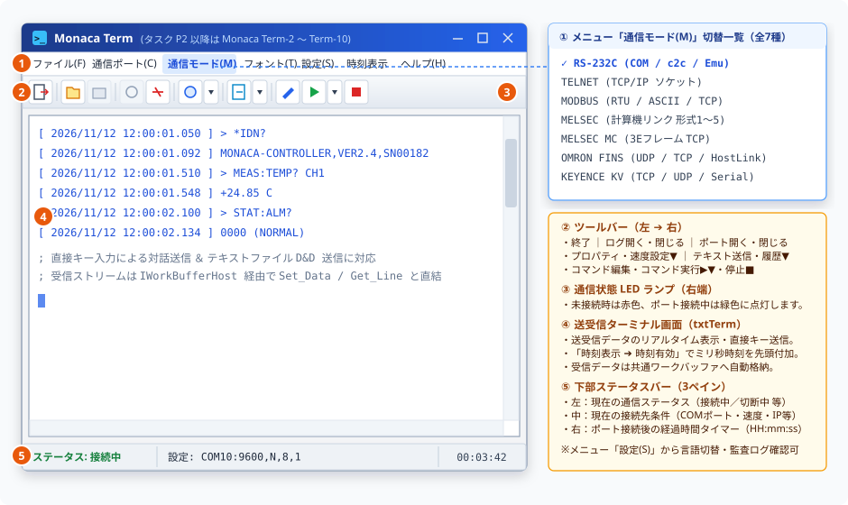

# メイン画面取扱説明書 (User Manual)

👉 [← TermAddIn 製品トップに戻る](../README.md)  
👉 [→ プロパティ設定画面取扱説明書](./プロパティ設定画面取扱説明書.Md) ／ [→ コマンド編集画面取扱説明書](./コマンド編集画面取扱説明書.Md) ／ [→ Excelアドイン取扱説明書](./Excelアドイン取扱説明書.Md)

---

本書は、Term 通信制御・シーケンス実行システムの中心画面として、シリアル（RS-232C / UART）・Telnet・Modbus（RTU / TCP）・三菱電機 MELSEC 計算機リンク（1C〜4C）・MELSEC MC プロトコル・オムロン FINS / Sysmac・キーエンス KV 上位リンクの **全 7 通信モード ** の切り替え、対話送受信、およびリアルタイムログ監視を行う ** 「メイン画面（Monaca Term）」** の総合取扱説明書です。

---

# 目次

- [第 1 章 概要・マルチタスク起動とコマンドラインオプション](#第-1-章-概要マルチタスク起動とコマンドラインオプション)
  - [1.1 本画面の役割と全 7 通信モード](#11-本画面の役割と全-7-通信モード)
  - [1.2 最大 10 タスクの多重起動（`P1`〜`P10`）の仕組み](#12-最大-10-タスクの多重起動p1p10の仕組み)
  - [1.3 コマンドライン起動オプション一覧（`Term.exe`）](#13-コマンドライン起動オプション一覧termexe)
- [第 2 章 メイン画面の全体構成と各部の詳細](#第-2-章-メイン画面の全体構成と各部の詳細)
  - [2.1 画面全体イメージ](#21-画面全体イメージ)
  - [2.2 上部メニューバーの詳細（全 7 分類）](#22-上部メニューバーの詳細全-7-分類)
  - [2.3 アイコンツールバー・LED ランプ・下部ステータスバーの詳細](#23-アイコンツールバーled-ランプ下部ステータスバーの詳細)
- [第 3 章 ターミナル送受信画面とワークバッファ連携](#第-3-章-ターミナル送受信画面とワークバッファ連携)
  - [3.1 対話入力・貼り付け送信・ファイルドラッグ＆ドロップ送信](#31-対話入力貼り付け送信ファイルドラッグドロップ送信)
  - [3.2 マクロ実行エンジン・ワークバッファとの自動連携](#32-マクロ実行エンジンワークバッファとの自動連携)
- [第 4 章 実践チュートリアル（目的別の操作手順）](#第-4-章-実践チュートリアル目的別の操作手順)
  - [4.1 手順 1：仮想 COM（c2c）を使って実機なしで 2 タスク送受信テストをする](#41-手順-1仮想-comc2cを使って実機なしで-2-タスク送受信テストをする)
  - [4.2 手順 2：通信モードを Modbus / MELSEC MC 等へ切り替えて接続準備する](#42-手順-2通信モードを-modbus--melsec-mc-等へ切り替えて接続準備する)
  - [4.3 手順 3：タイムスタンプ付きで通信ログを記録する](#43-手順-3タイムスタンプ付きで通信ログを記録する)
- [第 5 章 設定の自動保存・復元とトラブルシューティング（FAQ）](#第-5-章-設定の自動保存復元とトラブルシューティングfaq)

---

# 第 1 章 概要・マルチタスク起動とコマンドラインオプション

## 1.1 本画面の役割と全 7 通信モード

**メイン画面 ** は、シリアル機器・ネットワーク機器・各種産業用 PLC・組込マイコン基板との通信管理、対話送受信、およびログ監視を一元的に行うターミナル操作画面です。制御手順を Term マクロスクリプト（ **[マクロスクリプト取扱説明書](./マクロスクリプト取扱説明書.Md)** ）として登録しておけば、メイン画面のボタンや Excel シートから自動検査・自動データ収集を実行できます。

* **対応する全 7 通信モード**:
  1. **`RS-232C`** （汎用シリアル / UART 通信）
  2. **`TELNET`** （Telnet / TCP 生ソケット対話通信）
  3. **`MODBUS`** （Modbus RTU / ASCII / TCP 通信）
  4. **`MELSEC`** （三菱電機 MELSEC 計算機リンク 形式 1〜5）
  5. **`MELSEC MC`** （三菱電機 MELSEC MC プロトコル QnA 互換 3E）
  6. **`OMRON FINS / Sysmac`** （オムロン FINS UDP・TCP / シリアル HostLink）
  7. **`KEYENCE KV 上位リンク`** （キーエンス KV Ethernet TCP・UDP / シリアル）

> [!TIP]
> **実機なしで事前テストしたい場合**:
> 公式無償ツール **[c2c](https://github.com/Monaca-App/c2c)** （仮想 COM ケーブル・通信モニター）や **[TermEmulator](https://github.com/Monaca-App/TermEmulator)** （仮想計測器・仮想 PLC シミュレータ）を使うと、手元に実機がなくても PC 1 台だけで全 7 モードの通信テストを行えます。

## 1.2 最大 10 タスクの多重起動（`P1`〜`P10`）の仕組み

複数のシリアル機器や複数台の PLC を同時に制御するため、本画面は **最大 10 インスタンス（タスク 1：`P1` 〜 タスク 10：`P10`）まで同時に起動** できます。

* **自動採番**: タスク番号を省略して `Term.exe` を複数回起動すると、まだ起動していない最小の空き番号（`P1`, `P2`, `P3` ...）が自動的に割り当てられます。
* **タスク番号指定時の前面化保護**: コマンドラインで `/P1` のように特定のタスク番号を指定して起動した場合、または Excel アドインの「ツール起動」から既に起動中のタスク番号を選んだ場合は、二重起動せず既存の該当ウィンドウを最前面へ表示します。
* **タスク別設定の独立管理**: 各タスク（`P1`〜`P10`）の通信ポート、プロトコル設定、ウィンドウ位置・サイズは、`Setting.xml` 内でタスクごとに独立して保存されます。

## 1.3 コマンドライン起動オプション一覧（`Term.exe`）

ショートカットやバッチファイルから起動動作をカスタマイズできます。オプションの先頭記号には **`/`** または **`-`** のどちらも使用可能です。

| オプション | 構文例 | 詳しい機能と利用シーン |
| :--- | :--- | :--- |
| **起動タスク番号指定** | `/P1` 〜 `/P10` `/P=1` 〜 `/P=10` | 起動するタスク番号（`1`〜`10`）を明示指定します。既にその番号が起動中の場合は既存ウィンドウを前面化して終了します。 |
| **設定・位置の初期化** | `/INIT` | 保存されているウィンドウ座標や環境設定を初期状態へリセットして起動します（サブモニター変更で画面外に消えたときの復旧に便利です）。 |
| **最小化 / 最大化起動** | `/WINDOWMINI` / `/WINDOWMAX` | メイン画面を最小化状態、または最大化状態で起動します。 |
| **D&D 送信の無効化** | `/DROPDISABLE` | ターミナル画面へのファイルドラッグ＆ドロップ送信機能を無効化します（誤操作によるファイル送信を防ぎたい現場運用向け）。 |
| **SPI モード** | `/SPI` | 受信データに含まれる `0x00`（NUL）および `0xFF` を自動的に除外（フィルタリング）して表示します。 |
| **改行コード自動変換** | `/CRLF` | ターミナルからの送信入力時、改行コード（CR）を自動的に CR+LF（`\r\n`）へ変換して送信します。 |
| **ファイル送信遅延設定** | `/WAIT=0.05` | フロー制御のない低速マイコン基板等へ向けて、テキストファイル送信時のチャンク間ウェイト時間（秒単位・小数指定可）を設定します。 |
| **単一アクセスモード** | `/SINGLE` | ラベル解決およびパラメータワークアクセスモードを無効化します。 |
| **マクロファイル指定** | `seq.csv` `"seq1.csv+seq2.csv"` | 起動時に自動的に読み込むマクロスクリプト（CSV）を指定します。`+` で連結すると複数の CSV をまとめて読み込めます。 |

---

# 第 2 章 メイン画面の全体構成と各部の詳細

## 2.1 画面全体イメージ

メイン画面は、上から **① 上部メニューバー ** 、 **② アイコンツールバー ** 、 **③ 通信状態 LED ランプ ** 、 **④ ターミナル送受信画面 ** 、 **⑤ 下部ステータスバー（3 ペイン）** の 5 要素で構成されています。

---

## 2.2 上部メニューバーの詳細（全 7 分類）

### 1. `ファイル(F)` メニュー
| メニュー項目 | 詳しい機能と操作手順 |
| :--- | :--- |
| **`ログファイルを開く(O)`** | 保存先ファイルを指定して、ターミナル上に送受信されるデータのリアルタイム記録を開始します。 |
| **`ログファイルを閉じる(C)`** | 記録中の通信ログファイルを安全に閉じて内容を確定します。 |
| **`テキストファイルの送信(T)`** | 外部テキストファイルを選択し、その内容を通信ポートへ順次送信します（送信履歴はツールバーの `▼` に最大 10 件自動保存されます）。 |
| **`終了(X)`** | 開いている通信回線とログファイルを安全に閉じ、ウィンドウ位置等を保存してメイン画面を終了します。 |

### 2. `通信ポート(C)` メニュー
| メニュー項目 | 詳しい機能と操作手順 |
| :--- | :--- |
| **`ポートを開く(O)`** | 現在選択中の通信モード（全 7 モード対応）のプロパティ設定に基づき、通信回線を直接オープンします。接続成功すると右端の LED ランプが **緑色** に点灯し、下部ステータスバーに接続先情報と接続経過時間が表示されます。 ※マクロスクリプト内の `Com_Open`・`Telnet_Open`・`Modbus_Open`・`Mc_Open`・`Fins_Open`・`Kv_Open` 等からの接続も可能です。 |
| **`ポートを閉じる(C)`** | オープン中の通信回線（全 7 モード対応）を切断して解放します。LED ランプが **赤色** に戻ります。 |
| **`プロパティ(P)`** | マクロスクリプト（コマンド集）の登録と、現在選択中の通信モードに対応する通信パラメータを設定する ** 「プロパティ設定画面」** （[詳細](./プロパティ設定画面取扱説明書.Md)）を開きます。 |

### 3. `通信モード(M)` メニュー
| メニュー項目 | 詳しい機能と操作手順 |
| :--- | :--- |
| **`RS-232C`** / **`TELNET`** / **`MODBUS`** / **`MELSEC`** / **`MELSEC MC`** / **`OMRON FINS / Sysmac (O)`** / **`KEYENCE KV 上位リンク (K)`** | このタスクで使用する通信モードを切り替えます。ここで選択したモードに応じて、プロパティ設定画面に表示される専用タブが自動的に切り替わります。 ※対応するエクステンションライセンス（例: `TermAddIn_Modbus.License` 等）が有効なモードを選択できます。 ※回線オープン中（緑 LED 点灯中）は誤切替防止のインタロックにより通信モードを変更できません。変更する場合は先にポートを閉じてください。 |

### 4. `フォント(T)` メニュー
| メニュー項目 | 詳しい機能と操作手順 |
| :--- | :--- |
| **`フォント`** | ターミナル送受信画面（図中 ④）の表示フォント種類・スタイル・サイズ・文字色を変更します。変更内容は `Setting.xml` へ自動保存されます。 |

### 5. `設定(S)` メニュー
| メニュー項目 | 詳しい機能と操作手順 |
| :--- | :--- |
| **`設定(S)...`** | 環境設定ダイアログを開きます。設定ファイルの保存先確認および **UI 表示言語（`自動` / `日本語` / `英語`）のリアルタイム即時切替** を行えます。 |
| **`設定エラー履歴(H)...`** | 「ログ 設定」ダイアログを開き、ログ保存先フォルダ・ファイル名（既定 `info.log`）および出力ログレベル（`Test` ＜ `Debug` ＜ `Warning` ＜ `Error` ＜ **`Save`** ＜ `Info` ＜ `Critical` ＜ `None` の全 8 段階）を確認・設定できます。 |

### 6. `時刻表示` メニュー
| メニュー項目 | 詳しい機能と操作手順 |
| :--- | :--- |
| **`時刻有効`** / **`時刻無効`** | 受信データやログの各行先頭にミリ秒精度の時刻（例: `23:55:00.000 `）を自動付与するかどうかを切り替えます。マクロスクリプト内の [`Time_Stamp`](./Core/Work/Time_Stamp.Md) コマンドからも動的に ON / OFF できます。 |

### 7. `ヘルプ(H)` メニュー
| メニュー項目 | 詳しい機能と操作手順 |
| :--- | :--- |
| **`操作説明書(M)...`** | 同梱の HTML 版取扱説明書を既定の Web ブラウザで開きます。 |
| **`バージョン情報(A)...`** | バージョン番号・著作権情報・ライセンス認証状態・動作環境を確認できます。 |

---

## 2.3 アイコンツールバー・LED ランプ・下部ステータスバーの詳細

| 画面要素（図番） | 状態変化・操作条件 | 詳しい機能と使い方 |
| :--- | :--- | :--- |
| **プログラム終了** （②） | 常時クリック可能 | 回線・ログを安全に閉じてメイン画面を終了します。 |
| **ログを開く / 閉じる** （②） | 記録状態に応じ切替 | 通信ログファイルの記録開始・終了をワンクリックで行います。 |
| **ポートを開く / 閉じる** （②） | 全 7 モード接続切替 | 現在選択中の通信モードのプロパティ設定で、通信回線の直接オープン／クローズを行います。 |
| **プロパティ（`▼` 付き） ** （②） | ドロップダウン併用 | アイコンをクリックすると「プロパティ設定画面」が開きます。右横の **`▼`** をクリックすると、よく使うシリアル条件（`9600,N,8,1` / `115200,N,8,1` 等）へワンクリックでクイック切替できます。 |
| **テキストファイル送信（`▼` 付き）** （②） | 履歴最大 10 件 | 外部テキストファイルを送信します。`▼` から過去 10 件の送信履歴を選んで再送信できます。 |
| **コマンドパラメータ設定 ** （②） | 編集画面の表示切替 | **「コマンド編集画面（Termコマンドパラメータ編集）」** （[詳細](./コマンド編集画面取扱説明書.Md)）を開閉します。 |
| **コマンドリスト実行（`▶` / `▼`）** （②） | ドロップダウン実行 | 選択中のコマンドを単発実行します。`▼` を開くと登録済みコマンドの一覧から選んで即座にテスト実行できます。 |
| **コマンド停止（`■`）** （②） | 実行中に有効 | 実行中のマクロシーケンスやプロンプト待機（`Com_WaitPrompt` 等）を緊急強制中断します。 |
| **通信状態 LED ランプ** （③・右端） | **赤色** ＝ 未接続 **緑色** ＝ 接続中 | 現在選択中の通信モードの接続状態を表示します。 **ランプ自体をクリックしても回線の開閉をトグル切替** できます。 |
| **下部ステータスバー ** （⑤・3 ペイン） | 常時リアルタイム更新 | 左から順に、① **ステータス・エラー通知 ** 、② ** 現在の接続条件 ** （例: `設定: COM10:9600,N,8,1`）、③ ** 接続経過時間** （`hh:mm:ss`）を表示します。 |

---

# 第 3 章 ターミナル送受信画面とワークバッファ連携

## 3.1 対話入力・貼り付け送信・ファイルドラッグ＆ドロップ送信

画面中央の広いテキスト領域（図中 ④）は、送受信データをリアルタイム表示するターミナル画面です。

* **キーボード直接入力**: `RS-232C` 接続中（緑 LED 点灯中）にターミナル領域をクリックして文字をタイプすると、入力した文字がリアルタイムにシリアルポートへ送信されます。
* **右クリック貼り付け送信**: クリップボードにコピーしたコマンド文字列を右クリックメニューから貼り付けて送信できます。
* **ドラッグ＆ドロップ送信**: Windows エクスプローラーからテキストファイルをターミナル画面上へドラッグ＆ドロップすると、そのファイル内容をそのまま送信できます（誤送信防止のため無効化したい場合は `/DROPDISABLE` オプションで起動します）。

## 3.2 マクロ実行エンジン・ワークバッファとの自動連携

ターミナルで受信した文字列や通信エラー状態は、内部の **ワークバッファ** を介してマクロ実行エンジンと直結しています。
マクロスクリプト内で [`Set_Data`](./Core/Work/Set_Data.Md)（受信データの取り込み・書式抽出）、[`Get_Line`](./Core/Work/Get_Line.Md)（指定行の抽出）、[`Skip_Data`](./Core/Work/Skip_Data.Md) / [`Skip_Line`](./Core/Work/Skip_Line.Md)（不要ヘッダの読み飛ばし）を組み合わせることで、機器の応答電文から必要な測定値やステータスだけを正確に抜き出し、Excel シートの `Result` セルへ自動出力できます。

---

# 第 4 章 実践チュートリアル（目的別の操作手順）

## 4.1 手順 1：仮想 COM（c2c）を使って実機なしで 2 タスク送受信テストをする

手元にシリアル機器やケーブルがなくても、`c2c` と 2 つの `Term` タスクを使って双方向通信をすぐに体験できます。

1. 公式無償ツール **`c2c.exe`** を起動し、初期タブの **`接続1: COM10 ⇔ COM11`** が **`◐ 待受中`** になっていることを確認します。
2. **`Term.exe /P1`** （タスク 1）と **`Term.exe /P2`** （タスク 2）の 2 つのウィンドウを起動して左右に並べます。
3. タスク 1 で **`[通信ポート(C)] ➔ [プロパティ(P)]`** を開き、「通信ポート」タブの `ポート` で **`COM10`** を選んで **`[OK]`** をクリックします。
4. タスク 2 でも同様に「通信ポート」タブを開き、`ポート` で **`COM11`** を選んで **`[OK]`** をクリックします。
5. タスク 1 とタスク 2 の両方で、ツールバー右端の **赤色 LED ランプ ** （または「ポートを開く」）をクリックして **緑色（接続中）** にします。
6. タスク 1 のターミナル画面内をクリックして **`HELLO`** と入力し **`Enter`** を押すと、右隣のタスク 2 のターミナル画面にリアルタイムで `HELLO` が表示されます。

---

## 4.2 手順 2：通信モードを Modbus / MELSEC MC 等へ切り替えて接続準備する

1. メイン画面の上部メニュー **`[通信モード(M)]`** をクリックし、使用したいプロトコル（例: **`MODBUS`** や **`MELSEC MC`** ）を選択します。
2. **`[通信ポート(C)] ➔ [プロパティ(P)]`** を開くと、選んだプロトコル専用のタブ（例: `Modbus TCP` や `MELSEC MC`）が自動表示されます。
3. 接続先 IP アドレス（ローカルの TermEmulator へつなぐ場合は **`127.0.0.1`** ）とポート番号（Modbus TCP は **`502`** 、MELSEC MC は **`5000`** ）を設定し、 **`[OK]`** をクリックして保存します。
4. ツールバーの **「ポートを開く」** または右端の **赤色 LED ランプ** をクリックして **緑色（接続中）** になることを確認します（ツールバーの **「コマンドパラメータ設定」** から `Modbus_Open` や `Mc_Open` を単発実行して接続することもできます）。

---

## 4.3 手順 3：タイムスタンプ付きで通信ログを記録する

1. 上部メニュー **`[時刻表示] ➔ [時刻有効]`** を選択します。
2. 上部メニュー **`[ファイル(F)] ➔ [ログファイルを開く(O)]`** （またはツールバーのログアイコン）をクリックし、保存先フォルダとファイル名（例: `test_log.txt`）を指定します。
3. 通信テストを実行すると、各行の先頭にミリ秒単位の時刻が付与された状態で画面表示とファイル記録が同時に行われます。
4. テスト完了後、 **`[ファイル(F)] ➔ [ログファイルを閉じる(C)]`** をクリックしてファイルを安全に確定します。

---

# 第 5 章 設定の自動保存・復元とトラブルシューティング（FAQ）

### 自動保存される情報と監査ログ
* **自動保存先 **: ウィンドウ位置・サイズ・DPI、ターミナルフォント、選択中の通信モードおよび全プロトコル設定、UI 表示言語は **`%USERPROFILE%\Desktop\Monaca\Setting.xml`** （タスクごとに `Table="Monaca Term"` / `Monaca Term-2`〜`Monaca Term-10`）へ自動保存されます。
* **監査ログ **: 設定を変更・保存した際は、既定 **`%USERPROFILE%\Desktop\Monaca\info.log`** へ `- SAVE     -` 区分で変更前後の履歴が自動記録されます。

### よくある質問（FAQ）

#### Q1. `MODBUS` や `MELSEC MC` を選んで「ポートを開く」（または LED ランプ）を押したのに、緑 LED が点灯しません。
* 選択中の通信モードに対応するプロパティ設定（接続先 IP アドレス・ポート番号・COM ポート等）と相手機器（または `TermEmulator`）の待受状態、および対応するエクステンションライセンスが有効か確認してください。ツールバーの「ポートを開く」および LED ランプ押下は全 7 通信モードに対応しており、接続先へ正常に接続できた時点で **緑色** に点灯します。なお、`MODBUS` モードではプロパティ画面で最後に選択・保存したタブ（`Modbus TCP` または `Modbus RTU`）の伝送方式で接続を試行します。

#### Q2. `[通信モード(M)]` メニューに、使いたい PLC プロトコルが表示されない（または選べない）のはなぜですか？
* 対応するエクステンションライセンス（例: `TermAddIn_MelcoMC.License`、`TermAddIn_Omron.License` 等）が `%USERPROFILE%\Desktop\Monaca\` 等の探索フォルダに配置されているか確認してください。

#### Q3. ウィンドウが画面外に行ってしまった、または設定を初期状態に戻したい場合は？
* コマンドプロンプト等から **`Term.exe /INIT`** で起動すると座標・環境設定が初期化されます。全タスクの設定を完全にリセットしたい場合は、アプリと Excel を終了したうえで `%USERPROFILE%\Desktop\Monaca\Setting.xml` を退避（または削除）して再起動してください。

#### Q4. 複数の機器を同時にテストしたいのですが、どうすればよいですか？
* `Term.exe /P1`、`Term.exe /P2` のように別タスク番号で最大 10 個まで同時に起動できます。Excel アドインから呼び出す場合も、`P1:コマンド名` と `P2:コマンド名` を同一シート上に混在させて並列制御できます。
