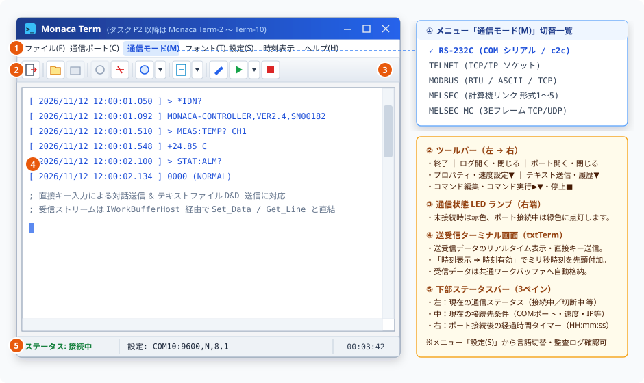

# メイン画面取扱説明書 (User Manual)

本ドキュメントは、Term 通信制御・シーケンス実行システムの中心画面として、シリアル（RS-232C / UART）・Telnet・Modbus・MELSEC 計算機リンク・MELSEC MCプロトコル 機器との直接通信、モード切替、およびリアルタイム送受信ログ監視を行う **「メイン画面」** の取扱説明書です。

---

# 目次

- [📖 1. 概要](#-1-概要)
  - [1.1 マルチインスタンス動作とタスク管理](#11-マルチインスタンス動作とタスク管理)
  - [1.2 コマンドライン起動オプション (Term.exe)](#12-コマンドライン起動オプション-termexe)
- [🛠️ 2. メニューとツールバーの説明 (機能別の分類)](#️-2-メニューとツールバーの説明-機能別の分類)
- [🖥️ 3. ターミナル送受信画面とワークバッファ連携](#️-3-ターミナル送受信画面とワークバッファ連携)
- [💾 4. 設定の自動保存・復元機能](#-4-設定の自動保存復元機能)

---

## 📖 1. 概要
メイン画面（`TermMainForm` / `frmTerm`）は、産業機器・ネットワーク機器・PLC・組込基板との通信管理、対話送受信、およびログ監視を一元的に行うターミナル操作画面です。  
制御対象の機器に対する通信手順や自動検査ロジックは Term マクロスクリプト（ **[マクロスクリプト取扱説明書](./マクロスクリプト取扱説明書.Md)** ）として定義・登録することで、ワンクリックまたは Excel シート連携で自動実行できます。

主な役割は以下の通りです：
*   **マルチプロトコル通信モード切替**: シリアル通信（Term / UART）、TCP/IP ソケット（Telnet）、産業用 Modbus、および三菱電機 MELSEC（計算機リンク / MCプロトコル）をメニューからシームレスに切り替え
*   **リアルタイム監視・対話送受信**: 送受信テキストやバイナリフレーム、通信ログをミリ秒タイムスタンプ付きでリアルタイムにモニタリングし、単発コマンドやテキストファイルを直接送信
*   **統合ランチャー**: コマンド引数を編集する「コマンド編集画面」や、ポート条件・コマンド集を設定する「プロパティ設定画面」へのアクセスハブ

### 1.1 マルチインスタンス動作とタスク管理
*   **最大 10 インスタンスの多重起動をサポート**:
    *   本システムは、最大 10 個（タスク 1 〜 タスク 10）までの同時起動（マルチインスタンス）を許可しています。
    *   起動タスク番号を明示しない場合、現在稼働していない空き番号（1〜10）が自動的に採番されます。
*   **タスク番号指定時の重複起動防止・前面化**:
    *   起動オプションで特定のタスク番号（`P1`〜`P10` または `P=1`〜`P=10`）が指定された場合、その番号がすでに起動中であれば多重起動を行わず、既存の対象ウィンドウを最前面にアクティブ化（最小化時は復元）して安全に終了します。

> [!TIP]
> **公式無償ツール `c2c` とマルチインスタンスを併用した実機なし折り返しテスト**  
> ドライバ不要の仮想ヌルモデム＆通信モニターツール **[c2c](https://github.com/Monaca-App/c2c)** を起動して仮想ポートペア（例: `COM10` ⇔ `COM11`）を公開し、タスク `P1` を `COM10`、別タスク `P2` を `COM11` に接続することで、実機やシリアルクロスケーブルを一切使わずに 1 台の PC 上で双方向通信シーケンスの折り返し検証と HEX / ASCII 電文監視を行えます。

### 1.2 コマンドライン起動オプション (Term.exe)
`Term.exe` はコマンドプロンプトやショートカット、スクリプトから各種起動オプションを指定して実行できます。引数プレフィックスには `/` または `-` を使用可能です。

| オプション | 構文例 | 説明 |
| :--- | :--- | :--- |
| **起動番号指定** | `/P1` 〜 `/P10` `/P=1` 〜 `/P=10` | 起動タスク番号（1〜10）を指定して起動します。指定されたタスク番号がすでに起動中の場合、重複起動せず既存ウィンドウを最前面化して終了します。 |
| **設定初期化** | `/INIT` | ウィンドウ座標や環境設定を初期化（デフォルト状態）して起動します。 |
| **最小化起動** | `/WINDOWMINI` | ウィンドウを最小化状態で起動します。 |
| **最大化起動** | `/WINDOWMAX` | ウィンドウを画面最大化状態で起動します。 |
| **D&D無効化** | `/DROPDISABLE` | ターミナル画面へのファイルドラッグ＆ドロップ機能を無効化します。 |
| **SPIモード** | `/SPI` | SPI 通信モードを有効化し、受信データ中の `0x00` および `0xFF` を自動除外（フィルタリング）します。 |
| **改行自動変換** | `/CRLF` | 送信入力時の改行コード（CR）を自動的に CR+LF へ変換します。 |
| **送信遅延設定** | `/WAIT=0.05` | フロー制御のないターゲット向けに送信文字間のインターバル（秒単位、小数を指定可能）を設定します。 |
| **単一アクセス** | `/SINGLE` | パラメータワークアクセスモードを無効化します。 |
| **マクロファイル指定** | `seq.csv` または `"seq1.csv+seq2.csv"` | 起動時に読み込むマクロコマンド定義ファイル（CSV）を指定します。`+` 記号で複数ファイルを連結指定可能です。 |

> [!NOTE]
> ※ 旧バージョンに存在した `SqnIF`（プロセス間通信オプション）はアーキテクチャ刷新に伴い廃止・削除されました。現在は共通基盤 DLL により直接高速連携が行われます。

---

## 🛠️ 2. メニューとツールバーの説明 (機能別の分類)
画面上部のメニューバー（`TermMainMenuHost`）、およびクイックアクセス用のツールバーボタンについて、機能分類ごとにまとめて説明します。メニューとツールバーで重複している機能は、それぞれの実行方法を併記しています。

*   **① 上部メニューバー（全 7 項目）**: 左から **`[ファイル(F)]`** 、 **`[通信ポート(C)]`** 、 **`[通信モード(M)]`** （`RS-232C` / `TELNET` / `MODBUS` / `MELSEC` / `MELSEC MC`）、 **`[フォント(T)]`** 、 **`[設定(S)]`** 、 **`[時刻表示]`** 、 **`[ヘルプ(H)]`** が並びます。
*   **② アイコンツールバー**: 終了、ログ開閉、ポート開閉、プロパティ・通信速度クイック切替（`▼`）、テキスト送信・送信履歴（`▼`）、コマンドパラメータ設定（エディタ起動）、コマンド実行（`▶` / `▼`）、およびコマンド停止（`■`）へワンクリックでアクセスできます。
*   **③ 通信状態 LED ランプ（右端）**: 未接続時は赤色ランプ、通信ポートオープン（接続中）時は緑色ランプが点灯します。
*   **④ 送受信ターミナル画面（`txtTerm`）**: 送受信データのリアルタイムスクロール表示、直接キー入力送信、およびテキストファイルのドラッグ＆ドロップ送信に対応します。
*   **⑤ 下部ステータスバー（3 ペイン）**: 左から「通信ステータス」「現在の接続先・通信条件（例: `設定: COM10:9600,N,8,1`）」「接続経過時間（`HH:mm:ss`）」を表示します。

### 📁 ファイル関連の機能
*   **ログ開始 / ログファイルを開く**
    *   **実行方法**: メニューの [ファイル(F)] ➔ [ログファイルを開く(O)]、またはツールバーの [ログファイルを開く] アイコン
    *   **機能**: 送受信データをファイルに保存するための、通信ログ記録を開始します。
*   **ログ終了 / ログファイルを閉じる**
    *   **実行方法**: メニューの [ファイル(F)] ➔ [ログファイルを閉じる(C)]、またはツールバーの [ログファイルを閉じる] アイコン
    *   **機能**: 現在実行中の通信ログ記録を終了し、ログファイルを安全にフラッシュ・保存して閉じます。
*   **テキストファイルの送信**
    *   **実行方法**: メニューの [ファイル(F)] ➔ [テキストファイルの送信(T)]、またはツールバーの [テキストファイルの送信] アイコン（右横の `▼` から送信履歴も選択可能）
    *   **機能**: 外部テキストファイルを選択し、ファイル内の文字列データを通信ポートへ一括または行単位で送信します。
*   **終了**
    *   **実行方法**: メニューの [ファイル(F)] ➔ [終了(X)]、またはツールバー左端の [プログラム終了] アイコン
    *   **機能**: 通信回線およびログストリームを安全に解放し、メイン画面を終了（Excel アドイン連携時は非表示化）します。

### 🔌 ポート・通信モード関連の機能
*   **ポートを開く（接続開始）**
    *   **実行方法**: メニューの [通信ポート(C)] ➔ [ポートを開く(O)]、またはツールバーの [ポートを開く] アイコン
    *   **機能**: 現在選択されている通信モード（`RS-232C` / `TELNET` / `MODBUS` / `MELSEC` / `MELSEC MC`）に基づき、対象機器との通信回線をオープンして接続を確立します（右端の LED ランプが緑色に点灯します）。
*   **ポートを閉じる（接続終了）**
    *   **実行方法**: メニューの [通信ポート(C)] ➔ [ポートを閉じる(C)]、またはツールバーの [ポートを閉じる] アイコン
    *   **機能**: 現在の通信接続を切断し、ポート状態を「クローズ」にします（右端の LED ランプが赤色に戻ります）。
*   **プロパティ** （[プロパティ設定画面取扱説明書](./プロパティ設定画面取扱説明書.Md)）
    *   **実行方法**: メニューの [通信ポート(C)] ➔ [プロパティ(P)]、またはツールバーの [プロパティ] アイコン（右横の `▼` から `9600,N,8,1` / `115200,N,8,1` のクイック切替も可能）
    *   **機能**: コマンド集（CSV）の登録や、各通信プロトコルのパラメータを管理する「通信ポートのプロパティ（プロパティ設定画面）」を開きます。
*   **通信モード切替（RS-232C / TELNET / MODBUS / MELSEC / MELSEC MC）**
    *   **実行方法**: メニューの [通信モード(M)] ➔ [RS-232C] / [TELNET] / [MODBUS] / [MELSEC] / [MELSEC MC]
    *   **機能**: メイン画面の通信バックエンドを RS-232C シリアル通信（`RS-232C`）、TCP/IP ソケット通信（`TELNET`）、Modbus 通信（`MODBUS`）、MELSEC 計算機リンク通信（`MELSEC`）、または MELSEC MCプロトコル通信（`MELSEC MC`）へ切り替えます。なお、マクロスクリプト実行時は、各ドメインのオープンコマンド（`Com_Open`, `Telnet_Open`, `Modbus_Open`, `Melsec_Open`, `Mc_Open`）によって自動的に排他切り替えが行われます。

### 🎨 表示・フォント設定
*   **フォント**
    *   **実行方法**: メニューの [フォント(T)]
    *   **機能**: 画面の送受信ターミナル表示領域で使用されるフォントの種類、スタイル、サイズ、および文字色をカスタマイズします。

### ⚙️ 設定・監査ログ関連の機能 (設定)
メニューの [設定(S)]（英語環境: [Settings...]）配下から、システム全体の言語設定やエラー・監査ログ設定を管理できます。

*   **設定（環境設定）**
    *   **実行方法**: メニューの [設定(S)] ➔ [設定(S)...]
    *   **機能**: アプリケーション全体の環境設定ダイアログを開きます。設定ファイルの保存先確認や、 **UI表示言語（日本語 / 英語 / 自動判別）の切り替え** が可能です。
    *   **言語切り替えの手順**:
        1. メニューの [設定(S)] ➔ [設定(S)...] をクリックして設定画面を開きます。
        2. 「言語」ドロップダウンから「日本語」「英語」「自動判別（OS設定準拠）」のいずれかを選択します。
        3. 選択すると即座に画面全体のラベルが選んだ言語に切り替わります。
        4. [確定] を押して保存すると、次回起動時もその言語設定が維持されます。
*   **設定エラー履歴**
    *   **実行方法**: メニューの [設定(S)] ➔ [設定エラー履歴(H)...]
    *   **機能**: システムログ保存先フォルダやファイル名、ログ出力レベル種別の設定・変更、および過去のエラー履歴の確認を行えます。設定変更履歴ログ（`info.log`）の保存先やファイル名も、この画面から自由に変更・確認できます。
    *   **ログ種別（レベル）の `Save` モード**:
        出力レベルの選択肢にある **`Save`** 種別を選択すると、通常ログでファイルを肥大化させず、設定変更履歴（`[SAVE]`）とエラーのみをピンポイントで記録できます。

### ⏱️ 接続時刻表示（タイムスタンプ付加）
*   **時刻有効 / 時刻無効**
    *   **実行方法**: メニューの [時刻表示] ➔ [時刻有効] または [時刻無効]
    *   **機能**: 送受信データや通信ログの各行の先頭に、ミリ秒精度のタイムスタンプ（例: `[ 2026/09/30 23:55:00.000 ]`）を付加して表示・記録するかどうかを切り替えます。マクロスクリプト内の [`Time_Stamp`](./Core/Work/Time_Stamp.Md) コマンドからも動的に ON / OFF を切り替え可能です。

### ℹ️ ヘルプ・バージョン確認関連の機能
*   **バージョン情報**
    *   **実行方法**: メニューの [ヘルプ] ➔ [バージョン情報...]
    *   **機能**: アプリケーションの現在インストールされている完全なバージョン番号、著作権情報、および動作環境（.NET Framework、OS 等）を表示するバージョン情報ダイアログ（`CommonAboutForm`）を開きます。

### 🚨 制御・編集関連の機能 (ツールバー専用)
*   **コマンド実行 (Go)**
    *   **機能**: 現在登録されているマクロスクリプトで利用可能なコマンドの一覧をドロップダウン形式で表示し、選択したコマンドを即座に非同期実行します。
    *   **用途**: 登録されているコマンドを一覧から選択し、単発で実行テストを行いたい場合に使用します。
*   **エディタ起動** （[コマンド編集画面取扱説明書](./コマンド編集画面取扱説明書.Md)）
    *   **機能**: コマンドパラメータを動的に編集するための「コマンド編集画面」を開きます。
    *   **用途**: コマンドごとの詳細な引数設定値を変更・確認しながら単発テストを行いたい場合に使用します。
*   **強制停止**
    *   **機能**: 実行中のマクロシーケンスや、連続通信・プロンプト待機処理を強制的に停止（`IsStopRequested = true`）します。
    *   **用途**: 通信相手機器が応答しなくなった場合や、途中でテストシーケンスを緊急停止したい場合にクリックします。

---

## 🖥️ 3. ターミナル送受信画面とワークバッファ連携
メイン画面の中央には、通信回線上の送受信ストリームをリアルタイム表示するターミナルテキスト領域が配置されています。

### ① リアルタイム送受信モニタリングと対話入力
*   通信ポートから受信した文字列および送信電文は、ターミナル画面上に順次スクロール表示されます。
*   画面上から直接テキストを入力して送信したり、メニューの「テキスト送信」から設定スクリプトを一括送出したりすることができます。

### ② 共通ワークバッファ（`IWorkBufferHost`）との自動連携
*   メイン画面の受信データバッファ（`ReciveData` / `ReciveLine`）および通信エラーフラグ（`CommunicationErrorFlag`）は、共通ワークバッファインターフェース（`IWorkBufferHost`）を介して解析エンジン（`TermAnalysis`）と直結しています。
*   これにより、マクロスクリプト内の [`Set_Data`](./Core/Work/Set_Data.Md)、[`Get_Line`](./Core/Work/Get_Line.Md)、[`Skip_Line`](./Core/Work/Skip_Line.Md)、[`Skip_Data`](./Core/Work/Skip_Data.Md) コマンドを用いて、画面に受信された応答電文から必要な測定値やステータス文字列だけを正確にパースし、Excel シートの結果セル（Result）へ自動展開できます。

---

## 💾 4. 設定の自動保存・復元機能
本システムでは、ユーザーがカスタマイズした動作環境や画面構成を次回起動時にもそのまま維持するため、設定の保存と読み込みをバックグラウンドで自動的に行っています。

### ① 自動的に保存・復元される情報
*   **画面の表示位置とウィンドウサイズ**: メイン画面や各ダイアログを閉じる際、その時の表示座標とウィンドウ寸法を `Setting.xml` に自動保存し、次回起動時に復元します（画面外座標の場合は自動的に画面中央へ安全配置されます）。
*   **ログ表示エリアのフォント設定**: 変更したターミナル文字のフォント種類、サイズ、太字、文字色を保持し、次回も同じ設定で表示されます。
*   **通信モードと各プロトコル設定**: 選択した通信モード（Term / Telnet / Modbus / Melco / MelcoMC）および各タブの通信パラメータ（COM ポート、ボーレート、IP アドレス、局番等）は自動保存され、次回起動時も引き継がれます。
*   **UI 表示言語設定 (`Language`)**: 選択した言語設定（日本語 / 英語 / 自動判別）は保存され、次回起動時も指定した言語で起動されます。

### ② 設定変更履歴（監査ログ）の自動記録と確認方法
通信設定や環境設定を変更して保存した際、いつ・どの設定が・どのように変更されたかが自動的に監査ログファイル（既定: `%USERPROFILE%\Desktop\Monaca\info.log`）へ `[SAVE]` タグ付きで記録されます。
*   **確認・変更手順**: メイン画面のメニュー **[環境設定...] ➔ [エラー履歴]** を開くことで、ログ保存先フォルダやファイル名、出力ログレベル（`Save`, `Info`, `Error` 等）をいつでも確認・変更できます。

### ③ 設定の初期化やトラブル発生時について
画面の位置がおかしくなった場合や設定を初期状態に戻したい場合は、デスクトップの `Monaca` フォルダ内にある `Setting.xml` を削除（または退避）してシステムを再起動すると、標準の初期設定で安全に再生成されます。

